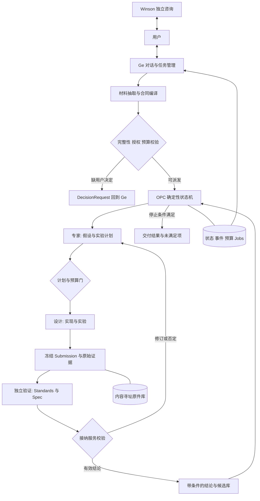

# OPC 框架实现方案：Ge 与可验证的自动研发闭环

版本：v0.2，2026-10-22。输入：[原交接文档](OPC%20自主研发工作流交接.md)与用户需求。性质：可实施设计、接口草案及本地技术验证；不是已部署的自主研发平台。

本次新增：[项目接入与目录规范](OPC%20项目接入与目录规范.md)、[GSD参考后的合同v0.2](contracts/V0.2.md)与[接入验证](docs/integration-validation.md)。OPC引擎独立于目标项目，目标项目保留原结构，`.opc/`只存接入配置与语义材料，候选工作区和实验原件按项目/任务/run/attempt隔离。下文原GEMV结果仍是v0.1演示历史，未被新版服务接管。

## 1. 设计判断

**我们把 OPC 建成“确定性控制内核 + 可替换 agent + 领域实验适配器”。Ge 是唯一运行入口，专家、设计、独立验证构成可迭代任务图。**

用户确认的三部分保留：

| 部分 | 输入与产出 | 权限与边界 |
| --- | --- | --- |
| Winson ↔ 用户 | 拆问题、比较方向、形成 MRD/SPEC 材料 | 独立顾问；不持有派发、预算或接纳权限 |
| 用户 ↔ Ge | 文档/对话 → 任务确认卡、版本化 TaskSpec；查询、暂停、纠偏、交付 | 用户唯一的运行入口；Ge 管理任务与依赖，受预算和合同约束 |
| 专家 → 设计 → 独立验证 → 专家 | 假设与实验计划 → 代码、实验原件 → 双轴审核、条件结论 → 下一轮 | 按需独立调用；状态和权限由程序执行，角色不能自授权限 |

“用户只有一个入口”指操作 OPC 时只找 Ge；不妨碍在框架外与 Winson 讨论。Ge 负责将材料转换成机器合同，用户不承担手写所有 JSON 或逐命令管理的工作。

**减法：**首版不建董事会、产品部、研发部等额外层级，不引入多个 Master，不自动部署自改后的 harness，不先造综合看板。先做单任务、串行实验、一种执行后端、一个领域适配器。保留多模块 DAG 接口，但到确有两个独立模块并行需求时再实现分布式调度。

这里的关键前提是“专家角色能持续给出有用的下一实验”。它尚未被验证；更多 agent 不一定更好。竞争路线是固定搜索策略 + 可靠评价器，尤其适合参数优化。两条路线用同一个协议：先以可重复策略验证控制内核，再用实际专家模型替换，比较单位预算的有效实验率，而不是凭对话流畅度判断。

## 2. 推导链与证据边界

| 类型 | 前提 / 推导 | 结果 |
| --- | --- | --- |
| 用户需求 | 自动多轮、独立审核、可暂停恢复、单一入口 | 需要持久状态与明确控制接口 |
| 源码事实 | Argus 有独立 review call 与 typed action；completion gate 只读取布尔值 | 可复用执行能力；不能直接继承业务接纳语义 |
| 官方事实 | LangGraph 可表达图与恢复；恢复节点会重执行部分代码 | 仍需 job intent、幂等键、对账与接纳服务 |
| 工程推断 | LLM 输出存在错误，工具存在重试，指标存在噪声 | 模型提案必须通过确定性校验；原始证据必须冻结 |
| 待验证假设 | 当前后端能提供独立会话、只读审核和可追踪费用 | 满足后才可宣称真实 agent 闭环；否则仍是离线控制验证 |

资料分别见[运行底座核查](docs/research/runtime-reuse.md)和[优化循环核查](docs/research/optimization-reuse.md)。二者是本轮固定版本源码/官方文档检查，不能继承原交接文档中无法访问的旧测试原件为本轮测试。

敏感点：如果真实任务持续数天、跨机器并依赖远端调度器，轻量 SQLite 主控的运维收益会下降，应评估 Temporal；如果任务没有可靠 evaluator，则先派发“建设参考与评价器”的任务，不能直接跑优化竞赛。

## 3. 复用选择与装配方式

| 项目 / 本轮核查基线 | 复用什么 | 需要自己补什么 | 决定 |
| --- | --- | --- | --- |
| ArgusAgent `fdfeb715…`，MIT | Worker 会话、Engineer↔Reviewer、单独审核重试、已有 UI、部分费用控制 | 通用合同、快照审核绑定、任务总预算、外部 job 对账、严格接纳接口 | 首个真实 backend 集成候选；未安装运行 |
| LangGraph 本机 `1.0.9`，MIT | 显式节点、条件边、可测试图执行 | 业务不变量、job ledger、授权、接纳；不凭 checkpoint 推断外部完成 | 本轮离线原型实际复用；生产可作 OPC 路由层 |
| Pydantic 本机 `2.12.5`，MIT；SQLite | 严格结构校验、生成 schema、事务与唯一约束 | 业务校验、服务鉴权、事件与 outbox | 本轮实际复用；少写基础设施 |
| OpenEvolve `6a18b392…`，Apache-2.0 | parent/inspiration、种群、候选生成、评测反馈与 checkpoint | 把预算、候选快照、审核、失败证据接到 OPC | 可选内循环；参数或程序搜索复杂后再接 |
| ShinkaEvolve `8adc053a…`，Apache-2.0 | 异步搜索、评测调度、数据库 | 硬预算与活作业恢复 | 与 OpenEvolve 二选一，不首轮同时引入 |
| openTPU `506e81b1…` / AAT v2 `4c7d4253…`，Apache-2.0 | 模块合同、候选隔离、功能先于性能、champion、失败留档 | 通用领域接口、独立科研审核、持久控制 | 借用工程流程；不复制其 PPA 数字或整套 EDA 环境 |
| RD-Agent / SoL-Pi | 假设→实验→反馈结构 / worker 工具效率扩展 | 不具备本项目完整接纳协议 | 后续选择性适配 |
| LongHorizon / Temporal | 另一主控路线 / 长作业持久工作流 | 同样需要内容绑定、资源和幂等 | 作为替代方案，触发具体需求后重评 |

本轮不 fork Argus。先定义 `WorkerAdapter`，将一个已冻结 TaskSpec/Plan 转成一次受限任务；Argus 返回的是执行事实与原生 review 结果，OPC 决定是否接纳。这样复用成熟工作流，且不把其内部完成状态混入我们的业务状态。

有两种部署形态，**首版采用 A**：

- **A：OPC 拥有外层任务状态机，Argus 作为执行/审核后端。**禁用或约束 Argus 自行生成下一目标；每次 mission 只处理已分配的 attempt。Ge 是 OPC 的对话界面，可复用 Argus UI 组件。接纳后由 OPC 决定下一任务。
- **B：保留 Argus 主控，在 mission 结算前增加失败关闭的 OPC 接纳调用。**改造更深入，须验证所有完成路径。现有 notification hook 失败只记 warning，不能承担此门禁。

若 A 不能可靠限制后端自行派发，则停止集成，选择 B 或单纯 coding worker；不能让两个调度器同时拥有“下一轮”的权力。全局有且只有一个 accepted 写入端。

## 4. 系统结构



建议目录职责：

以下是**框架自身源码目录**，不要求复制到每个目标项目。目标项目使用`.opc/`、artifact_root和项目外workspace_root三层布局，具体文件与生命周期以[接入规范](OPC%20项目接入与目录规范.md)为准。

```text
contracts/        TaskSpec/Plan/Submission/Review 等模式与模板（本轮已有）
opc/control/      状态转换、预算、权限、接纳（生产待实现）
opc/adapters/     Argus / coding worker / job scheduler（待实现）
opc/domains/      compiler、simulator、RTL 的领域插件（待实现）
opc/api/          Ge 使用的控制接口及状态投影（待实现）
artifacts/        原件、快照、日志、环境指纹（生产待实现）
examples/gemv_loop/  本轮可运行的离线技术验证
docs/research/    本轮开源复用依据
```

Skills 可以存放领域知识、写作方式、工具用法；不负责持久状态、身份、额度、完成判定。状态转换条件必须是可执行代码与版本化合同，不藏在提示词里。

## 5. 状态机与循环

模型决定“提出什么实验”，状态机决定“现在允许哪种动作”。不要把所有可能科研步骤写死进一张巨大状态表。

### 5.1 任务层

`DRAFT → VALIDATING → READY → ACTIVE → CLOSED`。

- 校验缺方向/权限/预算：`NEEDS_DECISION`；研究未知不等同方向缺口。
- ACTIVE 可进入 `PAUSE_REQUESTED → PAUSED`、`BLOCKED`、`CANCEL_REQUESTED → CANCELLED`。
- CLOSED 的业务结果单列：`target_met / best_within_budget / no_valid_candidate / inconclusive`。预算耗尽是停止原因，不能自动变成目标完成。
- resume 先做作业、证据、预算对账，再回到可继续的节点。cancelled 不隐式恢复；若要重新开展，创建新任务或明确版本。

### 5.2 一轮实验层

| 当前节点 | 允许输出与确定性门 | 下一步 |
| --- | --- | --- |
| EXPERT | ExperimentPlan：绑定合同、parent、假设、竞争解释、可证伪条件、成本上界 | PLAN_CHECK |
| PLAN_CHECK | 可改范围、冻结 evaluator、依赖、预算与资源预留通过 | DESIGN；否则专家修计划或请求决定 |
| DESIGN | 代码/脚本；工具失败也记录原件；不能改标准 | EXPERIMENT 或 failed_attempt |
| EXPERIMENT | 命令、输入、环境、退出码、日志、指标；job 已对账 | FREEZE |
| FREEZE | 服务重算所有摘要、保存不可变 manifest | REVIEW |
| REVIEW | 独立会话、固定快照、双轴结果、复算与主张范围 | ACCEPTANCE；基础设施失败停在待审 |
| ACCEPTANCE | 身份、版本、manifest、两轴、硬门、覆盖都有效 | accepted / revise / rejected / blocked |
| FEEDBACK | 已接纳结论 + 失败原件 + 剩余额度，检查停滞/目标 | 下一轮 EXPERT 或交付 |

专家可以改变实验方法；改变任务目标、验收标准、预算或冻结 evaluator 则走新的合同版本。设计 agent 可自行修复授权范围内代码错误，但每次实验失败耗用次数和实际资源。审核重试有单独额度，不重新执行已经完成的实验。

三个维度分开存：`run_state`（是否运行）、`acceptance_state`（是否经审核）、`candidate_state`（是否保留为 parent）。一个正确但较慢的候选可以有可信的实验结论，同时不成为 champion。

### 5.3 停止与负面结论

停止条件至少包含：总实验次数、模型费用/token、墙钟、审核次数、停滞次数、目标阈值、用户控制。专家不得自行扩预算。任务以机制辨识为目标时，“在条件 X 下成立，Y 尚不可辨识”可以是正确交付，不强行用一个性能 score 表达全部研究价值。

## 6. 用户与 Ge 的合同

当前模板见[v0.2模板入口](contracts/templates/v0.2/README.md)，新增PROJECT、REQUIREMENTS、CONTEXT、PLAN、SUMMARY、VERIFICATION与HANDOFF，机器模型见[models_v02.py](contracts/models_v02.py)。v0.1的两份模板和[原机器模型](contracts/models.py)保留为兼容材料，不原地修改旧合同与审核。

v0.2以稳定REQ-ID连接需求、计划、预期产物、可观察行为/关键连接与审核证据；增加ProjectConfig/ComponentConfig、固定baseline、locked/delegated/deferred决策分类和逐项coverage。`文件存在`与`行为已验证`分开；遗漏真实调用链检查不能用整体pass遮盖。具体字段、校验范围和迁移规则见[升级说明](contracts/V0.2.md)。

Ge 的转换程序：读取材料 → 保存原文摘要与 locator → 抽取已确定要求 → 列显式假设 → 将方向缺口转成 DecisionRequest → 生成合同 → 结构与语义校验 → 使用已有授权或等待缺失决定 → 派发。**没有来源的假设不能悄悄变成验收标准。**

| 对象 | 最关键的绑定 |
| --- | --- |
| TaskSpec | 目标、原始来源、范围、验收、输入、预算、权限、停止、revision |
| ExperimentPlan | task hash + 父提交 + 假设/反证 + 控制变量 + 执行动作与额度 |
| Attempt / JobRecord | 实际运行 call/session、工作区、job、预留与结算 |
| Submission | task revision/hash + plan/attempt + 全部产物 manifest + 有条件的主张 |
| ReviewDecision | 固定 task/submission/manifest + 服务登记 reviewer 身份 + 两轴报告 |
| DecisionRequest | 需要用户决定什么、选项、影响、阻塞动作与预期版本 |

合同示例默认是非派发模板，使用 `template://` 和待解析授权以避免将占位引用伪装成有效输入。原型自带可实际运行的受限合同；通用接口与原型接口尚未映射。

API 不从正文里搜索“通过”二字。用户自然语言的“暂停”“继续”“预算加到…”转换成类型化命令，服务验证主体、预期 revision 与幂等键。已有授权范围内的每轮实验无需再问用户。

## 7. 独立验证与不可变证据

用户提到的 `implement` 会委托 `code-review`；实际可借用的是后者的 **Standards / Spec 双轴**。本项目没有 Git 基线或 issue tracker，因此本轮借用审查方法，不套用其提交/issue 工具链。

- **Standards 轴：**修改范围、可维护性、类型/测试、证据完整性、实验脚本可复现、冻结文件未改。自动 lint 是证据之一，不等于整轴通过。
- **Spec 轴：**需求覆盖、数值/接口正确性、独立参考、测试覆盖、相同工作负载与计量窗口、指标口径、结论是否越界。
- 二者分别报告；必要时两个 reviewer 调用并行，最后由接纳服务合取。实验评价包括收益、失败解释、竞争解释、可重复性与未知项，不仅代码 review。

reviewer 只读固定 submission，在单独 scratch 复算；不修改原件。作者与 reviewer 可以使用同一种模型，但必须是不同调用，且调用身份由 adapter 的受限通道登记。独立调用降低自评问题，不保证统计独立或模型无共同盲点；关键结论仍需不同参考、holdout、复算和必要的人工决策。

冻结流程：收齐 code/input/config/environment/commands/stdout/stderr/results → 对每个原件计算 hash 与长度 → 服务生成 manifest → 服务分配 submission_id → reviewer 读取 manifest 与原件 → 提交受限回执 → 接纳前再次核对内容。任何 bytes 或 claim 变化产生新 submission，旧审核不继承。

生产隔离建议采用专用服务账号或容器：candidate 不能写 evaluator、合同、预算库或接纳库；reviewer 不能写 candidate 原件；Ge 调用 API，不能直接操作 accepted 数据表。文件 hash 只说明内容相同，不能证明签署主体，也不能替代 OS 权限。

## 8. 状态、预算、外部作业与恢复

### 8.1 最小持久化设计

个人单机首版使用 SQLite WAL、单一写入服务和文件原件库；真正并发/多机再迁移 PostgreSQL。建议表为 `task_versions / attempts / plans / jobs / submissions / reviews / budget_entries / events / outbox`。所有对象引用不可变版本，不覆盖历史记录。

关键唯一约束：`(task_id, revision)`、`(idempotency_key, operation)`、`(submission_id, review_call_id)`；事件使用单调 sequence。状态更新、预算预留、job intent 与 outbox 入队在同一事务。重试不是“再次执行同一段自然语言”，而是识别哪个操作尚无确定结果。

LangGraph 若承担路由，业务状态与 ledger 仍只有一个权威。可以使用数据库 state 驱动图节点，或让 checkpoint 存只读引用；不要让 graph checkpoint 与任务 JSON 各自推进状态。原型采取前一种简化方式，未宣称部署 LangGraph 持久 checkpointer。

### 8.2 预算

`可派发额度 = 总上限 − 已结算消耗 − 在途预留`。

每轮预留专家、设计、实验与审核；全部重试、失败与取消前已发生的耗用计费。预留不足，不启动下一动作。模型未知价格按 block 处理；只有确定没有模型调用的离线演示，模型增量费用才可写 0。托管订阅、研发劳动或宿主资源费用不能由此推为免费。

单次调用限制 token/时间/次数；不能假定估计成本是严格上界。平台无法强制费用上界时，在合同写出最大在途敞口与额度耗尽策略。不得绕过 reviewer 预留来增加最后一次实验。

### 8.3 外部 job 状态

`intent → submitted → running → succeeded/failed`；分叉为 `cancel_requested → cancelled` 或 `unknown`。

1. 调用外部系统前，事务保存输入摘要、幂等键、资源、预算和 intent。
2. backend 支持幂等创建时传同一 key；不支持时先用稳定标签查找，不盲目补提交。
3. 保存真实 job ID、进程出生身份/容器 ID 和回执。PID 单独不足以防复用。
4. 重启先查询后端：完成则收回原件；仍跑则认领观察；状态未知则阻塞；确认未提交才允许重试。
5. 不追求通用 exactly-once；追求已知完成不重跑、未知不盲发、每次消耗可对账。

暂停语义区分 `dispatch_stop`（停止新派发）、`drain`（到安全边界暂停）、`cancel`（实际请求终止）。远端取消未确认时显示 cancel_requested。生产 Windows runner 应使用 Job Object 或等价进程树管理，Linux runner 使用受控容器/进程组；该能力本轮未实现。

## 9. 领域适配器与自动探索例子

统一接口建议：

```python
class DomainAdapter:
    def preflight(self, task_spec): ...       # 资产、工具、参考、资源是否足够
    def validate_plan(self, plan): ...       # 领域合法性与冻结边界
    def execute(self, job_request): ...      # 返回 job handle，不伪装已完成
    def collect(self, job_handle): ...       # 原始日志、产物、环境与计量
    def verify(self, submission): ...        # 独立参考/复算，输出轴内证据
```

这只是接口意图，生产实现应使用类型对象与显式错误。实际 agent adapter 另提供 `start / inspect / cancel / reconcile / collect`，把模型调用、coding worker 和仿真器分开，不要求更换领域时重写主状态机。

### 9.1 首例：GEMV 行分块调度

从空白重新搭 openTPU RTL、EDA 和上板链会混入太多未知。首例缩为一个编译调度问题：`y = W x`，设计组件生成行分块 Python kernel；数值使用有符号整数，不涉及浮点容差和量化争议。专家依据上一轮流量与资源失败探索 tile；独立验证同时检查功能与容量。

模型假设：每个权重读取一次；每组 b 行共享一次输入向量；每行结果写一次；同时需要 b 个累加器。因此：

`T(b; M,K) = M*K + ceil(M/b)*K + M`（单位：元素搬运次数）。

例如 M=8、K=64：b=1 时 1032；b=4 时 648，减少 37.21%；b=8 时 584，但若只有4个累加器则非法。**这些是演示模型的算术推导，不是本轮实跑数字；实际默认配置与结果以原型报告为准。**

这个例子的判别力在于：更低指标的候选也可能必须被拒绝；尾块、非整除形状和负值可暴露漏算；只有正确性与资源门通过才能讨论改善。竞争解释是“流量下降仅因模型奖励输入复用，真实系统瓶颈在权重或带宽”。用真实内存 trace/硬件计数器或校准模拟器才能区分，不能由此宣称真实加速。

### 9.2 本轮验证层次

详见[验证结果](docs/validation.md)。目标是运行可复现的自动控制闭环，而不是展示一段写好的对话。

- 实际复用 LangGraph；规则专家、模板代码生成器与独立验证进程真实运行。
- 实际产生候选文件、数值实验结果、原始输出、hash 和审核记录。
- 验证预算、拒绝、暂停恢复、证据变更与未知作业边界。
- 专家和设计使用离线确定性策略，验证者是独立程序进程；**不等于实际 LLM 专家、设计 agent、验证 agent 全自主科研**。
- 本轮另由不同研究/审查 agent 核查来源和交付文件；这证明本次协作有独立审查，不等于原型已自动派发这些模型 agent。

### 9.3 将来接 openTPU 的第一张真实任务

选择一个现成模块，冻结模块 contract、基线 SHA、golden、fast tests、允许修改路径、工具版本和平台约束。专家只提一个局部假设，设计在隔离工作区修改，独立 reviewer 复跑功能后再看综合/时序；保留失败补丁和报告。初期以正确性 + 同配置综合代理指标为准，需要频率收益时再加入 P&R 重复确认。未持有 EDA/板卡或没有可运行基线时，该任务保持资源阻塞，不伪造 PPA。

## 10. 分阶段实施与退出条件

| 阶段 | 具体交付 | 可验收退出条件 |
| --- | --- | --- |
| P0，本轮 | 架构文档、合同模板/schema、来源核查、离线例子与原件 | 能复跑、能拒绝非法候选、预算/恢复边界有测试；明确未实现部分 |
| P1，真实单任务 | Ge intake + 合同/接纳服务 + 一个真实 agent backend + job ledger | 无逐步人工派发完成至少两轮；独立审核退回→修订→接纳；身份与manifest可追踪 |
| P2，隔离与持久服务 | 容器/账号隔离、后台服务、实际暂停/取消、恢复对账 | 杀主控/断链不重复实验；作者不能写评价器或审核库；不可用reviewer不放行 |
| P3，真实领域 | 一个compiler/simulator/RTL适配器、固定对照与任务链 | 符合该领域证据等级；跨模块依赖版本一致；真实工作负载结果复现 |
| P4，按需扩展 | 一个优化引擎、并行资源、多机或Temporal | 有数据表明比简单策略有效，且预算与失败率可控 |

P1 首要实现顺序：服务端 TaskSpec 校验 → snapshot/manifest → review identity 绑定 → 单任务图 → 工具 job/outbox → 预算预留结算 → Ge 状态投影。不要先扩 agent 数量。

生产失败注入矩阵：

| 注入 | 必须观察到 |
| --- | --- |
| 作者提交审核 / 自报 reviewer 名字 | 403 与审计事件，接纳不变 |
| 审核后修改代码或 claim | 内容不匹配；新 submission 重审 |
| reviewer 不可用 | 待审或 blocked；不重跑已完成实验 |
| 同幂等键不同请求 | 409，不能悄悄替换任务 |
| job 启动后主控崩溃 | 查询/认领或 unknown 阻塞；不默认重发 |
| 并行预留抢最后一份预算 | 至多一个成功预留；不能超卖 |
| 取消远端 job 超时 | 保留 cancel_requested 与资源/费用敞口 |
| evaluator 被候选修改 | 硬失败，原始验收不变 |
| 上游接口 revision 改变 | 下游依赖失效标记，选择性重验 |

以上为生产验收清单；哪些已由本轮原型覆盖、哪些未覆盖，必须看验证报告，不能因清单存在就标完成。

## 11. 开工时仍需落定的决定

本轮文档和离线验证不依赖这些选择，已先完成。进入 P1 时才需要落定：真实后端及可核查的费用限制、运行主机/隔离方式、首个可访问领域仓库、是否保留既有 P2 状态权威。已有授权继续有效；只有超出范围的决定交回用户。

推荐下一步是 **选一个目标项目，按v0.2接入协议盘点baseline、组件与评价器，再用一个最小任务接真实Expert/Designer/Reviewer adapter**。GEMV可作为受限首例，openTPU只替换领域适配器与验收链；先验证实际模型遵守合同和独立审核，再扩大到跨模块工程。
