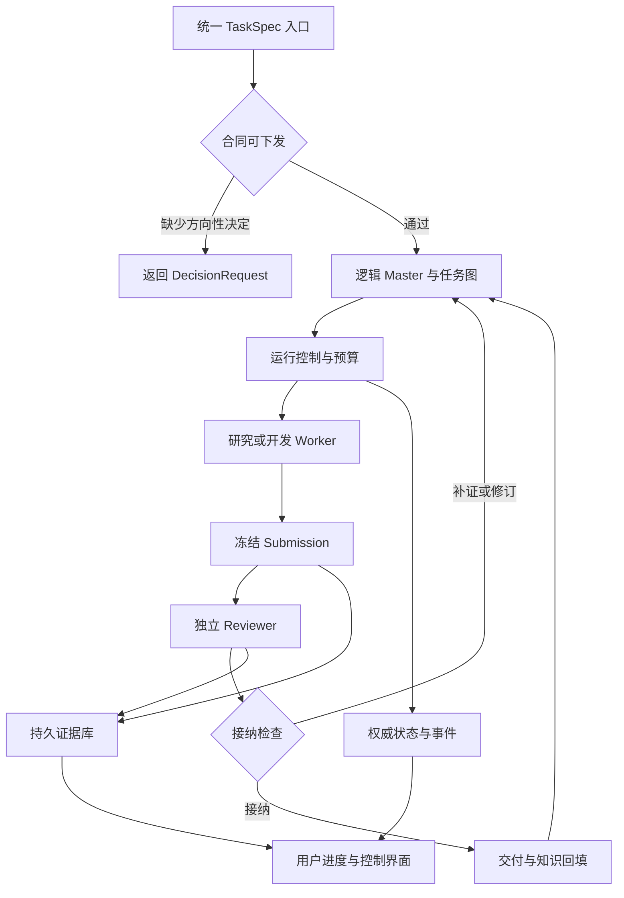

版本：v0.1\
整理日期：2026-10-21\
用途：供新会话、协作 agent 或后续实施者接手本轮讨论。\
状态：需求与架构交接；尚未建设完整 OPC 平台，技术选型仍需集成验证。

# 1 接手者首先应理解的结论

用户要建设一个通用的 OPC（one person company）自主研发工作流：上游确定目标、方向、范围、重要取舍和预算，通过统一接口下发；下游由 Master 协调研究、开发、实验、独立审核、返工和交付。

本轮重点已经从“为 P2 寻找工具”调整为“从 Master 开始，建设通用 agent harness 和自动迭代工作流”。PIM 项目是第一个领域实例，不是平台的范围边界。

已经明确的需求：

1. 用户只面对一个逻辑上的 Master，不直接管理每个 subagent 或每条命令。

2. 顶层目标讨论可以发生在任何地方，与执行框架解耦；最后必须转为统一的任务契约。

3. 关键目标、范围和验收边界没有明确时，不得把含糊意图伪装成已确定的任务下发。

4. 已获授权范围内，agent 自主选择调查方法、必要工具、实验和候选实现，并根据独立评审反馈继续推进。

5. 用户关注关键决策和最终结果，同时保留真实进度、原始证据、预算、暂停与恢复的可见性。

6. reviewer 必须实际承担审核工作，具有可核查的独立调用与权限，审核绑定提交版本。

7. 候选代码、研究方法和 harness 本身的改进要分开管理；不能通过修改验收器或放宽标准冒充进步。

8. 首版优先复用现有项目和组件；界面缺失不是排除优质研究循环的理由。

当前建议，而非用户已批准的最终选型：

- **ArgusAgent**：优先验证的 Master、后台运行和 Engineer↔Reviewer 基底。

- **统一契约与接纳适配层**：补足 TaskSpec、不可变 Submission、审核版本绑定、预算归属、外部作业对账及状态投影。

- **OpenEvolve／ShinkaEvolve**：按任务需要接入的候选优化内循环。

- **SoL-Pi**：可选 Pi worker 效率扩展；其论文另提供 harness 研究组织方法。

- **openTPU／auto-arch-tournament**：自主硬件研发的工程方法与局部循环参考。

- **LongHorizon-Harness**：运行基底备选；**RD-Agent**：研究反馈循环参考。

- 暂不同时引入多个竞争的 Master，也不在首版追求无人审核的 harness 自我部署。

接手者不能把本文件读成“已选定 Argus”“已接好 SoL-Pi”或“已证明系统能完成真实 PIM 研究”。

# 2 背景与讨论方向的变化

## 2 1 起始问题

用户最初要求深度调研 GitHub 上的 autoresearch、autonomous research、self-improving／self-evolving agents、agent harness，以及软硬件研发自主实验循环。

起点是：

- [https://github.com/FeSens/openTPU](https://github.com/FeSens/openTPU)

- [https://github.com/FeSens/auto-arch-tournament](https://github.com/FeSens/auto-arch-tournament)

初始困难不是没有研究文档或状态检查脚本，而是已有资产还没有形成可持续工作的系统：

- 研究执行依赖当前聊天 agent。

- 独立评审主要靠协议约定，缺少创建、派发和调度评审员的服务。

- 需要翻看文档、JSON、日志与聊天才能拼出状态。

- 看不清谁在执行、为什么停住、剩余多少预算、暂停到底影响什么。

- 跨会话状态一致性依赖人工核对。

## 2 2 用户随后明确的方向

用户希望把它做成通用 OPC。上层按照“目标 → 模块拆解 → 任务细化”推进，也可以采用 target → spec → ticket 等表达，但术语尚未定版。

用户愿意仔细讨论模块要解决什么问题、预期产物和重要取舍；具体怎么实现、怎么研究、怎么迭代与优化，应交给自动流程。用户提出“只负责看最终结果”，应理解为无需日常逐命令管理；重大范围、预算或验收变化仍须由用户决策。

最新的范围收敛是：

> 本轮不深入研究用户怎样讨论顶层目标，而是研究统一下发接口之后，Master 到各个 subagent 的 harness、审核与自动迭代机制。

因此，后续应先明确平台接口与运行语义，避免再次回到如何在聊天里收集需求，或重新展开 PIM 硬件架构选型。

## 2 3 openTPU 在用户想法中的作用

用户把 openTPU 视为一种目标体验：给定硬件规格与 PPA 目标后，由自动流程完成模块设计、验证、仿真和迭代优化。

需要保留一个技术限定：规格与目标本身不是充分的运行条件。参考模型、评测工具、工作负载、允许修改的范围、接纳规则和可执行环境也必须建立。它们可以由下层任务逐步建设，但不能假定只输入几项硬件参数就已经具备全部条件。已核查的 openTPU 自主循环依赖这些工程基础。（S01、S02）

# 3 第一个领域实例与已有资产

## 3 1 PIM 评估链

用户拥有厂商提供的 PIM emulator 和配套 ExecuTorch 编译部署工程，能够完成 GEMV 与 LLAMA 的平台部署。用户希望基于现有材料搭建：

**工作负载与硬件配置 → 编译器 → 模拟执行器 ↔ DRAM 仿真器 → 有来源的 PPA 评估。**

其中，DRAM 请求的接受、等待与完成需要影响模拟执行。当前首先理解现有通路与机制，再建设、对齐自己的编译器和 emulator；后续才进行策略或硬件方案比较。

## 3 2 GEMV 的调查覆盖范围

以 GEMV 为贯穿案例，从模型图输入到编译、部署、参数与状态提取，讲清各模块动作与接口：

| 调查维度 | 要回答的问题 | 主要观察与产物 |
| - | - | - |
| GEMV 模型与输入 | 究竟计算什么 | M/K、dtype、量化分组、scale、bias、输入权重、参考输出 |
| 导出 优化与分区 | 原模型怎样变成执行计划 | 优化前后图、融合与分解、常量变化、后端分区、PTE 内容 |
| 加载与运行时分派 | 计划怎样找到实际执行代码 | 加载对象、缓冲、调用顺序、PIM 适用条件、同步与失败传播 |
| 数据格式与空间管理 | 数据怎样被 PIM 消费 | packing、padding、转换、分配大小、基址与生命周期 |
| 切分与地址映射 | 每块算什么、放哪里、谁决定 | M/K tile、循环顺序、元素到块及 channel/bank/row/column 的映射 |
| 指令与请求生成 | tile 怎样展开为动作 | 配置与指令装载、输入复用、权重访问、归约、写回及请求顺序 |
| emulator 控制与计算 | 请求怎样改变状态和计算 | 模式切换、指令解释、RF/MAC、累加精度、清零与跨调用状态 |
| DRAM 服务 | 请求何时接受与完成 | 时序、队列、仲裁、冲突、等待、完成与排空 |
| 输出与评估 | 结果能够支持什么判断 | 数值误差、模拟周期、流量、计量窗口、能量与面积成本来源 |

这些维度不预设九个软件模块或九个 agent，任务可以跨维度。模块边界应按状态所有权、接口与独立验证能力另定。

这些是领域任务，不应写进 OPC 核心的固定状态机。OPC 应能用同一套 TaskSpec、Attempt、Submission 和 ReviewDecision 表达其他软件、编译器或硬件研究任务。

## 3 3 已有材料与访问边界

用户自述已有：

- 部分编译实现、ExecuTorch 与 emulator 集成。

- P2 的部分源码研究结果。

- 仿真与硬件建模调研。

- Markdown、JSON、Python 形式的研究归档。

- 总流程、项目规格与 `pim-experiment-loop/SKILL.md`。

- 可检查范围、依赖、预算、冻结文件、证据引用和审核状态的 P2 Python CLI。

- 可保存成功与失败原件的命令记录器。

本轮没有拿到这些领域资产的完整源码，因此其能力是用户提供的背景，尚未逐项做实现核验。接入前需检查实际 schema、状态文件与命令接口。

## 3 4 领域验收不能丢失的限制

- 当前 P2 以机制辨识、覆盖和证据可信度为进展，不自动改成性能优化竞赛。

- “只在某些条件下成立”“目前不可辨识”“缺少观测”都可以是有价值的研究交付。

- 编译侧固定工作负载与硬件约束，研究计划生成与策略；模拟侧尽量固定同一计划、数据与配置，对齐执行。

- 参考系统不能消费同一计划时，必须说明适配与可比性，不宣称逐层完全对齐。

- 功能、请求与状态、时序、成本分别验证。

- 模拟统计、宿主运行耗时、真实硬件测量分别记录。

- 能量和面积缺少组件、工艺等来源时保持未知，不用性能结果推算成已验证 PPA。

# 4 用户期望与必须成立的运行规则

## 4 1 单一用户接口与职责

| 角色 | 职责 | 不应代行的权限 |
| - | - | - |
| 用户 | 方向、范围、重要取舍、预算，必要时纠偏 | 不承担每次工具运行与内部状态维护 |
| 逻辑 Master | 理解已下发合同，拆解任务与依赖，选择下一步，调度与汇总 | 不自行改写上层验收或伪造 reviewer 决定 |
| 研究或开发 worker | 调查、写探针、实现、执行实验、保存证据、提出结论 | 不给自己的提交签署最终审核通过 |
| 独立 reviewer | 对固定计划、提交与原件复核，可复算、退回补证、限定结论 | 不静默修改研究者提交或用户合同 |
| 运行与状态系统 | 启停、预算、资源、提交冻结、审核权限、恢复与事件 | 不把正常退出直接解释成业务接纳 |

Master 是一个逻辑入口，可以由 Manager、Planner 与确定性服务共同实现；不要求一个模型常驻并记住所有内容。subagent 也不要求每个角色常驻，按任务创建独立调用即可。

## 4 2 可下发门槛

“需求没有讲清楚不得下发”不意味着研究前必须知道全部技术答案。应区分：

- **方向性缺口**：目标、范围、允许的取舍、预算或验收责任不明确。返回具体问题，不开始主体任务。

- **研究性未知**：规则、参数、机制或可观测性未知。这正是合法研究任务的对象。

例如，“调查 K 维切分是否导致输入重载，输出证据、适用条件与未知项”可以下发；“随便把性能弄好，费用不限，标准由 agent 自己定”不满足合同要求。

## 4 3 审核与接纳规则

1. 研究者与 reviewer 使用可核查的独立调用身份；同一模型的不同会话可以采用，但名字不同不构成证据。

2. reviewer 读取固定的合同版本与提交快照，原件只读；需要复算时使用独立 scratch 或隔离运行环境。

3. 决定由 reviewer 的受限接口提交；研究者不能通过改 JSON 身份字符串自审。

4. 审核绑定 `task_spec_revision + submission_id + manifest_hash`。

5. 证据、代码、输入、配置或主张变更，形成新提交；旧审核继续属于旧快照，不能给新快照放行。

6. reviewer 不可用时停在待审或审核阻塞；不能自动视为通过。

7. 限定条件后的结论可以被接纳，但接纳范围必须明确；不能借“有条件通过”绕过原本必需的证据。

这些是平台要求，不能仅通过角色提示词宣称已经满足。

# 5 拟议的通用 OPC 框架

本节为架构建议，尚未作为最终实现规格批准。

## 5 1 主要构成

采用“稳定运行协议 + 可变化的任务图与研究过程”。

- **任务入口**：接收版本化 TaskSpec，验证合同完整性与授权范围。

- **Master 协调层**：维护目标与任务关系，选择最小下一问题，管理依赖和返工。

- **运行控制层**：管理 attempt、worker/reviewer 调用、资源、预算、停止与恢复。

- **Worker adapter**：接入实际 coding agent、CLI 或 SDK，统一事件与产物出口。

- **审核与接纳层**：冻结提交、派发独立审核、记录回执并决定接纳状态。

- **证据与经验层**：保存原件、提交与审核，管理带条件和版本的结论及方法资产。

- **进度界面**：由真实运行记录生成视图，用户通过同一个 Master 交互和控制。

- **可选优化引擎**：在适用任务内部运行候选搜索，不成为第二个顶层调度者。



图中的返回 Master 表示它检查还有哪些任务、依赖和目标未满足；如果全部满足，进入项目交付，不无限生成新任务。

## 5 2 四个需要区分的循环

| 循环 | 决定下一轮的主体 | 输入与输出 | 终止依据 |
| - | - | - | - |
| Master 跨任务循环 | Master 提议，运行规则校验 | 目标、依赖、已接纳结果 → 下一任务或决策请求 | 目标完成、阻塞、预算耗尽、用户停止 |
| 实现与审核返工循环 | reviewer 给意见，Master/worker 制定修订 | 固定计划、提交、审核 → 补证或新提交 | 有效接纳、达到修订上限、无法推进 |
| 候选优化循环 | 优化策略与 evaluator | 候选、测量、反馈 → 保留、淘汰、下一候选 | 评测预算、轮数、时间、声明的停滞条件 |
| Worker 工具循环 | 当前执行 agent | 上下文与观察 → 工具动作、结果、解释 | 本次执行提交、限制触发、取消或错误 |

未来可以增加第五类“harness 改进任务”，但它应作为普通受审核任务运行：提出平台改动、隔离评测、冻结候选、批准发布。首版不让运行中的 Master 直接覆盖自身验收与控制代码。

## 5 3 交付与优化的区别

优化器的 `best_candidate` 只表示它按给定 evaluator 找到的最好候选；OPC 的 `accepted_submission` 表示一个固定提交已经满足合同与独立审核。

达到性能目标不自动意味着证据充分；预算用完也不自动意味着任务失败。系统可能交付“预算内最佳但未满足目标”“已验证的条件结论”或“当前不可辨识”。这些状态要显式表达。

# 6 统一接口与数据结构草案

接口应先于具体模型、框架与 UI 定义。以下是待细化的 v0.1 草案，不是已经实现的 API。

## 6 1 最小对象

| 对象 | 核心字段与作用 |
| - | - |
| TaskSpec | ID、版本、上级目标、任务类型、目标、范围、输入引用、交付物、验收、预算、权限、审核策略、停止条件、未知项 |
| TaskGraph | 任务节点、依赖、接口版本、阻塞原因、变更理由；已完成实验计划保持历史 |
| Attempt | 一次实际执行的 ID、任务版本、worker/session 身份、workspace、预算预留、开始与结束、外部 job |
| Submission | 不可变产物快照、代码与环境、输入配置、原件 manifest、主张、条件、未知项、失败与覆盖 |
| ReviewDecision | reviewer 调用身份、提交与合同 hash、检查记录、结论、理由、补证要求、签署时间 |
| ArtifactRef | 可访问 URI、hash、类型、大小、来源、完整性状态、生产 attempt/job |
| JobRecord | 外部作业 ID、提交意图、幂等键、进程或调度器身份、状态、完成回执、取消结果 |
| BudgetLedger | 预留、实际结算、未定价、在途估计、各模型与资源归属、剩余额度 |
| DecisionRequest | 需要上游决定的问题、具体选项、影响、推荐、阻塞的任务 |
| Event | 带时间、序号和主体的事实记录，供状态投影与恢复使用 |

`task_kind` 可先支持 `research`、`implement`、`optimize`；后续再加入 `harness_improvement`。业务字段可通过领域扩展提供，核心不内置 GEMV、PTE 或 DRAM 参数。

## 6 2 TaskSpec 示例

以下是“研究输入重载规则”的草案，用于说明结构；预算和审批尚未填写，因此不能直接派发，也不是本轮实验授权。

```json
{
  "schema_version": "opc.taskspec.v0.1-draft",
  "task_id": "gemv-input-reload-study",
  "revision": 1,
  "task_kind": "research",
  "status": "needs_decision",
  "objective": "识别指定参考版本中输入重载的触发条件及其对执行模型的影响",
  "scope": {
    "in": ["授权源码调查", "获准配置内的最小探针", "条件结论与未知项"],
    "out": ["性能优化竞赛", "修改验收规则", "无来源的能量与面积结论"]
  },
  "inputs": [],
  "deliverables": [
    "可复核的机制说明",
    "原始命令与输出",
    "配置及版本清单",
    "对执行模型接口的影响",
    "未覆盖条件与后续问题"
  ],
  "acceptance": {
    "contract_ref": null,
    "requires_independent_review": true,
    "allows_conditional_findings": true,
    "allows_explicit_unknowns": true
  },
  "budget": {
    "currency": "USD",
    "model_cost_cap": null,
    "wall_time_seconds": null,
    "max_attempts": null,
    "max_review_rounds": null
  },
  "authorization": {
    "dispatch_approved": false,
    "allowed_repositories": [],
    "allowed_resources": []
  },
  "open_decisions": [
    "参考版本与可访问资产",
    "获准运行范围",
    "本次总预算与审核预留"
  ]
}
```

正式接口还需定义：schema 校验、输入与环境冻结、鉴权、幂等提交、任务变更规则和错误码。示例不能替代它们。

## 6 3 建议的命令边界

```text
submit_task(TaskSpec, idempotency_key)
get_task(task_id)
request_pause(task_id, mode)
resume_task(task_id)
cancel_task(task_id)
submit_result(attempt_id, artifact_manifest, claims)
request_review(submission_id)
submit_review(review_call_identity, ReviewDecision)
record_decision(decision_request_id, selected_option)
```

审核签署主体必须来自实际运行身份，不能由调用者随意填写名字。用户与 Master 的自然语言操作最终应落到这些明确命令与事件，而不是直接编辑内部 JSON。

# 7 从下发到交付的完整流程

1. **接收任务**：读取 TaskSpec，检查目标、范围、交付物、验收责任、预算与权限。方向性缺口形成 DecisionRequest。

2. **形成任务图**：Master 拆分模块、接口与依赖，引用已有结论并核对版本和适用条件。

3. **选择下一问题**：优先解决当前阻塞的最小问题；冻结本次计划和验收，不要求一次列完所有未来实验。

4. **预留预算与资源**：包括执行、评审和必要返工；建立 attempt 与 workspace。

5. **自主执行**：worker 调查、开发工具、运行获准命令、保存原件。可修改方法与候选，但不能静默改变合同。

6. **提交快照**：运行控制层冻结产物与证据，生成 Submission。正常退出仅意味着执行结束或待审。

7. **独立审核**：reviewer 获取固定合同、提交和原件；必要时复算，提交接纳、修订、补证、阻塞或需上游决定的结论。

8. **处理反馈**：已有授权内的修订自动形成新 attempt；新证据形成新 Submission 并重新审核。

9. **回填与推进**：接纳结果进入带条件和版本的知识记录，更新需求、模块接口或设计；Master 选择下一问题。

10. **项目交付**：检查所有必需交付、依赖和审核有效性，输出结果、证据、限制、遗留问题和成本。未满足目标不能仅因运行结束而宣布完成。

接口修订必须产生新版本。Master 标记受影响的消费者任务和产物；运行中的 attempt 继续绑定原输入版本。旧审核保留，但不自动证明新接口兼容；仅对受影响部分适配或重审，交付时核对依赖版本一致，避免各模块分别通过却无法正确集成。

## 7 1 失败路径必须是流程的一部分

| 情况 | 应有行为 |
| - | - |
| 研究者尝试自审 | 拒绝该审核调用，保留事件，不接纳提交 |
| 审核后修改产物 | 生成新提交，旧审核只属于旧快照 |
| reviewer 不可用 | 明确待审或阻塞，允许只重试 reviewer |
| 命令失败 | 保存完整失败原件，按策略修复或提出阻塞 |
| 多次返工无实质进展 | 停止同一路径，切换假设或请求决策，不无限重试 |
| 预算不足 | 停止新派发，说明在途任务和已预留费用，交付当前状态 |
| 上游接口改变 | 标记受影响依赖，按版本重新验证，不覆盖旧结论 |
| 证据缺失或捕获不完整 | 显式标注，不能用摘要或 hash 假装完整原件存在 |

## 7 2 运行状态与接纳状态分离

建议至少分开表达：

- 执行状态：queued、running、pause_requested、paused、completed、failed、cancelled、lost。

- 接纳状态：unsubmitted、pending_review、reviewing、needs_revision、accepted、blocked。

- 候选状态：proposed、evaluated、retained、rejected、superseded。

- 覆盖状态：已核验、条件成立、未知、未覆盖。

某个 attempt 可以 completed，而对应 Submission 仍 pending_review。审后修改不抹去旧提交的历史接纳，只使它不能代表当前新提交。

# 8 预算 持久运行与可视化

## 8 1 预算控制

预算应覆盖 Master、worker、reviewer、摘要调用、重试、工具及外部算力。至少区分模型费用、墙钟时间、实验次数与独占资源时长。

建议采用“预留—执行—结算”：

- 派发前预留本次执行和审核费用。

- 在途任务占用预算，防止并行派发时共同超支。

- 费用未知显示 unknown；不能按 0 展示成免费。

- 不可严格预测的调用，应设置 token、时间或调用数上限，并显示允许的超额边界。

- 达到预算停止派发后，已经运行的任务是否完成或取消由明确策略决定。

这些是通用控制层要求；所选项目的局部软阈值不能自动覆盖跨任务总预算。

## 8 2 暂停语义

界面应让用户区分：

- **停止派发**：不启动新任务，当前工作继续。

- **排空后暂停**：等待约定的安全边界或当前任务结束，再暂停。

- **取消执行**：对实际本地进程或远端 job 发出取消，并回报确认状态。

暂停按钮不能只改变 UI。远端取消未确认时，应显示“取消请求已发出，实际状态待确认”，而不是直接显示已停止。

## 8 3 重启与恢复

持久化聊天或 checkpoint 不足以保证昂贵实验不重复执行。需要保存：

- 发起作业前的提交意图与幂等键。

- 实际 job ID、进程出生身份或调度器身份。

- 已完成回执、日志与产物。

- 未决的审核与预算预留。

- 重启后的对账记录。

恢复时先区分已完成、仍运行、丢失和未知，再决定继续、认领、重试或等待；未知状态不能默认重新启动。首版不必追求通用分布式“恰好一次”，但必须避免没有依据地重复提交。

## 8 4 用户界面

入口仍为 Master 对话，并提供同一任务上下文中的控制与证据视图：

- 目标、任务、依赖与当前合同版本。

- 当前执行者、最近动作、日志与资源。

- 已运行、待审、已接纳、失败和未覆盖。

- reviewer 身份、读取的提交版本、检查与退回原因。

- 实际费用、在途预留、剩余预算或未知值。

- 阻塞原因、下一步与用户可采取的动作。

- 暂停、取消、继续和针对失败环节的重试。

UI 读取权威事件和状态。进度分母随范围变化时要保留版本；不能把“任务数量增加”隐藏成完成率下降或通过改分母制造进步。

# 9 优先复用的项目

所有版本是截至 2026-10-21 的核验快照。下面区分项目本身的能力与对 OPC 的迁移建议；不是新的部署承诺。

## 9 1 主要候选定位

| 项目 | 拟复用的部分 | 关键缺口或边界 | 当前优先级 |
| - | - | - | - |
| microsoft/ArgusAgent | Master 运行基底、任务派发、后台生命周期、Engineer↔Reviewer、原生 UI 与经验设施 | 需统一任务合同、不可变提交、每次审核版本绑定、外部 job 对账和总预算适配 | 优先集成验证 |
| AMAP-ML/LongHorizon-Harness | Manager→Executor→Auditor、ledger、Web 控制与续跑 | 旧审核失效、权限与提交绑定、总费用预算缺口更大 | 基底备选 |
| algorithmicsuperintelligence/openevolve | parent/inspiration、候选生成、评测、population、archive、checkpoint | 优化结果不等于研究接纳；需隔离与全局控制 | 优先内循环 |
| SakanaAI/ShinkaEvolve | 异步候选评测、local/Slurm、SQLite、反馈、可选 prompt evolution | 软预算可能因在途工作超支；外部活作业恢复未证实 | 内循环备选 |
| skydiscover-ai/skydiscover | Optimize/EvoX 搜索；SkySynth 内容绑定和审后失效规则 | audit stamp 没有真实 reviewer 身份认证；不再嵌套一个竞争 Master | 选择性借用 |
| microsoft/RD-Agent | 假设→实验→开发→运行→反馈→Trace；CoSTEER 内层修订 | 没有我们要求的独立签署接纳服务；恢复路径需保留历史 | 研究过程参考 |
| NVlabs/SoL-Pi | Pi worker 工具与上下文效率；论文中的研究筛选方法 | 当前发布核心是四扩展，不是完整研究编排服务 | 可选 worker 组件 |
| FeSens/openTPU | 合同、候选 worktree、验证、重复确认、资源锁与证据 | RTL 与具体 PPA 成果不通用；独立科研审核和控制台需另建 | 工程实践参考 |
| FeSens/auto-arch-tournament | 评测指纹、formal/cosim、候选淘汰、固定测试与硬件优化循环 | 框架偏硬件指标搜索；EDA 依赖与历史评测问题须保留 | 工程实践参考 |

## 9 2 Argus 为什么排在前面

代码核查确认，其 Web 任务入口能连接到实际 daemon 和同一个 SkillLoop，再进入 Engineer↔Reviewer 与后续规划。Reviewer 有单独调用、会话元数据，以及绑定本次调用的 typed action；普通自然语言回复不能直接成为审核决定。reviewer 基础设施失败时，可仅重试审核，不必重跑已有执行。（S03—S06）

并非所有入口都不可豁免独立审核。试用需显式启用 `ARGUS_SKILL_REQUIRE_INDEPENDENT_REVIEW=1` 并核对后端的生效策略；self-review 路径不满足 OPC 的独立审核要求。该配置仍需与权限隔离和提交版本绑定配合。（S28）

它比只有角色提示或流程图的候选更接近需要的执行基底，但仍需补足以下部分：

- 不可变 Submission 与 TaskSpec 版本绑定。

- 证据 manifest、条件主张和未知项。

- 审核回执与当前提交的一致性。

- 接纳库与研究 workspace 的权限边界。

- 复用原生跨项目每日 USD/token/call 限额，补足单个任务或 campaign 的累计额度、reviewer 预留、在途结算与外部作业恢复。

- 对实际模型后端的原生 review action、只读权限和独立复算验证。

原生 reviewer 的 Docker validation 代码提供固定镜像、只读挂载与独立 scratch 的参考；相关本地测试跳过，不能写成已验证隔离部署。（S07）

所核代码的未定价费用策略默认是 `block`，不能沿用 README 中不同的叙述；部署时应显式配置并验证实际生效值。（S29）

Argus 也存在经过审核、冻结候选、等待用户 Adopt、在任务边界切换的框架维护路径。因此不能简单写成“完全不能改进 harness”；准确定位是受审核与采纳控制的维护能力，其完整部署链尚未实际验证。（S26）

## 9 3 Argus 的两个接入层次

\*\*首版可先不 fork 核心。\*\*下文“接纳服务”指对外统一接纳接口：如果保留 P2 CLI 的权威状态，它只作为调用与投影网关；如果迁移到 OPC 服务，后者才接管权威存储。始终只有一个 accepted 写入端。

该接口向 Argus 提供只读的外部完成门：

```text
ARGUS_SKILL_EXTERNAL_COMPLETION_GATE=acceptance/current.json:satisfied
```

这一配置能阻挡项目或阶段的错误收尾，但它本身只读取布尔值，不验证签名、manifest 或文件 owner。未配置时门不启用。接纳服务写入目录必须通过实际权限保护。（S08）

更重要的是，该门不控制每一次普通 mission 的 done：

- Argus done：执行与原生审核循环结束。

- OPC accepted：指定合同下的固定提交获有效接纳。

- Master 的下游依赖、项目完成与 UI 都必须消费正确的 OPC 接纳状态。

如果要使原生 mission done 严格等同 accepted，就需要在结算前增加同步、失败关闭的验收接口。不能把下列现有 hook 当成强制门：

- `review_completed_hook`：异常仅记录 warning，不撤销 verdict。

- `iteration_assessor`：影响是否继续迭代，不是所有提交的接纳校验。

Vertical 插件适合接领域规则、阶段和证据格式，但不能仅凭安装插件就声称每次审核已绑定提交。（S09、S10）

## 9 4 OpenEvolve 等如何适配研究任务

OpenEvolve 和 Shinka 不只支持一个返回数值：可以携带多个 metrics、artifacts 或文本反馈。但其候选选择仍以 fitness 为中心。（S11、S12）

适配原则：

- 正确性、合同与证据有效性先作为门槛。

- 条件结论、未知项、反例和覆盖信息单独保存。

- 评分可以决定下一个尝试的优先级，不能独自决定科研主张成立。

- 淘汰候选代码不删除该次失败与不利证据。

- evaluator 不在候选作者可修改范围；允许更改时必须作为合同变更或独立任务审核。

- OpenEvolve 的恢复后 iterations 与 Shinka 的总 generations 语义不同，adapter 必须换算，不能复用同一计数参数。

SkySynth 的任务与提交摘要绑定值得借鉴；已运行的边界探针表明，同一进程可以自行生成有效 stamp，因此它提供内容一致性，不提供独立签署主体。（S13）

## 9 5 SoL Pi 的最新结论

论文：SoL-Pi: Recursively Scaling Auto-Research Loops for Efficient Agent Harness，arXiv:2609.20519v1，2026-09-17。

必须区分两件事：

1. **论文中的研究过程**：从轨迹提假设，在隔离分支实现，独立 review，开发评测与筛选，冻结后进行隔离验证。

2. **当前主分支发布的成果**：Pi 的四项效率扩展，以及示例启动器。未找到完整公开的研究调度器、reviewer 服务和全部实验复现入口。

四项代码机制：

| 机制 | 可复用价值 | 必须保留的边界 |
| - | - | - |
| Action Fusion | 修改文件后直接执行已知后续命令，减少模型往返 | 失败不自动回滚；内部 Bash 路径需纳入外层记录和权限 |
| ObservationPack | 大成功文本结果归档，前两次全文、之后 handle 与片段，按需召回 | 不是所有 stdout/stderr 的完整归档器；可召回不保证模型会召回 |
| Online Context Compact | 在步骤边界估算压缩价值，压缩后自动继续 | 会话状态恢复不等于外部 job 恢复；计划 completed 不是独立接纳 |
| Evidence-Preserving Reducer | 辅助模型生成日志摘录，再核对 hash、状态与原文引文 | 引文存在不证明完整、因果或结论正确；不是独立 reviewer |

优先尝试 ObservationPack，再比较 Action Fusion；是否启用其他机制取决于真实后端与任务。当前兼容性文档说明，codemode=only 下 Reducer 正常情况下不起作用。原件需转入 OPC 持久证据库，不能只把 worker 本机路径交给独立 reviewer。（S14—S18）

论文报告四机制全开的成本下降同时伴随平均任务分数下降；不应把其降本百分比当成 PIM 工作负载承诺。官方也说明人参与初期方向筛选与最终代码重构；递归产生下一代效率收益仍是愿景。当前源码晚于论文，尚未确认论文实验的精确 SHA。（S19、S20）

## 9 6 FeSens 两仓的可迁移部分

openTPU 已核实的自主循环会建立独立 worktree，调用假设与实现 agent，限定可改范围，执行正确性、性能与综合门禁，更新 champion 并保留补丁、日志与经验；部分 fmax 路径还要求第二次布局布线确认。（S01）

可以借用：

- 模块契约与候选隔离。

- 工具驱动的外部评测。

- 接纳前的重复确认。

- 独占资源锁。

- 可回取的候选与原始结果。

不能直接迁移：

- 特定 RTL、硬件参数、平台脚本和 PPA 数字。

- 把自动测试或 scribe 当成独立科研 reviewer。

- 把后台运行或重跑当成昂贵作业的幂等恢复。

auto-arch-tournament 可借鉴评测合同指纹、formal/cosim、候选保留与淘汰。V2 使用 Gowin EDA，许可和部署要求独立；V1 nextpnr 曾漏计路径，不能继承旧收益数字。所谓 research mode 仍以 CPU 指标优化为主，不等于开放式机制辨识。（S21）

## 9 7 保留但不优先组合的项目

| 项目 | 保留理由 | 本轮定位 |
| - | - | - |
| karpathy/autoresearch | edit→run→score→keep/reset 的极简实验协议 | 方法模板；外部 coding agent 承担循环执行，无自带持久服务 |
| jennyzzt/dgm | agent 代码自修改、benchmark 与 archive | 自进化研究参考，不作为首版主控 |
| stanford-iris-lab/meta-harness | 固定模型外的 harness 提案、评测与筛选 | 后续 harness 改进任务参考 |
| EvoScientist/EvoScientist | 研究体验、领域 skill、CLI/TUI 的 goal/rubric | 次级候选；核验版本的 WebUI/serve 未贯通 goal grading |
| OpenHands 系列 | 执行、workspace 与软件 agent 组件 | 后端替代候选，不默认再引入第二个主控 |
| LangGraph 与 Deep Agents | 图运行、checkpoint、agent 组合原语 | 自建运行层的备选，不把 checkpoint 直接解释成外部作业恢复 |
| MLflow／Langfuse | 实验和模型调用观测 | 补充组件，不能代替 Master 或审核 |
| Temporal | 持久工作流与外部作业适配的候选基础 | 有具体恢复需求后再评估，首版不默认引入 |

许可注意：autoresearch 的核验快照只有 README 声明 MIT，未发现独立 LICENSE；AI-Scientist-v2 为带用途限制的 Source Code License，不作为无条件开源替代。Langfuse 核心与 ee 许可分开，商业托管与模型 API 费用也不因核心开源而消失。补充组件未做本项目集成测试。

# 10 最小集成方案与状态权威

## 10 1 首版建议

优先验证这组最小组合：

**Argus 运行基底 + 通用合同与接纳适配层 + 持久证据目录 + 实际 worker 后端。**

已有 UI 可先扩展，不为首版另建复杂前端。候选优化器和 SoL-Pi 都是后续可选项，先让一次任务完整经历“下发—执行—审核退回—补证—重新审核—接纳—恢复”。

必要适配代码：

| 适配项 | 主要工作 | 可用性判断 |
| - | - | - |
| TaskSpec adapter | schema、下发门槛、映射 Argus mission、返回 DecisionRequest | 原生任务入口可复用；统一合同需开发 |
| Submission service | 冻结代码/输入/配置/原件/主张，生成不可变 ID 与 manifest | 需开发或适配现有 CLI |
| Review adapter | 独立调用、只读证据、复算环境、绑定回执、禁止作者签署 | 原生审核调用与动作可复用；后端需配置，提交绑定需开发 |
| Acceptance service | 校验合同与提交版本、记录决定、提供只读 gate 与事件 | 接纳逻辑需开发；Argus 项目 gate 可配置 |
| Worker adapter | 启动、事件、结果、费用、取消与外部 job 关联 | 已支持后端可复用；统一接口和 job 对账需适配 |
| Budget与Job ledger | 预留结算、资源锁、提交意图、恢复对账 | 原生费用限制可复用；跨任务总预算与外部恢复需开发 |
| UI adapter | 区分运行完成与接纳，显示审核、阻塞、预算与控制结果 | 原生 UI 可复用；业务状态和控制结果映射需开发 |
| Domain adapter | 接现有 skill、CLI、归档格式及领域验收，不改核心协议 | skill 可配置；CLI 与证据接口需适配 |

不建议现在给出精确工期或模型账单：尚未锁定部署、后端、资源和首个完整试验。应先做一条纵向链路，记录实际修改范围与运行成本，再估算后续投入。

## 10 2 状态只有一个接纳权威

如果保留现有 P2 CLI 作为接纳状态权威，则外层服务调用其接口并读取结果；如果改由 OPC 服务接管，则 P2 文件成为受控导出或兼容视图。二者不能独立维护互相冲突的 accepted。

建议方向是：

- Argus 维护实际运行与角色会话事实。

- 通用接纳服务维护固定合同与提交的业务接纳。

- UI 读取这两类事实的明确投影，不把它们混成一个 completed。

- 领域 Markdown/JSON 保留历史，逐步索引或只读导入，不回写覆盖旧证据。

- 未经独立审核的历史材料可作为背景证据；不得事后补造 reviewer 身份与签署。

这是建议的权威划分。是否沿用现有 CLI 仍需在拿到其实现后决定。

# 11 首次试用与验收计划

本节是待运行方案，不构成已经批准真实工程实验或付费模型预算。

## 11 1 先验通用闭环

先使用现有试用包中的合成 input-reload fixture。它只是虚构的机制调查案例，不能产生真实 PIM 或 PPA 结论。

演示要求：

1. 通过统一接口提交“调查输入重载规则”的任务。

2. 范围与预算未确定时，系统明确阻塞下发。

3. 确定演示合同后，worker 执行探针并形成固定提交。

4. reviewer 发现结论只适用于配置 A，退回补证或要求缩小主张。

5. worker 针对配置 B 补证，形成新提交并重新审核。

6. 接纳结果关联后续模拟器需求，未知项继续保留。

7. 中途暂停并重启运行服务，核对已完成步骤、活作业与待审状态。

8. 故意触发自审、审后修改、reviewer 不可用、预算耗尽和命令失败。

通过标准是实际事件、提交、审核与控制结果正确；不以对话中“看起来完成了”为标准。

## 11 2 既有离线试用包

前一轮已生成：

- `autonomous-research-report.html`

- `autonomous-research-trial-kit.zip`

试用包包含固定 SHA、能力矩阵、203 条证据索引、原始离线结果、边界探针、复验脚本与合成 fixture。该包早于 SoL-Pi 补充核查，也早于本文件对通用 OPC 的最终范围整理；出现定位差异时，以本文件的用户范围和后续审计修正为准。

解压后可参考以下命令；prepare 会下载公开代码并安装依赖，verify 运行包中指定的离线测试，不会启动付费模型：

```bash
python3 trial.py --help
python3 trial.py prepare argus --root ./trial-work
python3 trial.py verify argus --root ./trial-work
python3 fixture/input_reload.py --config A
python3 fixture/input_reload.py --config B
```

具体依赖、结果路径与跳过条件见试用包 README。未来依赖解析可能变化，应记录实际安装版本；不能仅凭相同 SHA 宣称环境完全一致。

## 11 3 再验真实模型与领域适配

离线检查之后，先选一个实际后端，验证 reviewer 的 native action、权限与真实费用统计，再接现有 P2 CLI。

最后才进入真实源码调查和获准的探针，验证：

- 计划、代码、输入、配置和原件版本能关联。

- reviewer 能独立读取并复算。

- 条件结论与未知项能交付。

- 中断恢复不会重复昂贵实验。

- UI 与权威状态一致。

SoL-Pi 的对照试用应另设相同任务、环境与预算，比较原生 Pi、Pi+ObservationPack、再加入 Action Fusion 的质量与成本。当前没有这些实际结果。

# 12 已完成的核验与不能扩大解释的结果

证据等级：

- **文档**：作者声明或官方使用说明。

- **源码**：固定 SHA 的实际实现路径已检查。

- **离线运行**：本会话已执行的无付费模型测试或局部探针。

- **真实闭环运行**：实际模型、独立 reviewer、UI 与外部实验贯通；本项目尚未完成。

| 对象 | 本轮既有实际结果 | 解释边界 |
| - | - | - |
| Argus | 两批合计 64 项：62 通过，2 项 Docker 跳过 | MemoryBackend/mock 与局部代码路径；不是实际 provider 或完整审核部署 |
| OpenEvolve | 25 tests 与 2 subtests 通过 | population/checkpoint 等局部检查，部分使用 mock |
| SkyDiscover 的 SkySynth | 57 项 checkpoint/run-tests 通过 | 不代表 EvoX 搜索或真实 reviewer 已复现 |
| SkySynth 边界探针 | 缺 stamp 拒绝；同进程自生成 stamp 可接受；审后改 bytes 拒绝 | 说明内容绑定存在，身份独立性不足 |
| LongHorizon adapters | 16 通过、2 项 Web 用例剔除 | 模拟可执行文件与调用参数，不是完整 Web 链路 |
| LongHorizon resume | 9 个原生 coroutine 测试逐个执行通过 | ledger、轮数等状态，不是昂贵外部 job 崩溃恢复 |
| LongHorizon 旧审核探针 | 文件变化后，夹具 clean review 仍可使恢复完成 | 暴露该路径缺提交摘要失效门，审核与 Manager 回复为 fixtures |
| AAT main | 21 个纯接纳规则测试函数通过 | 未运行 EDA、模型或硬件优化 |
| AutoResearchClaw | 局部路由探针观察到取消等待不等于终止 worker | 使用无害 worker stub，不是完整服务测试 |
| SoL-Pi | 论文、文档与静态源码核查 | 没安装运行、没执行其测试或复现实验 |

未完成：付费模型自主闭环、真实独立 reviewer 领域审核、完整浏览器操作演示、真实 PIM/DRAM/EDA 实验、作者 benchmark 复现，以及服务崩溃后的昂贵作业认领。

# 13 尚未确定的事项

只需围绕会影响实施的少量问题继续，不重新询问已经明确的目标。

1. **首个 worker 后端**：Codex、Pi 或其他实际可用后端；涉及 review action、事件、权限和费用可观测性。

2. **部署与隔离**：个人 Linux 主机、容器、远端执行资源；权限与资源锁的实际边界。

3. **状态接管方式**：现有 P2 CLI 是否继续作为接纳权威，还是迁移到通用服务。

4. **预算模型**：一次任务的模型费用、时间、实验与 reviewer 预留，允许的在途超额。

5. **第一条真实任务**：访问哪些仓库和版本，允许哪些源码读取、探针、设备或远端作业。

6. **Argus 接入深度**：先用项目 gate 的适配方案，还是要求原生 mission 结算前严格接纳。

7. **后续自主改进的边界**：允许优化候选代码和实验方法的程度；harness 发布始终通过何种授权。

TaskSpec 字段名、API、状态机、数据库、UI 方案及模型供应商均未定版。本文件的草案用于推动下一步设计，不应直接当成最终接口实现。

# 14 下一位协作者的工作顺序

建议从一个具体任务开始：

**定义 OPC TaskSpec 与 Submission／ReviewDecision 的最小协议，并验证它能映射到 Argus 的一条真实执行与审核路径。**

工作顺序：

1. 先读本文件第 1、4、5、6、9.3、10 节，复述系统边界，避免把通用 OPC 收缩为 P2。

2. 保留用户已经确认的方向；将尚未定版的内容列为方案，不要擅自记录为已批准。

3. 先对齐统一接口、接纳权威与调用身份，再选择数据库、UI 或模型细节。

4. 阅读固定版本代码；若使用新 HEAD，记录差异和新 SHA，不把旧核查结果自动套用。

5. 检查一条纵向链路：合同→派发→执行→提交→审核退回→补证→接纳→重启恢复。

6. 在已有授权内完成可审查的配置、适配和离线验证；真实模型费用及领域实验按明确范围推进。

7. 结果不满足时，先定位缺的是原语、配置还是自研适配，避免重新堆叠多个完整平台。

与用户讨论时保持渐进：每轮讲清一个关键概念，结合具体任务示例，确认理解再进入下一层。用户需要有判断力的研究合作者，应检验前提、说明取舍，不简单附和。

## 可复制的新会话起始提示

```text
请阅读《OPC 自主研发工作流交接》，作为本项目的接手背景。

我的目标是建设通用 OPC 工作流。上层目标讨论已与执行解耦，
当前重点是统一任务接口之后的 Master→subagents→独立审核→
自动返工或优化→交付，以及真实状态、预算、暂停和恢复。

PIM/ExecuTorch/GEMV 是首个领域实例，不是平台核心的固定边界。
不要重新穷举硬件或 DRAM 模拟器，也不要先搭一个没有执行控制的看板。

请先区分已确认需求、架构建议、源码核实与实际运行。
优先沿用已调研候选：Argus 作为待验证运行基底，
OpenEvolve/Shinka 作为可选优化内循环，
SoL-Pi 作为可选 Pi worker 效率组件，
openTPU/AAT 作为自主工程方法参考。

下一步先讨论并细化统一 TaskSpec 与 Submission/ReviewDecision，
以及它们怎样绑定真实独立审核和不可变提交。
每次只推进一个关键设计问题，用具体例子说明，确认后再继续。
尚未确定的模型、部署、费用与真实实验范围不要自行假定已批准。
```

# 15 固定版本与一手资料

## 15 1 主要仓库快照

完整 SHA 用于重建核验基线；后续升级需另记版本。

| 项目 | 版本或分支 | SHA | 许可 |
| - | - | - | - |
| [ArgusAgent](https://github.com/microsoft/ArgusAgent) | 0.1.8 Beta | `fdfeb715b0749db176c7d8b3212a717fb81087ba` | MIT |
| [LongHorizon-Harness](https://github.com/AMAP-ML/LongHorizon-Harness) | 0.1.8 | `d53df0aa11e8506dfc9518ef63620c62baee04d3` | MIT |
| [OpenEvolve](https://github.com/algorithmicsuperintelligence/openevolve) | 0.4.0 | `6a18b3928ccd92898167c0bb27149954ed3e9a9d` | Apache-2.0 |
| [ShinkaEvolve](https://github.com/SakanaAI/ShinkaEvolve) | 0.0.7 | `8adc053a2ce4511ad2ac310e004c530a73fb974a` | Apache-2.0 |
| [SkyDiscover](https://github.com/skydiscover-ai/skydiscover) | 0.2.0 | `0d932b690670a7e544388ad362e9876c8bd256a0` | Apache-2.0 |
| [RD-Agent](https://github.com/microsoft/RD-Agent) | 1.0.0 | `484776c211e4fbbeef03e0ec00d6bbee7362a4f4` | MIT |
| [SoL-Pi](https://github.com/NVlabs/SoL-Pi) | 包版本 0.1.1 | `219568034fa54ed121ede80961655e33dfb9d0e3` | MIT |
| [openTPU](https://github.com/FeSens/openTPU) | main 快照 | `506e81b1d297e22739dab5ecaeee684493d5c720` | Apache-2.0 |
| [auto-arch-tournament](https://github.com/FeSens/auto-arch-tournament) | main | `4a137bb1378834ca3664a1c971684777eb5f364a` | Apache-2.0 |
| [auto-arch-tournament](https://github.com/FeSens/auto-arch-tournament/tree/v2) | v2 | `4c7d42537ae3c8f4f8da778f2c7794a94af73287` | Apache-2.0 |
| [autoresearch](https://github.com/karpathy/autoresearch) | 快照 | `228791fb499afffb54b46200aca536f79142f117` | README 声明 MIT |
| [DGM](https://github.com/jennyzzt/dgm) | 快照 | `a565fd2d1dca504ef5104a7cc0f3bdc4ab9b4fd2` | Apache-2.0 |
| [Meta-Harness](https://github.com/stanford-iris-lab/meta-harness) | 快照 | `8123ccabe2b19fa1123090b2e5f1bacc20963ce8` | MIT |
| [EvoScientist](https://github.com/EvoScientist/EvoScientist) | 0.3.7 | `4cc55dca92ec162798212bf01bddb0d81a27dfb5` | Apache-2.0 |

不要混用 microsoft/ArgusAgent 与 lbx154/Argus 开发预览的核查结论。SoL-Pi 的当前代码也不能直接视为论文实验原始 artifact。

## 15 2 关键源码与官方说明索引

- **S01** [openTPU 候选执行与接纳](https://github.com/FeSens/openTPU/blob/506e81b1d297e22739dab5ecaeee684493d5c720/tools/tourney/orchestrator.py#L365-L685)

- **S02** [openTPU ASIC 迭代方法](https://github.com/FeSens/openTPU/blob/506e81b1d297e22739dab5ecaeee684493d5c720/docs/asic_timing_loop.md#L17-L91)

- **S03** [Argus Web 任务派发](https://github.com/microsoft/ArgusAgent/blob/fdfeb715b0749db176c7d8b3212a717fb81087ba/argus/webapi/mission_items.py#L115-L139)

- **S04** [Argus Reviewer 主路径](https://github.com/microsoft/ArgusAgent/blob/fdfeb715b0749db176c7d8b3212a717fb81087ba/argus/reviewer/_core.py#L870-L1005)

- **S05** [Argus 审核动作与调用绑定](https://github.com/microsoft/ArgusAgent/blob/fdfeb715b0749db176c7d8b3212a717fb81087ba/argus/reviewer/tools.py#L1-L262)

- **S06** [Argus 仅重试 reviewer](https://github.com/microsoft/ArgusAgent/blob/fdfeb715b0749db176c7d8b3212a717fb81087ba/argus/engineer/round_reviewer.py#L451-L580)

- **S07** [Argus Docker review validation](https://github.com/microsoft/ArgusAgent/blob/fdfeb715b0749db176c7d8b3212a717fb81087ba/argus/reviewer/validation.py#L102-L285)

- **S08** [Argus external completion gate](https://github.com/microsoft/ArgusAgent/blob/fdfeb715b0749db176c7d8b3212a717fb81087ba/argus/core/external_completion_gate.py#L1-L72)

- **S09** [Argus review 完成通知 hook](https://github.com/microsoft/ArgusAgent/blob/fdfeb715b0749db176c7d8b3212a717fb81087ba/argus/engineer/round_settlement.py#L350-L378)

- **S10** [Argus iteration assessor](https://github.com/microsoft/ArgusAgent/blob/fdfeb715b0749db176c7d8b3212a717fb81087ba/argus/life/supervisor/_mission_execution_settlement.py#L424-L480)

- **S11** [OpenEvolve 候选接纳与迭代](https://github.com/algorithmicsuperintelligence/openevolve/blob/6a18b3928ccd92898167c0bb27149954ed3e9a9d/openevolve/process_parallel.py#L644-L802)

- **S12** [Shinka 异步预算与在途工作](https://github.com/SakanaAI/ShinkaEvolve/blob/8adc053a2ce4511ad2ac310e004c530a73fb974a/shinka/core/async_runner.py#L2247-L2323)

- **S13** [SkySynth 内容绑定与 stamp](https://github.com/skydiscover-ai/skydiscover/blob/0d932b690670a7e544388ad362e9876c8bd256a0/skydiscover/synthesize/spec/checkpoint.py#L632-L686)

- **S14** [SoL-Pi 四机制注册入口](https://github.com/NVlabs/SoL-Pi/blob/219568034fa54ed121ede80961655e33dfb9d0e3/src/sol-pi/index.ts#L14-L50)

- **S15** [SoL-Pi ObservationPack](https://github.com/NVlabs/SoL-Pi/blob/219568034fa54ed121ede80961655e33dfb9d0e3/src/sol-pi/extensions/observation-pack/index.ts#L58-L215)

- **S16** [SoL-Pi 压缩与继续执行](https://github.com/NVlabs/SoL-Pi/blob/219568034fa54ed121ede80961655e33dfb9d0e3/src/sol-pi/extensions/online-context-compact/extension.ts#L294-L470)

- **S17** [SoL-Pi 日志摘录的验证边界](https://github.com/NVlabs/SoL-Pi/blob/219568034fa54ed121ede80961655e33dfb9d0e3/src/sol-pi/extensions/evidence-preserving-reducer/receipt.ts#L85-L175)

- **S18** [SoL-Pi codemode 兼容性](https://github.com/NVlabs/SoL-Pi/blob/219568034fa54ed121ede80961655e33dfb9d0e3/docs/compatibility.md#L123-L140)

- **S19** [SoL-Pi 论文 v1](https://arxiv.org/html/2609.20519v1)

- **S20** [SoL-Pi 官方项目说明](https://nvlabs.github.io/SoL-Pi/)

- **S21** [AAT V2 FPGA 评估入口](https://github.com/FeSens/auto-arch-tournament/blob/4c7d42537ae3c8f4f8da778f2c7794a94af73287/tools/eval/fpga.py#L330-L392)

- **S22** [RD-Agent 研究循环](https://github.com/microsoft/RD-Agent/blob/484776c211e4fbbeef03e0ec00d6bbee7362a4f4/rdagent/components/workflow/rd_loop.py#L181-L243)

- **S23** [RD-Agent checkpoint 与 checkout](https://github.com/microsoft/RD-Agent/blob/484776c211e4fbbeef03e0ec00d6bbee7362a4f4/rdagent/utils/workflow/loop.py#L427-L527)

- **S24** [LongHorizon Manager 与审核](https://github.com/AMAP-ML/LongHorizon-Harness/blob/d53df0aa11e8506dfc9518ef63620c62baee04d3/src/lh_harness/manager.py#L778-L830)

- **S25** [LongHorizon 恢复与重试](https://github.com/AMAP-ML/LongHorizon-Harness/blob/d53df0aa11e8506dfc9518ef63620c62baee04d3/src/lh_harness/supervisor/service.py#L2366-L2505)

- **S26** [Argus 框架维护与用户 Adopt](https://github.com/microsoft/ArgusAgent/blob/fdfeb715b0749db176c7d8b3212a717fb81087ba/argus/life/supervisor/_mission_execution_settlement.py#L832-L929)

- **S27** [EvoScientist goal 能力范围](https://github.com/EvoScientist/EvoScientist/blob/4cc55dca92ec162798212bf01bddb0d81a27dfb5/docs/guides/goal.md#L1-L60)

- **S28** [Argus 独立审核与执行权限配置](https://github.com/microsoft/ArgusAgent/blob/fdfeb715b0749db176c7d8b3212a717fb81087ba/argus/apps/_runtime_execute.py#L655-L728)

- **S29** [Argus 未定价费用的默认策略](https://github.com/microsoft/ArgusAgent/blob/fdfeb715b0749db176c7d8b3212a717fb81087ba/argus/core/cost_control.py#L802-L809)

## 15 3 既有附件的使用方式

如果接手环境中有前一轮试用包，优先查看：

- `repositories.json`：其他候选的完整 SHA、许可证与核验范围。

- `capabilities.json`：原生、配置、插件、需开发、商业范围或证据不足的逐项矩阵。

- `evidence.json`：源码与运行证据索引。

- `results/`：实际离线结果和依赖记录。

- `notes/argus-extension-review.txt`：后续修正，尤其是外部 gate 与 mission 接纳边界。

- `probes/`：缺口重放脚本。

- `fixture/`：纯合成机制调查案例。

本文件已经包含接手所需的目标、范围、架构与关键边界；缺少这些附件时可以继续设计讨论，但不能把无法访问的测试原件重新描述为本次已复核。
