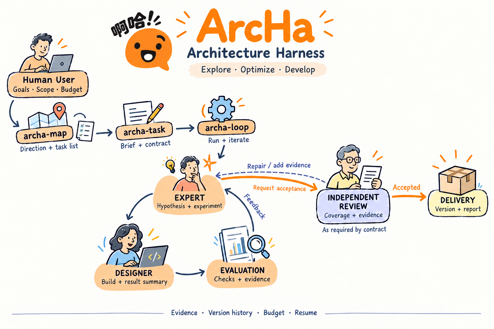

<p align="center">
  
</p>

<h1 align="center">ArcHa · Architecture Harness</h1>

<p align="center"><strong>由人定义目标，以实验推进工作，用独立审核交付可信成果。</strong></p>
<p align="center">探索 Exploration · 优化 Optimization · 开发 Development</p>
<p align="center"><a href="https://github.com/kongxiangcong/ArcHa">GitHub</a> · <a href="#框架总览">框架总览</a> · <a href="#三步开始一个最小任务">快速开始</a> · <a href="#从一次迭代到可信交付">工作流程</a> · <a href="#当前进度与能力边界">项目状态</a></p>

## 框架总览



**图 1 · ArcHa 的任务生命周期与执行架构。** 用户设定方向、目标、范围、验收条件和预算；三个技能入口将这些意图转换为可执行任务。实验结果沿 Feedback 回路交给专家分析；独立审核发现的缺口沿 Repair / add evidence 路径返回专家处理。图中展示的是包含独立审核要求的交付流程。

- **任务准备：** `archa-map` 形成研究地图和任务清单；`archa-task` 生成简报并通过 onboard 准备契约；`archa-loop` 启动或恢复执行。首次创建执行 Run 时冻结对应的契约依据。
- **自动迭代：** Expert 提出假设、proposal、对照与判定方式；Designer 完成开发或调查，交付摘要和原件；需要正式评价时由 Evaluation 执行冻结检查与测量。结果、失败和反例返回 Expert，支持下一步决策。
- **独立交付：** Expert 选择候选提交与主张版本并请求验收。框架执行完整验收，Reviewer 核查合同要求的需求覆盖、证据充分性及适用边界；缺口回到迭代流程处理，只有满足必需条件才声明完成。
- **持久化支撑：** 版本化契约明确执行依据，账本与原件保留证据来源，候选和主张保留版本，累计预算与恢复机制维持跨轮次工作的连续性。

---

## ArcHa 是什么

**ArcHa（Architecture Harness）是面向探索、优化和开发的自动迭代框架。** 用户决定方向、目标与边界；专家 Worker 提出可检验的假设和实验方案；设计 Worker 完成实现、验证及结果摘要；审核 Worker 对选定成果和证据开展独立审查。框架负责把这些工作组织成可执行、可追溯、可恢复的闭环。

同一套流程可以用于理解一个架构机制、改善已有实现的性能，也可以完成一个尚未实现的功能。每一步都围绕明确的任务契约展开：要交付什么、允许改什么、如何验证、在什么资源范围内推进，以及什么条件下才能宣布完成。

> **用户掌握“为什么做、做到什么程度”；Worker 负责“提出方案、落实工作、解释证据”；框架保证执行与交付有据可查。**

Python 发行包名为 `archa-opc`，底层引擎和命令行仍使用 `opc`。`archa-map`、`archa-task`、`archa-loop` 是面向用户的 Agent 技能入口。

## 为什么需要 Architecture Harness

架构研究和工程研发经常跨越多轮工作：先理解问题，提出解释，再修改实现、运行实验、分析反例，最后判断结果是否足以支持交付。仅有一次代码生成或一份实验报告，无法承担整个过程。

ArcHa 将持续研发所需的几个环节连接起来：

- **把意图落实为任务契约。** 方向转化为交付物、验收条件、可改范围和预算，Worker 有明确的工作依据。
- **让下一步由证据驱动。** 专家结合结果选择继续开发、补测、补分析、调整假设，或有依据地结束任务。
- **保留过程中的有效积累。** 候选版本、原始证据、反馈分析及主张版本可以追溯；失败和不确定结果也进入后续判断。
- **将完成交给独立验收。** 运行停止、指标改善和任务完成分别记录，最终交付须满足约定的自动检查与独立审核要求。

ArcHa 的领域事实通过目标项目的 `.opc/` 接入层表达。框架核心不预设某种 NPU、编译器或模拟器；具体项目提供输入、权限范围、评价器、工具链和验收条件。这使架构建模、性能调优与功能开发能够共享执行基础。

## 三个场景，一套迭代机制

| 场景 | 用户想得到什么 | 典型工作 | 完成依据 |
| --- | --- | --- | --- |
| **探索** | 对机制、因果关系或设计空间形成有边界的认识 | 阅读材料、提出竞争假设、设计对照、采集证据、分析反例 | 主张有来源与适用范围；证据和未知项明确；通过约定审核 |
| **优化** | 在正确性与资源约束内改善已有实现 | 建立可比基线、修改实现、重复测量、比较候选 | 冻结条件下的有效改善、约束满足及完整验收 |
| **开发** | 交付可使用的功能或工程成果 | 拆解缺口、开发、局部检查、集成验证、修复 | 必需需求被覆盖，交付物可用，自动检查与审核通过 |

例如，同一个队列项目可以提出三个不同任务：“解释队列长度为何影响出队耗时”“降低长队列的出队耗时”“修复 FIFO 顺序并完成空队列行为”。它们共享角色和证据链，但目标与验收方式不同。

当前配置对应 `exploration`、`tuning` 和 `development` 三类 Profile。Profile 提供版本化默认策略；实际行为由任务目标、权限、评价能力和验收契约共同决定。探索和开发可以没有数值优化目标，此时使用需求与验收门判断完成，无需人为制造一个分数。

## 谁负责什么

| 角色 | 主要职责 | 关键产出 |
| --- | --- | --- |
| **用户 User** | 选择方向、目标、交付要求、范围与预算；决定是否修改验收标准 | 任务意图及授权边界 |
| **专家 Worker · Expert** | 提出假设与 proposal，设计实验和对照；分析反馈，选择下一步及最终候选 | 工作计划、实验设计、反馈分析、带适用范围的主张 |
| **设计 Worker · Designer** | 按方案开发或执行调查，保留必要原件，说明实际行为、偏差与局限 | 候选实现、实验材料、工作结果与结论摘要 |
| **审核 Worker · Reviewer** | 在独立上下文中核查选定成果、需求覆盖与证据，指出缺口 | 审核结论、逐项判断及修复依据 |
| **ArcHa 引擎** | 管理契约、执行、评价、账本、预算、恢复与交付状态 | 可追溯的运行事实和交付报告 |

设计者的摘要描述本次实际完成的工作和观察；专家进一步判断这些证据支持什么主张、是否需要调整方案。独立审核针对明确的候选与主张版本，不能为后来修改的内容自动背书。

## 从一次迭代到可信交付

下文对应[框架总览](#框架总览)中的准备、迭代与交付三个阶段。

### 1. 定义方向与准备任务

`archa-map` 把需求组织为方向地图与任务清单；`archa-task` 聚焦一个具体任务，形成简报，并自动调用 onboard 准备执行契约。契约明确目标、范围、交付物、评价方式和预算。

准备阶段可以完善同一候选契约。首次绑定执行 Run 时冻结执行依据；此后改变目标、权限或验收等实质内容，需要按修订流程处理，历史结果仍保留原依据。

### 2. 由专家提出可检验的下一步

专家读取当前任务、历史结果与授权材料，提出 hypothesis / proposal：要解决什么问题，采用什么方法，哪些观察会支持或削弱假设，为什么值得投入下一步。

一个工作可以是代码开发，也可以是无补丁的新测量、诊断、证据补充或分析。实验允许得到“不支持原假设”或“证据不足”的结果。

### 3. 由设计者实施，框架保存与评价

设计者在授权范围内完成工作，提交必要原件及摘要。框架保存候选和证据；需要正式评价时，按照冻结的评价条件执行。数值优化任务还要核对可比性、约束和有效收益。

专家接收结果并作反馈分析，选择继续、调整、补充证据，或请求验收。循环依据缺口、证据和继续工作的预期价值推进，同时遵守预算与用户暂停、停止指令。

### 4. 独立审核后形成交付

专家请求验收后，`archa-loop` 通过引擎对选定成果执行完整验收，并完成合同要求的独立 review。**面向正式交付的任务应在简报中明确独立审核要求，并核对该要求已进入合同。** 当前实现按合同启用审核，并非每一轮都默认调用 Reviewer。

若不通过，框架根据缺口补验、重试审核、修复候选或补充证据。缺少继续条件时，保留未完成状态及重开条件。只有实际交付结果 `delivery.complete=true` 才能声明任务完成。

> **达到数值目标、Run 已结束、任务已验收完成，是三个不同事实。** 默认交付包括报告和选定提交；不会自动把结果合并到用户分支。

## 三步开始一个最小任务

下面使用一个极小的 Python 队列项目演示开发场景。示例中的预期输出是教学说明，不是已发生的 ArcHa 运行报告。

### 准备：安装技能并创建示例项目

需要 Python 3.10+、Git，以及能够发现这些技能、调用已配置 Worker 后端的 Agent 环境。当前提供 Codex、DSH 等适配；技能安装不等于后端凭据或工具链已准备好。

在 ArcHa 仓库执行：

```bash
git clone https://github.com/kongxiangcong/ArcHa.git
cd ArcHa
git switch main
git pull --ff-only origin main
python tools/install_research_skills.py
```

安装器默认写入 `$CODEX_HOME/skills`，未设置时使用 `~/.codex/skills`；随后开启能发现新技能的会话。技能会为目标项目部署 `.opc/archa.py` 和本地 runtime。若还需全局 `opc` 命令，可在 ArcHa 仓库运行 `python -m pip install -e .`。

另建 `queue-demo` 目录，创建 `queue_impl.py`：

```python
class Queue:
    def __init__(self):
        self._items = []

    def push(self, item):
        self._items.append(item)

    def pop(self):
        return self._items.pop()  # 当前是后进先出；任务要求 FIFO
```

在该目录初始化并提交：

```bash
git init
git add queue_impl.py
git commit -m "demo: initial queue implementation"
```

目标是保持 `Queue.push(item)` / `Queue.pop()` 接口，实现先入先出；空队列 `pop()` 抛出 `IndexError`，且抛错后仍可正常使用。用户给定的是行为和边界，具体实现方式交给 Worker。

### 第一步 · archa-map：把方向变成任务地图

在目标项目的 Agent 会话中输入，先替换实际项目路径：

```text
$archa-map 当前项目是 /absolute/path/queue-demo。
我要把这个极小的队列实现变成行为正确、可验证的 FIFO 队列。
请围绕“先修复行为，再考虑性能”形成一张简洁地图。
第一项只做 FIFO 顺序、空队列异常和异常后的可继续使用；保持公开 API。
不加入并发、持久化或新依赖，本次不做性能优化。
请给出第一项任务的实际目录，以及可复制的 archa-task 提示词。
```

你会得到研究地图、任务占位目录和下一步提示词。地图将本次开发任务与后续性能方向分开；此时尚未开始实现或正式实验。

一个可能的布局如下，**具体名称以工具实际返回为准**：

```text
queue-demo/
├── queue_impl.py
└── .opc/
    ├── archa.py
    ├── runtime/
    └── research/topics/queue-correctness/
        ├── research-map.md
        ├── discussion.md
        └── tasks/r01-fifo/
            └── task.md
```

### 第二步 · archa-task：把一个任务准备到可执行

复制上一步返回的实际任务目录：

```text
$archa-task "/absolute/path/queue-demo/.opc/research/topics/queue-correctness/tasks/r01-fifo/"
请准备这个开发任务的简报和执行合同。
目标：保持公开 API，实现 FIFO；空队列 pop 抛出 IndexError，之后仍能正常入队出队。
验收覆盖单元素、多个元素、交替入队出队、重复值和空队列恢复。
交付 queue_impl.py 的修复、必要验证材料和简短工作结果摘要。
没有数值优化目标，不增加吞吐量或耗时评分。
请将独立审核列为必需验收：核对行为、边界情况、证据与需求覆盖。
只完成准备，暂不启动正式迭代。
```

该阶段读取项目并调查任务，生成 `task-brief.md`，自动执行 onboard，核对执行契约、评价器与交接关系。无需用户手写引擎 task ID 或另行启动 onboard。

准备完成后，应能看到：

| 需要确认的信息 | 这个例子中的含义 |
| --- | --- |
| 目标与完成条件 | FIFO 和空队列行为全部满足 |
| 可改范围 | 必要实现及明确授权的开发材料 |
| 冻结验收 | 使用准备好的行为检查，执行中不能改标准求通过 |
| 数值目标 | 无，`acceptance.objective=null` |
| 独立审核 | 必需，覆盖行为、边界和证据 |
| 执行交接 | 明确的 Task / revision，以及下一步任务目录 |

`ready-for-onboard` 仅表示简报可以交给起草流程；`brief-check` 通过仅表示结构合格。它们都不等于任务已经完成，也不单独证明执行条件就绪。

### 第三步 · archa-loop：运行、修复、验收、交付

```text
$archa-loop "/absolute/path/queue-demo/.opc/research/topics/queue-correctness/tasks/r01-fifo/"
按已准备的合同启动自动迭代，完成 FIFO 开发任务。
由专家提出假设和工作计划，由设计者实现并提交结果摘要；
通过冻结行为检查后，对选定成果完成合同要求的独立审核。
在原授权范围与累计预算内修复实际发现的问题。
最后说明是否完成、交付版本、验证证据、审核结论和剩余缺口。
```

技能会定位该任务对应的合同，完成必要准备、执行检查、接入文件提交和 preflight，然后启动或恢复运行。开发任务允许产品功能尚未通过的基线，但工具、输入和输出通道必须真实可用。

这个任务的一轮工作可能如下：

| 环节 | 示例内容 |
| --- | --- |
| 专家 proposal | 当前从列表尾部弹出导致 LIFO；调整出队行为应满足 FIFO，同时保持空队列异常 |
| 实验设计 | 入队 A、B、C，预期依次出队 A、B、C；补充交替操作与空队列恢复对照 |
| 设计者工作 | 修改授权实现，执行局部检查，摘要说明行为变化及局限 |
| 正式验证 | 冻结检查核对需求，保留真实输出 |
| 专家反馈 | 判断已有证据是否足够，必要时补充边界验证，随后请求验收 |
| 独立审核 | 核查选定版本、检查覆盖、原始证据和未声明限制 |

实际实现方式、轮数和结果以运行记录为准。若预算耗尽或必要审核未通过，应明确交付“当前成果与未完成项”，不能以进程退出成功替代任务完成。

### 如何读最终结果

先看四件事：**是否完成、交付了哪个版本、依据是什么、还缺什么。** 然后按需追溯 Task、revision、Run、候选提交、测试原件和审核报告。

正常交付应能回答：“FIFO 行为由哪些检查证明？独立审核覆盖了什么？选定的是哪个提交？”失败交付也应能回答：“缺哪个条件？已有成果能否保留？什么新证据或外部变化才值得继续？”

## 将同一流程用于探索与优化

以下提示词是新的任务方向入口。后续仍使用地图返回的具体任务目录调用 `archa-task`，再调用 `archa-loop`。

### 探索：理解现象和机制

```text
$archa-map 当前项目是 /absolute/path/queue-demo。
我想理解不同队列长度下，出队实现为什么会产生不同耗时。
请从现有实现提出可区分的机制假设，规划一个小规模探索任务。
需要对照设计、原始测量、适用条件、反例和未知项；区分代码推断与实测。
成果用于决定后续是否值得优化，不预设某种实现一定更好。
请将最终机制解释和证据充分性纳入独立审核。
```

### 优化：在约束内改善性能

```text
$archa-map 当前项目是 /absolute/path/queue-demo，已有正确的 FIFO 基线。
我要降低长队列场景的出队耗时，保持公开 API、FIFO 语义和空队列行为。
请先核查基线、计时方法与噪声，准备一个最小优化任务；
在任务合同中明确负载、重复测量、可改范围和有效改善的判定方法。
最终交付需要正确性检查、可比性能证据和独立审核。
没有实测前不要承诺加速比例。
```

### 继续、暂停与修改目标

| 意图 | 可复制表达 |
| --- | --- |
| 继续原任务 | `$archa-loop "<实际任务目录>" 继续原 Run；若存在多个可恢复 Run，先列出身份供我选择。` |
| 查看进展 | `只查看该任务状态，说明当前工作、累计预算、结果与阻塞；不要恢复执行。` |
| 暂停 | `暂停这个任务，保留原 Run、成果和累计用量，并确认暂停已生效。` |
| 调整范围 | `将该任务的范围从 X 改为 Y，保留历史依据；请判断是否需要新 revision，完成新合同准备。` |

每次显式调用 `archa-map` 都会创建新专题。继续旧专题时，直接提供原专题目录及修改要求。`archa-task` 和 `archa-loop` 必须指向**具体任务目录**，不能用项目根目录、专题根目录或某个 Markdown 文件代替。路径有空格时加双引号。

对于已经清楚的工程任务，也可以直接从含 `task.md` 的具体任务目录调用 `archa-task`，无需先创建研究地图。

## 框架如何保留可靠性

**任务契约。** 执行目标、权限与验收在运行边界固定下来。准备过程可迭代，已经执行的合同不能被后来草稿悄悄替换。

**证据链。** 工作结果、原始观测、专家反馈分析和主张分别记录。缓存是历史证据；执行失败不自动证明假设错误；性能改善也不自动证明机制解释成立。

**可恢复运行。** 恢复以明确的 Run 身份及冻结配置为依据，保留历史和累计消耗。查看状态不会解除暂停，也不会启动新工作。

**连续预算。** 默认 Task 时间额度为两小时、token 不设上限，同时遵守已有明确硬限制。准备、不同 revision 和各次 Run 的累计用量连续计算，不能通过重启清零。

**独立交付判定。** 审核缺失、证据不足或仍有必需条件未满足时，不能声明完整交付。更改验收标准由用户决定；审核者提出的建议不会自行成为新的授权。

## 当前进度与能力边界

当前主线已合并 S1–S5 大版本重构与流程修复（[PR #11](https://github.com/kongxiangcong/ArcHa/pull/11)）；Python 包版本为 `0.3.0`。

主线已包含三阶段技能入口、任务契约与版本化 Profile、准备和恢复、工作与证据交接、主张反馈、终验及修复流程，以及调试工作台和持久化运行控制。具体执行约定见三个技能入口和接入指南。

测试项目已组织为 DeepStack 开发、Ramulator2 优化、DeepStack 探索和独立端到端题目，并保留 DMA 小型回归。**题目准备、局部检查、真实模型完成任务和外置验收通过，是不同验证层级。** 本文不把准备报告当作三类场景全面通过的性能证明，也不提供未经核验的加速或成功率数字。

具体任务能否执行，仍取决于项目评价器、Worker 后端、工具链、权限及输入材料。Profile 名称本身不保证这些条件已经具备。已部署项目的 runtime 和全局技能也不会因上游更新而自动升级，应按各自入口显式更新。

## 安装与运行参考

引擎需要 Python 3.10+ 和 Git，支持原生 Windows 与 Linux。Windows 可使用 Git for Windows 和 PowerShell，详见 [跨平台运行](docs/cross-platform.md)。

```bash
# 在 ArcHa 仓库中安装底层命令行
python -m pip install -e .

# 查看目标项目的实际状态与报告
opc status -p /absolute/path/to/project --task <task-id>
opc report -p /absolute/path/to/project --task <task-id> --revision <revision>
```

`<task-id>` 和 `<revision>` 使用任务准备阶段返回的实际身份，不根据目录名称猜测。通过技能部署的项目也可以使用 `python <project>/.opc/archa.py` 替代 `opc`。首次使用推荐按上面的三个技能入口操作；底层合同、门命令和接纳规则见 [接入指南](opc/scaffold/ONBOARDING.md)。

每个 Worker 的模型与推理强度可以在目标项目的 `.opc/local/workers.json` 中独立配置；已有本机配置保持不变。新项目默认配置见 [workers.json](opc/scaffold/workers.json)，覆盖顺序、DSH provider 与预算规则见 [Worker 环境配置](opc/scaffold/ONBOARDING.md#独立的-worker-环境配置)。

## 工作台

工作台展示任务进度、Worker 活动、历史调用、证据与交付状态，默认只读。显式启用控制模式后，可以暂停、继续同一运行或停止，保留成果、冻结配置和累计用量。

<details>
<summary>展开：安装、启动与开发验证</summary>

从干净 checkout 构建并安装（Node 20.19+ 或 22.12+；Python 3.10+）：

```bash
npm --prefix web ci
npm --prefix web run build
python -m venv .venv
# Linux / macOS / WSL
. .venv/bin/activate
# Windows PowerShell 改用 .venv\Scripts\Activate.ps1
python -m pip install '.[observer]'
python -m opc.observer --demo
```

访问 <http://127.0.0.1:8765>。演示模式在独立临时目录生成合成的当前源格式材料，仍由同一读取适配器处理；页面始终标注演示。退出清理临时材料，不访问用户项目。查看真实项目：

```bash
python -m opc.observer --project /absolute/path/to/project
# 显式启用本机运行控制（支持暂停、继续同一运行及停止）
python -m opc.observer --project /absolute/path/to/project --control
# 端口可通过 --port 8766 指定
```

观察器不创建缺失项目或数据库。默认且仅允许绑定 loopback；远程使用既有 SSH 隧道。项目配置明确指定的外置 `artifact_root` 也可读取，其他路径和越界符号链接会被拒绝。Markdown 不执行原始 HTML，外部图片不自动加载，HTML/SVG 原件仅显示源码或下载。页面 URL 保存任务、run、工作、筛选与所选调用；局部刷新保留阅读位置。控制接口只接受同源 JSON 和固定项目目标；重试先查询原请求，不自动补发。继续使用独立本地执行进程，保留原运行、冻结配置、成功回执与累计用量，不依赖页面或 HTTP 连接存活；恢复失败或执行未确认时保留现场，不自动重启。已暂停运行停止时直接由运行端关闭，不先恢复工作；无法确认执行结束时明确提示，停止不代表任务交付成功。演示、只读和缺少执行来源的历史不能控制。

前端开发可运行 `npm --prefix web run dev`，Vite 会将 API 转发至本地 Python 服务。生产构建输出到 `opc/observer/static/`，该目录不提交，但构建后打包的 wheel 包含它；安装这种 wheel 后运行观察器不需要 Node。没有安装 observer extra 时原有 `opc` CLI 继续独立工作。只安装源包而未构建前端时，观察服务会明确提示构建命令。

后端可选依赖锁定在 `pyproject.toml`，前端与传递依赖锁定在 `web/package-lock.json`。升级 ArcHa 时，在 `opc/observer/adapter.py` 核对变化的路径、账本列、冻结合同和 provider 日志映射；前端消费 `/api/observer/v1` DTO，控制模式另使用 `/api/control/v1` 的请求与查询。实体及接口模型见 `opc/observer/models.py`，服务的 `/openapi.json` 可读取生成的合同。升级后运行以下离线检查，不要求模型密钥：

```bash
python -m pip install -e '.[observer]' pytest httpx
python -m pytest opc/tests/test_observer.py opc/tests/test_observer_control.py opc/tests/test_results.py -q
npm --prefix web run typecheck
npm --prefix web run build
# 浏览器验收另需 Playwright 与本机 Chromium
python tools/observer_browser_smoke.py
```

框架基础安装的回归只需 `python -m pip install -e . pytest` 后运行 `python -m pytest -q`。
未安装 FastAPI 或 HTTPX 时只跳过依赖它们的 HTTP 测试，观察器文件适配器测试仍运行。
CI 在基础安装和安装 observer 测试依赖后分别运行完整回归，并显式检查 HTTP 测试依赖可导入。

当前规格与逐票验收见 [S5 规格和事项](.scratch/s5-debugging-workbench/spec.md)，旧版只读实现记录见 [观察工作台 tickets](docs/design/observer-workbench/tickets.md)。受控执行验证框架行为，不代表真实模型或用户部署已验证；未识别来源明确提示，不迁移源数据。

</details>

## 源码与深入阅读

从用户入口到执行实现，可按需继续阅读：

- [archa-map：方向地图与项目初始化](skills/archa-map/SKILL.md)
- [archa-task：任务简报与自动 onboard](skills/archa-task/SKILL.md)
- [archa-loop：运行、恢复、终验与修复](skills/archa-loop/SKILL.md)
- [Expert / Designer 的工作协议](opc/adapters/prompts.py)
- [任务配置及 Profile 解析](opc/core/config.py)
- [交付验收与独立审核实现](opc/core/promote.py)
- [测试项目与验证边界](benchmarks/README.md)

## 贡献与许可

开发前请阅读 [AGENTS.md](AGENTS.md) 和 [文档导航](docs/README.md)。基础回归使用 `python -m pytest -q`；工作台的可选依赖与验证命令见上方展开内容。提交问题或实验结果时，请附上版本、任务目标、必要运行信息、实际结果与证据位置。

ArcHa 使用 [Apache License 2.0](LICENSE)。

---

<p align="center"><strong>ArcHa · Architecture Harness</strong><br/>方向由人决定，工作由证据推进，成果经独立审核交付。</p>
