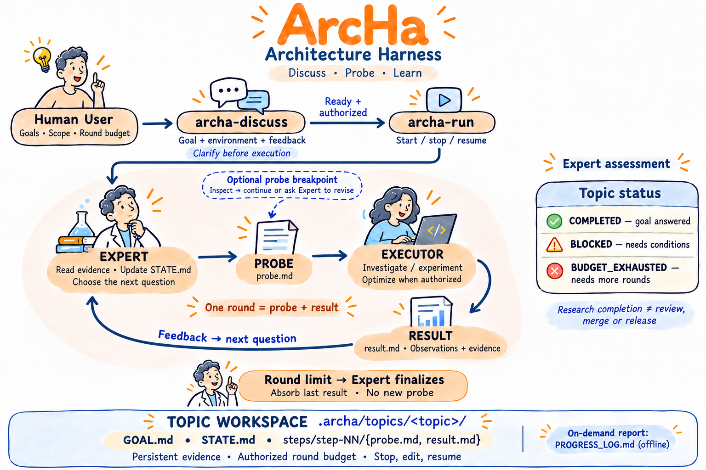

<p align="center"></p>

# ArcHa · Architecture Harness

ArcHa 用持续专题组织研究：人定义目标，Expert 消化证据并选择下一问，Executor 核查资料或完成最小实验。目标、当前认知状态与逐轮探针/结果保存在目标工程的 `.archa/topics/<topic>/`，停止后可以修改并继续。



*专题工作流程。准备就绪且已有授权后进入探针循环；Expert 消化结果、更新认知并决定下一问，Executor 完成调查、实验或授权优化。可选探针断点支持检查与反馈重拟；达到轮数上限后只做收尾消化。目标、认知与逐轮材料保存在专题工作区，研究完成不代表独立审核、合并或发布。恢复时按已有材料继续待执行步骤，具体协议见[引擎说明](opc/README.md)。*

Python 发行包为 `archa-opc`，命令为 `opc`，要求 Python 3.10+。Worker 通过命令数组接入外部 CLI 或脚本；默认 Codex 配置需要本机已有可用的 Codex CLI 和授权。

使用两个流程技能：

- `/archa-discuss`：多轮澄清目标、范围和完成判据，讨论环境搭建、就绪依据及反馈方式；目标足以指导下一步后才创建专题。
- `/archa-run`：目标和必要准备均已就绪且已有执行授权时，启动或继续探索与授权优化，也负责停止、查看进展和按需离线报告。

安装到 Agent 的技能目录：

```bash
python tools/install_research_skills.py --destination /path/to/skills
```

安装器只安装这两个技能；指定目录中的旧四技能移到相邻 `skill-backups`，不保留可发现的旧入口或兼容别名，无关技能保持不变。技能共用 `GOAL.md`、`STATE.md` 和逐轮材料，已有答案与授权继续有效，不要求手动重复调用或另写交接文档。

可以这样开始开放探索：

> /archa-discuss 我想研究这个工程，但还没决定关注正确性还是性能。先查阅现有材料，与我讨论用途、范围和完成判据；也明确环境怎么搭建、怎样证明就绪，以及观测怎样反馈给 Expert。先讨论，不启动探索。

明确任务也先补齐准备：

> /archa-discuss 核查这个整数求和实现是否精确，只调查、不改源码，授权最多 1 轮。请先确认运行入口和依赖、环境就绪的验证依据，以及逐例输入、期望值、实测或异常怎样记录和判读；缺口补齐、准备满足后开始，复用这一轮授权。

讨论会把研究目标、环境入口、必要准备和反馈约定写入现有目标及环境说明。安装完成、配置可读或 `check` 通过都不能替代任务环境就绪。目标、准备、反馈回路确认且已有执行授权后即可交接；技术未知由循环内探针调查，不要求预先拆出完整方向清单。未立项讨论留在会话，跨会话继续需带入已有摘要。

目标工程由已安装的 `archa-discuss/scripts/initialize.py --project PROJECT` 部署 `.archa/archa.py` 和固定快照 runtime；后续通过 `python PROJECT/.archa/archa.py ...` 调用，不依赖全局安装。安装新技能不会隐式升级既有工程；仅在停止后显式加 `--update` 升级并备份旧快照。升级保留 `.archa/workers.json`；自定义 Codex 命令若含 `-o {output_file}`，须显式移除，避免最终聊天摘要覆盖 Worker 写出的协议文件。

运行中可让 `/archa-run` 停止、继续或查看进展。普通恢复使用已有待执行探针；若要改变关注点，交给 `/archa-discuss` 正常停止并完成提交恢复，再更新目标及受影响认知，处理最后一个尚无结果的探针，让 Expert 重新出题。仅编辑目标不会自动替换旧探针，也不会撤销工程副作用；已完成轮次与预算保留，额外轮数须有授权，实质换题新建专题，已完成专题不重开。

“查看进展”只读已有状态与材料；明确要求“生成报告”才离线生成专题内 `PROGRESS_LOG.md`，不调用 Worker。研究完成、专题阻塞、预算耗尽和调用失败有不同含义：完成不代表审核、合并或发布；阻塞需补齐条件，耗尽需授权追加，失败保留错误及日志而不自动重试。同一工程最多一个执行者，未提交调用恢复时可能重跑。

详细命令、状态与提交恢复协议见 [引擎说明](opc/README.md)，讨论和执行步骤分别见 [archa-discuss](skills/archa-discuss/SKILL.md)、[archa-run](skills/archa-run/SKILL.md)。开发者也可 `pip install -e .` 使用同一 CLI 的 `opc` 命令。

工作台显示专题状态、Expert/Executor/收尾日志与材料，默认只读；加 `--control` 开启停止、继续和追加轮数：

```bash
pip install -e '.[observer]'
npm --prefix web ci
npm --prefix web run build
python -m opc.observer --project /path/to/project --control
```

打开 `http://127.0.0.1:8765`。`python -m opc.observer --demo` 使用临时离线演示材料。工作台只绑定本机地址，材料阅读不会执行原始 HTML。

开发验证：`python -m pytest -q` 收集核心与工具测试；`npm --prefix web run build` 完成类型检查和生产构建。安装 Playwright/Chromium 后运行 `tools/observer_browser_smoke.py` 与 `tools/workbench_control_smoke.py`，验证真实浏览器和后端流程。跨平台边界见 [说明](docs/cross-platform.md)。

实现依据：[专题工作区 ADR](docs/adr/0001-topic-workspace.md)、[术语表](GLOSSARY.md)。旧 `.opc/` 运行格式已退役；原始研究数据与验证记录保留，不迁移或自动继续执行；被替代的根方案和 S1–S5 规格／工单通过 Git 查找。
