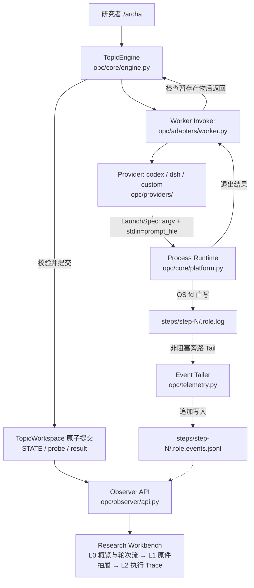

# ArcHa 重构方案（v1.1 修订版）：Research Workbench 与多 Provider 执行架构

> **文档类型**：需求方案 + 技术设计提案（已完成两轮需求澄清，保留为讨论依据）  
> **实施规格**：[Research Workbench 与多 Provider 执行](.scratch/research-workbench-providers/spec.md)（`ready-for-agent`）；后续实施要求以该规格为准，本方案不再平行维护。  
> **版本**：v1.1（2026-11-17 修订版，合入本地源码核查、十一项已确认决定与四大开发约束）  
> **参考基线**：[kongxiangcong/ArcHa](https://github.com/kongxiangcong/ArcHa) 与 `/root/LoopForge` 本地检出源码；DSH stdin 协议核查基于本机 `0.2.2-rc.1` 安装包源码，尚未进行真实 CLI 联调  
> **核心定位**：**保留 ArcHa 极简文件权威研究内核，以渐进式披露重构具有 [LoopForge 设计水准](https://github.com/Tencent/LoopForge/blob/main/design.md) 的 Research Workbench；用干净的 Provider 抽象直接替换旧 Worker 预设，支撑 Codex 与 DeepSeek Harness（DSH）等多 CLI 执行。**

---

## 0. 四大核心工程约束（本次修订的最高准则）

在参考 [Tencent/LoopForge](https://github.com/Tencent/LoopForge) 进行架构与体验升级时，所有代码设计与接口取舍必须无条件服从以下四条第一性工程准则：

1. **禁止过度防御（No Over-Defensiveness）**
   - ArcHa 运行在研究者本机的受信任科研环境中，不是多租户公有云平台。
   - **不搞环境变量白名单与私有 HOME 隔离**：子进程默认直接继承宿主机的 `os.environ`（仅叠加 Provider 显式指定的少量参数），保留本机 `~/.codex`、`~/.dsh` 登录配置入口；Conda、Bazel、Verilator、SystemC 等工具链是否可用，须在 Agent 内部 shell 中实际验收，避免重蹈 [LoopForge Issue #897](https://github.com/Tencent/LoopForge/issues/897) 因清空环境变量与重定向配置目录导致本地鉴权全面失效的覆辙。
   - **不搞逐行正则脱敏流水线、文件哈希指纹校验与繁琐错误枚举**：信任本地文件系统与 `TopicWorkspace` 原子重命名机制；不给派生视图加版本指纹，不构造 7 种细碎错误枚举，进程退出统一收敛为 `completed`、`failed`、`timed_out`、`cancelled` 四种结果并附带可取得的原始退出码与失败日志上下文；这些是进程结果，不是研究产物发布结果。

2. **尽量做减法（Do Subtraction Wherever Possible）**
   - **目录与文件做减法**：取消 v1.0 拟议的 `.archa/topics/<topic>/telemetry/<invocation-id>.jsonl` 独立目录与 `invocation_id` 注册表。直接复用每轮已有的 `steps/step-N/` 目录，在四种角色调用的 `.role.log` 旁写入派生的 `.role.events.jsonl`（角色与保留规则见 §5.1）。一轮、一调用角色、一确定性路径，零额外索引文件。
   - **接口与字段做减法**：砍掉 `ProviderCapabilities` 预声明的 7 个布尔开关（如尚无消费方的 `mcp`、`skills`、`session_resume`），将 `AgentEvent` 从 12 个信封字段精简为 6 个核心字段（`seq`、`ts`、`kind`、`title`、`status`、`detail`）。
   - **状态源做减法**：绝不引入数据库、不恢复 `HISTORY.md`、也不额外生成每轮状态快照文件。历史演进直接由 `steps/step-N/probe.md`（天然包含对上轮结果的判定与本轮假设）与 `result.md` 构成的客观证据链驱动。

3. **不要打补丁（Clean-Slate Replacement, No Ad-Hoc Patching）**
   - **配置一次切齐，不留双轨兼容胶水**：不在 `opc/adapters/worker.py` 中维护“旧 `preset` / `command` 自动映射新 `provider`”的兼容补丁层。直接移除旧 `PRESETS` 字典，将 `opc/scaffold/workers.json` 与解析逻辑一步到位收敛为清晰的 `provider` 结构。
   - **进程 I/O 改为文件直写**：现有 `worker.py` 使用 stdout/stderr PIPE 与两个持续读取线程，并非无人消费的同步管道。本次将其替换为操作系统文件描述符直写 `.role.log`，由轻量级文件尾随器（File Tailer）旁路读取新增内容并解析为 `.events.jsonl`；不再从 stdout 获取研究产物。
   - **前端轮询不打重挂载补丁**：借鉴 [LoopForge 前端设计约定 (`design.md`)](https://github.com/Tencent/LoopForge/blob/main/design.md) 的就地更新原则，定时轮询返回时仅增量合并数据与状态属性，绝不通过销毁重建组件树或伪造定时器来修补动效。

4. **渐进式披露（Progressive Disclosure）**
   - **界面认知分层（拒绝首屏四栏同开的信息过载）**：将 Workbench 从拥挤的“四区域常驻”重构为 **L0（研究概览与轮次流）→ L1（按需滑出原件抽屉）→ L2（深层执行 Trace 与原始日志）** 三级渐进披露结构。
   - **协议与阶段渐进演进**：先用最简契约跑通核心闭环，不在第一天为未来可能接入的协议预埋空壳抽象。

---

## 1. 背景、现状与架构边界

### 1.1 问题定义

[kongxiangcong/ArcHa](https://github.com/kongxiangcong/ArcHa) 是面向开放式探索与工程优化（如 NPU/PIM 架构建模、性能瓶颈定位与编译器调度探索）的自动研究 Harness：由人设定专题目标（`GOAL.md`），Expert 基于当前认知（`STATE.md`）与证据提出下一轮探针（`probe.md`），Executor 执行最小实验并产出结果（`result.md`），循环往复直至目标达成、条件阻塞或预算耗尽。

当前亟待解决的两个核心痛点：

- **可观察，但缺乏层次感（缺渐进式披露）**：现有 Web 工作台将材料与日志平铺展示，缺少从“研究脉络（为什么做这一轮、得出了什么结论）”到“原件证据”再到“底层 Agent 执行轨迹”的清晰阅读层次与现代视觉反馈。
- **Worker 绑定单一，缺乏干净的 Provider 边界**：`opc/adapters/worker.py` 目前围绕 Codex 预设（`codex exec --ephemeral ...`）构建，缺少原生多 CLI Provider 抽象（如接入 DeepSeek Harness `dsh`）与标准化的事件提取机制。

### 1.2 现有代码处理原则（减法与直接替换）

| 当前文件 | 已有职责 | v1.1 处理原则（做减法、不打补丁） |
|---|---|---|
| [opc/core/engine.py](https://github.com/kongxiangcong/ArcHa/blob/main/opc/core/engine.py) | `TopicEngine` 调度 Expert / Executor 循环与预算 | **保持不变**，研究语义与调度规则零改动 |
| [opc/core/workspace.py](https://github.com/kongxiangcong/ArcHa/blob/main/opc/core/workspace.py) | 专题权威文件（`GOAL`/`STATE`/`probe`/`result`）、原子提交与恢复 | **保持不变**，继续作为唯一事实来源 |
| `opc/core/topic_control.py`、`opc/core/platform.py` | 进程锁、执行身份、进程树管理与停止控制 | **复用现有控制语义**；配合 Worker 将 I/O 从双线程管道读取改为文件直写 |
| [opc/adapters/worker.py](https://github.com/kongxiangcong/ArcHa/blob/main/opc/adapters/worker.py) | `PRESETS`、`configuration()`、`invoke()`、子进程调用与文件校验 | **干净重构**：删除 `PRESETS` 硬编码，替换为 `Provider` 调度与旁路事件提取 |
| [opc/scaffold/workers.json](https://github.com/kongxiangcong/ArcHa/blob/main/opc/scaffold/workers.json) | 默认 Worker 角色配置 | **直接升级**为显式 `provider` 结构，不保留旧字段兼容分支 |
| [opc/observer/api.py](https://github.com/kongxiangcong/ArcHa/blob/main/opc/observer/api.py)、`adapter.py` | 基于文件的只读投影与 HTTP 接口 | **最小扩展**：补充 L0 原文摘录与可重置的事件增量读取；保留材料及控制接口 |
| `web/src/App.tsx`、`styles.css`、`poll.ts` | React / Vite 前端页面与轮询 | **按渐进式披露重写 UI**，引入设计令牌与三级视图结构 |

### 1.3 从 LoopForge 借鉴什么、舍弃什么

对照 [LoopForge 架构说明 (`docs/architecture.md`)](https://github.com/Tencent/LoopForge/blob/main/docs/architecture.md) 与 [LoopForge 工程规范 (`AGENTS.md`)](https://github.com/Tencent/LoopForge/blob/main/AGENTS.md)，LoopForge 是面向团队代码交付的固定 SOP 平台（包含 Go 引擎、13 个 MySQL 领域仓储、Docker 沙箱与人工审批门禁）。ArcHa 必须坚持以下取舍：

- **借鉴其设计精髓**：
  1. **控制与执行解耦**：Engine 决定何时调用何角色，Provider 只负责组装 CLI 启动参数并解析原生输出流（参考 [LoopForge `internal/runtime`](https://github.com/Tencent/LoopForge/blob/main/docs/architecture.md)）。
  2. **克制的现代视觉系统**：借鉴 [LoopForge 前端设计约定 (`design.md`)](https://github.com/Tencent/LoopForge/blob/main/design.md)（源自 MIT 授权的 Grasp 布局与 Harness UI 规范），采用统一 CSS 令牌、零位移悬停、平滑抽屉过渡与真实状态徽标。
  3. **吸收其踩坑经验**：直接规避 [LoopForge Issue #434](https://github.com/Tencent/LoopForge/issues/434)（长 Prompt 拼入 `argv` 触发 Linux 128 KiB `E2BIG` 崩溃）、[LoopForge Issue #897](https://github.com/Tencent/LoopForge/issues/897)（私有环境隔离破坏本地鉴权）与 [LoopForge Issue #898](https://github.com/Tencent/LoopForge/issues/898)（SSE 断线重连丢失中间状态）。
- **坚决舍弃的重型设计**：不引入 Go/MySQL 双重账本、不引入静态 DAG 流程图编辑器、不引入多租户权限与容器编排、不将无头 CLI 仓库级自动钩子（见 [LoopForge 部署安全边界 (`docs/deployment.md`)](https://github.com/Tencent/LoopForge/blob/main/docs/deployment.md)）带入研究循环。

---

## 2. 总体架构与核心隔离边界



### 2.1 研究与观测职责隔离

1. **权威研究链（实线，决定研究推进）**：`TopicEngine` → `Worker Invoker` → `Process Runtime` → 校验 `.staging` 临时产物 → 原子重命名提交至 `STATE.md` / `probe.md` / `result.md`。
2. **观测与展现链（虚线，纯只读旁路）**：子进程 `stdout/stderr` 直写 `.role.log` → 旁路 Tailer 解析结构化行写入 `.role.events.jsonl` → `Observer API` → Workbench 渲染。**观测解析或事件写入失败不改变研究结果、不阻止产物提交；须可见地标明 Trace 不完整。控制循环不能被无限日志读取或解析拖延，停止与超时仍须及时生效。**

### 2.2 三类状态严格正交

| 状态类别 | 枚举值 | 唯一事实来源 | 约束规则 |
|---|---|---|---|
| **研究状态** | `IN_PROGRESS`、`COMPLETED`、`BLOCKED`、`BUDGET_EXHAUSTED` | `STATE.md` 与 `TopicWorkspace` | 沿用 Workspace 的提交、收尾与恢复规则；恢复可追加预算，不改变研究语义 |
| **当前活动** | `idle`、`running`、`stopping`、`unknown` | `topic_control.py` 现有控制信息 | 不以研究 `IN_PROGRESS` 推断正在执行；保留 `unknown`，不把它映射成 idle 或 failed |
| **UI 视图态** | 当前展开的抽屉层级（L0/L1/L2）、选中轮次、明暗主题 | 浏览器本地状态 | 阅读状态不驱动内核；显式控制操作仍走现有控制接口 |

进程结果、最近错误与断点等待分别展示。`failed` 是失败结果而非新增持久活动状态；停止可能留下错误文本，不能用“有错误”推断失败。Trace 中 `completed` 仅表示进程成功退出：Worker 的产物检查、Workspace 的校验与发布在其后发生，零退出不等于本轮成功。产物提交与研究推进由现有权威文件及错误信息说明，不新增 Engine 发布事件钩子。

---

## 3. 主线 A：基于渐进式披露的 Research Workbench 设计

### 3.1 核心设计原则：用 L0 → L1 → L2 渐进式披露取代多栏平铺

放弃 v1.0 中同时在屏幕上塞满“导航 + 演进图 + 上下文检查器 + 底部多标签 Trace 面板”的四栏 IDE 布局。遵循**渐进式披露**原则，按研究者的思考深度分三层呈现信息：

```text
┌──────────────────────────────────────────────────────────────────────────────┐
│ [侧栏 260px] │ L0 主画布：专题原文摘录 + Research Journey 轮次演进流           │
│              │ ┌──────────────────────────────────────────────────────────┐  │
│ 专题列表     │ │ Goal & Current State 摘录卡（认知小节 / 轮次预算）│  │
│ ───────────  │ └──────────────────────────────────────────────────────────┘  │
│ ● pim-gemv   │   ↓                                                           │
│ ○ npu-tiling │ ┌──────────────────────────────────────────────────────────┐  │
│              │ │ Step 12 · 验证 bank 组写时序对 SRF 2CK 极限的影响 [Running] │  │
│              │ │ 探针摘录 (来自 probe.md)  →  结果摘录 (来自 result.md) │  │
│              │ │ [查看完整报告 L1]                 [展开执行 Trace L2 (3)] │  │
│              │ └──────────────────────────────────────────────────────────┘  │
└──────────────┴───────────────────────────────────────────────────────────────┘
```

| 披露层级 | 触发方式与承载容器 | 展示内容与边界 | 数据来源 |
|---|---|---|---|
| **L0：全局脉络层（默认可见）** | 页面主画布（单列居中阅读流，最大宽 920px） | 顶部展示 `GOAL.md` 与当前 `STATE.md` 的原文摘录及轮次预算；下方按最新轮在前展示 `Step N` 卡片（标题、探针摘录、已有结果摘录、执行与产物状态） | 现有 `/topics/{topic}` 接口 |
| **L1：证据原件层（按需一级展开）** | 点击任一轮次卡片或文件引用时，从右侧滑出 480px 宽的只读阅读抽屉（Context Drawer） | 阅读 GOAL、STATE、probe、result、feedback 及现有实验附件；保留 Markdown 证据链接、长文件分段读取，支持代码高亮与一键复制路径 | 现有 `/materials` 接口 |
| **L2：执行诊断层（按需二级下钻）** | 仅由用户点击“执行 Trace”主动展开；运行或失败只通过徽标与诊断入口提示，不自动展开 | 展示四种角色各自最新调用的追加式事件列表，呈现实际取得的 Provider、耗时、工具事件与用量信息；底部可折叠查看对应 `.role.log`，保留大日志增量读取 | `.role.events.jsonl` 与 `.role.log` |

**摘录边界**：L0 明确标注“原文摘录”，不承诺自动提炼核心结论。GOAL 取正文摘录，STATE 从现有认知小节提取，跳过状态与预算元数据；probe/result 展示标题与正文摘录。采用确定性提取，不增加模型总结、结构化产物要求或历史快照。摘录长度、空内容与截断规则在 to-spec 中定义。

**保留现有能力**：停止、继续、追加轮数、断点调试开关、方向意见重拟继续可用，按现有状态呈现。保留完成专题不可重开、预算耗尽需追加、重拟后再次停下，以及控制未启用和演示模式只读等语义。

### 3.2 借鉴 LoopForge 的视觉令牌与动效纪律

参考 [LoopForge 前端设计约定 (`design.md`)](https://github.com/Tencent/LoopForge/blob/main/design.md) 中的 `--hui-*` 规范与组件交互准则，建立精简的 `web/src/tokens.css`：

1. **色彩与表面令牌（明暗同构）**
   - 浅色模式：画布 `#fafafb`、卡片表面 `#ffffff`、细边框 `#eae9ee`、主文字 `#18181b`、次级文字 `#62626c`、强调色 `#7b61ff`。
   - 深色模式（`html[data-theme="dark"]`）：画布 `#111114`、卡片表面 `#141417`、细边框 `#26262b`、主文字 `#ededf0`、次级文字 `#a1a1aa`、强调色 `#a08aff`。
   - 状态色调严格绑定真实状态：`running`（蓝色呼吸点 `#597dcc` / `#8aa8ee`）、`completed`（绿色 `#338768` / `#34d399`）、`failed` / `BLOCKED`（红色 `#c15161` / `#f0899a`）、`BUDGET_EXHAUSTED`（琥珀色 `#b7791f` / `#f2c46d`）、`idle`（中性灰 `#6b6b76`）。

2. **零位移悬停与稳定布局**
   - 普通按钮、轮次卡片和列表行悬停**只改变边框或背景色，严禁使用 `translateY` 上浮、弹跳或改变容器宽高**（参考 [LoopForge `design.md`「标签页与悬停」](https://github.com/Tencent/LoopForge/blob/main/design.md)）。
   - L1/L2 右侧抽屉采用 `220ms` 滑入滑出过渡；关闭时立即设置 `inert` 与 `aria-hidden="true"`，待动画结束后卸载内容（参考 LoopForge `usePanelPresence` 模式）。
   - 全局遵守 `@media (prefers-reduced-motion: reduce)`，开启减少动态效果时关闭所有呼吸灯与过渡动画。

3. **轮询就地合并（禁止重绘打断）**
   - 保留 `poll.ts` 的轮询调度职责，组件按稳定的轮次与当前调用事件更新。调用更换按 §5.2 重置事件，不销毁整个阅读组件；不要求额外建立对象级合并框架。若当前打开的 L1 抽屉文件未发生变化，绝不重置抽屉滚动条位置、键盘焦点或正在播放的状态呼吸灯（参考 [LoopForge `design.md`「节点当前活动」](https://github.com/Tencent/LoopForge/blob/main/design.md)）。

---

## 4. 主线 B：极简 Provider 抽象与干净替换

### 4.1 减法后的 Provider 协议（`opc/providers/base.py`）

去除 v1.0 中过度设计的 `ProviderCapabilities` 与多余配置开关，将 Provider 抽象收敛为命令构造与单行事件解析。下列为职责示意；§4.3 确认保留的配置传递方式由 to-spec 定义，不能因示意未列出而删除：

```python
from dataclasses import dataclass, field
from pathlib import Path
from typing import Protocol, Literal

RoleName = Literal['expert', 'executor', 'expert_finalize', 'expert_revise']

@dataclass(frozen=True)
class WorkerRequest:
    role: RoleName
    topic_dir: Path
    workdir: Path
    prompt_file: Path
    output_file: Path
    state_file: Path
    model: str | None = None
    timeout_seconds: int = 1800

@dataclass(frozen=True)
class LaunchSpec:
    argv: list[str]
    cwd: Path
    env: dict[str, str] = field(default_factory=dict)

@dataclass(frozen=True)
class AgentEvent:
    seq: int
    ts: str
    kind: Literal['lifecycle', 'tool', 'usage', 'diagnostic']
    title: str
    status: Literal['running', 'ok', 'error', 'info'] = 'info'
    detail: str | None = None

class WorkerProvider(Protocol):
    name: str
    def prepare(self, req: WorkerRequest) -> LaunchSpec: ...
    def parse_line(self, line: str, seq: int) -> AgentEvent | None: ...
```

### 4.2 关键执行契约（不打补丁、不过度防御）

1. **Prompt 统一从 `stdin` 读取（避免正文触发 `E2BIG`）**
   - 吸取 [LoopForge Issue #434](https://github.com/Tencent/LoopForge/issues/434) 中 `dsh` 将长 Prompt 拼入 `argv` 导致超过 Linux `MAX_ARG_STRLEN`（128 KiB）触发 `syscall.E2BIG` 崩溃的教训，公共 `Process Runtime` **固定将 `req.prompt_file` 打开并绑定至子进程 `stdin`**。
   - 任何 Provider 的 `prepare()` 均只组装 CLI 标志参数，**严禁将 Prompt 正文拼入 `argv`**。

2. **直接继承宿主环境 + 无头非交互模式**
   - `Process Runtime` 启动子进程时使用 `{**os.environ, **spec.env}`，完整保留研究者本机的 PATH、虚拟环境与 CLI 登录态（规避 [LoopForge Issue #897](https://github.com/Tencent/LoopForge/issues/897)）。
   - CLI 入口继承环境不等于其内部 shell 自动继承；验收须通过 Agent 工具实际访问所需环境与工具链。权限沿用用户选定的本机 CLI 配置，不擅自扩大权限或隔离 HOME。
   - 各 Provider 在 `argv` 中显式传入无头非交互标志（如 `codex exec --ephemeral`、`dsh` headless 参数），避免无头进程在后台等待终端交互确认（参考 [LoopForge `docs/deployment.md`](https://github.com/Tencent/LoopForge/blob/main/docs/deployment.md)）。

3. **首批内置 Provider（`opc/providers/`）**
   - `codex`：封装 `codex exec --ephemeral`，支持 `--json` 事件行解析。产物由 Agent 按提示词写入指定暂存文件，禁止用 `-o <output_file>` 将最终聊天写入协议产物；收尾时该路径可能就是状态草稿。
   - `dsh`：封装 DeepSeek Harness 无头调用，从 `stdin` 读取任务，解析其原生 JSON 事件行（工具调用与完成事件），并沿用同一文件产物协议。本机 `0.2.2-rc.1` 安装源码支持省略 task 或用 `-` 从 stdin 读取，`--json` 输出 JSONL；LoopForge 当前仍将 DSH prompt 放入 argv，不照搬该部分。模型覆盖须按 DSH 实际配置协议实现并验收。
   - `custom`：接收显式 `command: list[str]` 模板，替换 `{output_file}` / `{state_file}` 占位符，不解析内部 JSON 事件（`parse_line` 直接返回 `None`，仅由 Runtime 生成首尾 `lifecycle` 事件）。

4. **`workers.json` 一步到位配置（不留旧格式兼容层）**
   直接将 `opc/scaffold/workers.json` 定义为直观的角色字典，删除旧 `preset` 字段：

```json
{
  "expert": {
    "provider": "codex",
    "model": null,
    "timeout_seconds": 1800
  },
  "executor": {
    "provider": "codex",
    "model": null,
    "timeout_seconds": 1800
  }
}
```

### 4.3 配置保留与升级边界

- 默认 Expert 与 Executor 均使用 Codex；DSH 由用户显式选用。保留模型、超时、必要环境覆盖、Codex 推理强度及 custom 文件路径参数。
- 移除旧 `output_mode=stdout` 产物模式，三个 Provider 统一通过文件协议交付研究产物。旧命令参数与新配置的准确映射在迁移说明中列明。
- 旧配置明确报错并给出人工迁移说明，不运行时兼容、不自动覆盖工程配置。现存 `.archa/workers.json` 优先于 scaffold，初始化与运行时升级均不会自动替换它。
- 更新现有安装器的运行时分发清单，纳入 Provider 和 telemetry 模块；同步更新已有使用说明与测试入口，验收新工程安装及旧工程升级。

---

## 5. 极简事件流与旁路文件尾随（Telemetry）

### 5.1 存储位置做减法：直接并入 `steps/step-N/`

不新建 `telemetry/` 目录，不生成跨目录 UUID 映射表。每次角色调用直接在当前轮次目录下产生成对的日志与事件文件：

```text
.archa/topics/<topic>/
  GOAL.md                         # 权威目标
  STATE.md                        # 权威当前状态
  steps/step-12/
    probe.md                      # 权威探针（Expert 提交）
    result.md                     # 权威结果（Executor 提交）
    .expert.log                   # 原生 stdout/stderr（OS 文件描述符直写）
    .expert.events.jsonl          # 派生事件流（旁路 Tailer 生成，供 L2 消费）
    .executor.log                 # 原生 stdout/stderr（OS 文件描述符直写）
    .executor.events.jsonl        # 派生事件流（旁路 Tailer 生成，供 L2 消费）
    .expert_revise.log            # 本轮最近一次探针重拟（若发生）
    .expert_revise.events.jsonl
    .expert_finalize.log          # 最后已完成轮次的收尾（若发生）
    .expert_finalize.events.jsonl
```

沿用引擎四种调用角色：`expert`、`executor`、`expert_revise`、`expert_finalize`。重拟可在同一待执行轮次多次发生，收尾归属最后已完成轮次；二者不构成新探索轮次。每轮每种角色只保留最新一次调用的 `.log` 与 `.events.jsonl`，新调用覆盖旧调用，明确不提供重试或历次重拟的完整 Trace 历史。

存量专题不回放旧日志、不补建历史事件。没有事件文件的旧调用在 L2 显示“此调用无结构化事件”，研究材料与原始日志仍可阅读；新调用开始生成事件。新调用的观测故障按 §5.2 提示 Trace 不完整，不以存量无事件提示掩盖故障。

### 5.2 旁路 Tailer、最小 JSONL 与游标重置

1. **为什么坚持 OS 文件直写 + 旁路 Tailer**
   - 重构后子进程 `stdout/stderr` 由操作系统内核直接写入 `.role.log`，即使 Executor 瞬间打印数十兆模拟器日志，也绝不会填满管道缓冲区导致子进程死锁。
   - 以约 `200ms` 周期尾随新增内容，进程结束后处理剩余内容；调用 `provider.parse_line(line, seq)`，有事件则追加写入 `.events.jsonl`。读取与解析不能无限占用控制循环，具体读取预算或执行方式由 to-spec 定义。
   - 普通非 JSON 行保留在原始日志，不生成事件；真正的解析或事件写入故障显示一次简短诊断，标明 Trace 不完整，继续研究。不得静默吞掉所有异常；事件文件不可写时也须有独立于该文件的可见诊断途径。

2. **6 字段极简事件格式（单行 JSONL）**

```json
{"seq": 1, "ts": "2026-11-17T12:00:01Z", "kind": "lifecycle", "title": "启动 executor (provider=dsh)", "status": "running", "detail": null}
{"seq": 2, "ts": "2026-11-17T12:00:05Z", "kind": "tool", "title": "shell: python3 sim_pim.py", "status": "ok", "detail": "exit 0 (3.2s)"}
{"seq": 3, "ts": "2026-11-17T12:00:18Z", "kind": "lifecycle", "title": "executor 进程成功退出", "status": "ok", "detail": "exit 0；产物提交状态见研究材料"}
```

首版只追加事件：工具开始和结束可为两条记录，不合并为单条状态卡片，不要求工具关联 ID。用量与 Provider 等信息仅展示实际取得的数据，不从展示文案反向解析出独立指标。

3. **单一增量读取 API**
   - 仅在 `opc/observer/api.py` 新增一个轻量接口：
     `GET /api/observer/v1/topics/{topic}/steps/{step}/events?role=executor&after_seq=0`
   - 上述 URL 仅示意同一次调用内的增量读取。`seq` 只在一次调用内单调递增；接口须额外让前端识别调用更换并重置游标与旧事件，即使新调用已结束、事件数超过旧游标，也不能混接两次调用。具体响应与游标结构在 to-spec 定义，不新增调用注册表。刷新或重连只能恢复当前保留调用的事件，不承诺恢复已被覆盖的历史。

---

## 6. 代码改造清单（聚焦最小改动面）

| 文件路径 | 操作类型 | 具体变更内容（严格遵循减法与不打补丁） |
|---|---|---|
| `opc/providers/__init__.py`、`base.py`、`codex.py`、`dsh.py`、`custom.py` | 新增 | 定义 `WorkerRequest`、`LaunchSpec`、`AgentEvent`、`WorkerProvider` 及 `codex` / `dsh` / `custom` 三个干净实现 |
| `opc/adapters/worker.py` | 删繁就简重构 | 删除 `PRESETS` 与旧参数拼接分支；接入 `get_provider()`，绑定 `prompt_file` 到 `stdin`，并在进程轮询循环中调用旁路 Tailer 写入 `.events.jsonl` |
| `opc/scaffold/workers.json` | 直接更新 | 替换为 `{"expert": {"provider": "codex", ...}, "executor": {"provider": "codex", ...}}` |
| `opc/observer/adapter.py`、`api.py` | 最小增量 | 补充 GOAL/STATE/每轮材料的确定性摘录，并新增支持调用更换的 `/steps/{step}/events` 增量读取端点 |
| `opc/telemetry.py` | 新增 | 四角色事件尾随、进程结果、可见观测诊断，不影响研究提交 |
| `skills/archa-discuss/scripts/initialize.py`、已有使用说明及相关测试 | 更新 | 补全分发清单、新配置及人工迁移说明，覆盖安装与升级 |
| `web/src/tokens.css`、`styles.css` | 样式重构 | 建立明暗双主题 `--hui-*` 令牌、零位移悬停样式、呼吸灯徽标与 `prefers-reduced-motion` 规则 |
| `web/src/App.tsx` | 视图分层重构 | 拆分为 L0（顶部认知卡 + Research Journey 轮次流）、L1（右侧 Context 抽屉）、L2（抽屉内可折叠 Execution Trace 与日志），实现轮询就地合并 |

---

## 7. 渐进式实施路线（三阶段可验证切片）

砍掉繁琐的前置文书阶段与远期插件规划，按三个可直接交付运行的纵向切片推进：

### 阶段 1：Provider 干净替换与多 CLI 闭环（后端减法重构）

- **目标**：用 `opc/providers/` 直接替换 `worker.py` 中的 `PRESETS` 硬编码，跑通 Codex 与 DSH 的独立或交叉调用。
- **动作**：
  1. 实现 `base.py`、`codex.py`、`dsh.py` 与 `custom` Provider，强制所有 Prompt 经 `stdin` 读取。
  2. 更新 `worker.py` 与 `workers.json`，移除旧配置兼容分支。
  3. 在 `worker.py` 集成旁路 Tailer，生成四种调用角色对应的 `.role.events.jsonl`。
- **验收标准**：`Expert=codex` + `Executor=dsh`（及反向组合）能跑通完整一轮探针生成、实验执行与原子提交；超过 128 KiB 的长 Prompt 不触发 `E2BIG`；任一 CLI 非零退出、产物缺失或校验失败绝不污染 `STATE.md`。真实 CLI 验收涵盖模型覆盖、无交互执行、本机登录配置与 Agent 内部 shell 工具链；安装包源码核查不能替代联调验收。

### 阶段 2：Research Workbench L0 + L1 渐进式视图（前端核心重构）

- **目标**：在不依赖复杂 Trace 的前提下，交付具有 [LoopForge 视觉质感](https://github.com/Tencent/LoopForge/blob/main/design.md) 的 L0 全局脉络与 L1 原件阅读抽屉。
- **动作**：
  1. 落地 `tokens.css` 明暗主题、状态徽标与零位移悬停规范。
  2. 重构 `App.tsx` 为“左侧专题导航 + 中央 L0（Goal/State 摘录 + Step 演进流）+ 右侧 L1 按需滑出原件抽屉”。
  3. 保留轮询调度职责，更新组件数据时保持滚动、焦点与展开状态，不打断过渡动效；已展开的 Trace 持续更新，运行或失败不抢焦点、不自动展开。
- **验收标准**：打开真实专题即可在首屏（L0）读到目标、当前认知小节及历轮探针/结果的原文摘录；点击任一轮次平滑滑出 L1 抽屉阅读完整 `probe.md` / `result.md`；正确区分研究 `IN_PROGRESS` 与当前活动 `running`；回归 §3.1 的全部既有控制与材料阅读能力。

### 阶段 3：L2 执行 Trace 下钻与实时事件联动

- **目标**：将 `.role.events.jsonl` 接入 Observer API 与 L2 视图，实现工具调用轨迹与真实状态动效。
- **动作**：
  1. 在 `opc/observer/api.py` 暴露 §5.2 定义的可识别调用更换的增量事件接口。
  2. 在轮次卡与 L1 抽屉内增加 L2 “Execution Trace” 折叠区，按 `seq` 增量展示 `lifecycle` / `tool` / `usage` / `diagnostic` 事件，并提供一键查看 `.role.log` 原文入口。
- **验收标准**：运行期间 L2 实时追加真实工具调用事件，进程完成/失败后活动动效停止，但不据此断言产物发布成功；对于不输出 JSON 的 `custom` 脚本，L2 自动降级为起止生命周期事件 + 原始日志，不伪造任何虚假中间态。同角色重试、多次重拟及重连时正确切换当前调用；解析/写入故障可见且不影响研究，日志洪峰下停止与超时及时生效。

---

## 8. 验收清单（Definition of Done）

- [ ] **零过度防御**：无环境变量白名单阉割、无逐行正则脱敏开销、无视图哈希校验，本机 CLI 登录态与编译工具链直通可用。
- [ ] **彻底做减法**：无独立 `telemetry/` 目录、无 `invocation_id` 索引表、无冗余 `ProviderCapabilities` 空字段、无额外历史状态快照文件。
- [ ] **干净无补丁**：`worker.py` 无旧 `PRESETS` 兼容分支，子进程 stdout/stderr 改为 OS 文件直写，轮询更新保持组件身份与阅读状态。
- [ ] **渐进式披露**：首屏（L0）清爽呈现研究主线，点击按需滑出 L1 原件抽屉，L2 执行 Trace 与原始日志仅由用户主动展开；运行、失败及轮询均不抢焦点或改变展开状态。
- [ ] **存量材料可读**：旧调用无事件时明确提示，仍可阅读原始日志与研究材料；不补建历史 Trace，新调用正常生成事件。
- [ ] **跨 CLI 连续研究**：同一专题可在不同轮次间自由切换 `codex` 与 `dsh`，完全依靠专题权威 Markdown 文件衔接上下文。

---

## 9. 参考源码与核实链接

- **ArcHa 核心实现**：[kongxiangcong/ArcHa 仓库](https://github.com/kongxiangcong/ArcHa) · [opc/core/engine.py](https://github.com/kongxiangcong/ArcHa/blob/main/opc/core/engine.py) · [opc/adapters/worker.py](https://github.com/kongxiangcong/ArcHa/blob/main/opc/adapters/worker.py) · [opc/observer/api.py](https://github.com/kongxiangcong/ArcHa/blob/main/opc/observer/api.py) · [docs/adr/0001-topic-workspace.md](https://github.com/kongxiangcong/ArcHa/blob/main/docs/adr/0001-topic-workspace.md)
- **LoopForge 架构与视觉规范**：[Tencent/LoopForge 仓库](https://github.com/Tencent/LoopForge) · [系统架构 (`docs/architecture.md`)](https://github.com/Tencent/LoopForge/blob/main/docs/architecture.md) · [前端设计约定 (`design.md`)](https://github.com/Tencent/LoopForge/blob/main/design.md) · [工程规范 (`AGENTS.md`)](https://github.com/Tencent/LoopForge/blob/main/AGENTS.md) · [部署与安全边界 (`docs/deployment.md`)](https://github.com/Tencent/LoopForge/blob/main/docs/deployment.md)
- **LoopForge 生产环境前车之鉴**：[Issue #434 (`dsh` 长历史拼入 `argv` 触发 Linux `E2BIG` 崩溃)](https://github.com/Tencent/LoopForge/issues/434) · [Issue #897 (环境变量隔离导致本地网关鉴权失效)](https://github.com/Tencent/LoopForge/issues/897) · [Issue #898 (SSE 断线重连丢失中间状态回放)](https://github.com/Tencent/LoopForge/issues/898)
