# ArcHa 整体架构方案：任务策略驱动的自主迭代 Harness

> 2026-10-31 更新：S0 需求已收束，以 [S0 当前决定](00-foundations-and-test-methods/README.md) 为准。Expert 位于 Run 层，Attempt 执行选定工作，引擎维护增量 DAG；Call 与会话分离。最终采用开发、调优、探索三个模块题及独立端到端题。正文中的早期示例/范围如有冲突，由此决定替代。框架实现与正式考试尚未完成。

**副标题：统一探索研究、工程开发与数值优化的目标、证据、工作流和 Worker 契约**

- 文档日期：2026-10-30。
- 文档性质：本次会话的完整讨论整理与整体方案，不是现有代码的改造清单、开发工单或已实现功能说明。
- 覆盖范围：从 Hermit 的“训练”含义、EAT 与 Harness Adapter 的关系，到未知目标的研究验收、角色组织、共享经验、研究决策、停止判据，以及任务策略驱动的通用 ArcHa。
- 事实与建议：引用的项目机制依据一手资料；ArcHa 的目标架构、配置格式和接口是本会话形成的方案。本文为形成完整接口而补充的内容会注明，不将其冒充已经逐项确认或已实现的能力。
- 验证状态：核对了参考资料和部分关键源码；没有运行 Hermit、EAT、openTPU 或 ArcHa 实验，没有验证本文方案的性能收益。
- 图示：流程图使用可编辑 Mermaid。此前消息中的文字流程与示意框图在此重新绘制，不代表额外实测结果；不支持 Mermaid 的阅读器仍可读取图的源码和相邻解释。

---

## 目录

1. [背景、需求与整体判断](#s01)
2. [本次讨论如何演变到当前方案](#s02)
3. [概念边界：训练、Harness、Adapter、Evolution 与 RSI](#s03)
4. [未知目标如何建立可验收的任务](#s04)
5. [总体架构与组成模块](#s05)
6. [任务 Profile、活动类型与三类策略](#s06)
7. [从 archa-map 到 archa-loop 的完整工作流程](#s07)
8. [统一迭代引擎与 Attempt 语义](#s08)
9. [Expert、Designer、Evaluator 与 Reviewer 的组织](#s09)
10. [共享经验空间：内容、权限、版本与认知更新](#s10)
11. [验证器、结果接纳与最终验收](#s11)
12. [下一步如何选择、何时停止](#s12)
13. [配置体系与完整配置示例](#s13)
14. [Worker 接口与交接消息](#s14)
15. [三个贯穿案例](#s15)
16. [如何评价 ArcHa 的泛化与有效性](#s16)
17. [设计边界、风险与不做什么](#s17)
18. [共识、建议和待决事项](#s18)
19. [参考资料与采用方式](#s19)
20. [附录：逐轮覆盖索引、历史表述校正与图示索引](#s20)

---

<a id="s01"></a>
## 1. 背景、需求与整体判断

### 1.1 要解决的不是一个单独的研究工作流

ArcHa 的应用背景是芯片架构、编译器、推理调度、性能建模与模块开发。用户希望给出方向和目标后，由 Agent 自主提出下一步、实施、获得反馈、解释结果并继续推进，而不是由用户逐个提供实验点子。

本次会话逐步明确了三个必须同时覆盖的场景。

| 场景 | 已知的是什么 | 未知的是什么 | 最终需要什么 |
|---|---|---|---|
| 编译器调度优化 | 正确性、资源约束、执行周期等评价方式 | 更好的切分、排布、调度和搜索策略 | 在约束内更好的方案与可信测量 |
| 性能时序对齐模型开发 | 希望交付可执行模型，参考对象是 RTL 或可靠轨迹 | 实现路径、关键机制、误差来源 | 可运行模型、测试与对齐证据 |
| 未知 TPU-like 架构逆向 | 研究用途、系统入口、可观测能力 | 应研究哪些参数、哪些机制存在、怎样区分解释 | 有证据的局部机制或行为模型，以及未知边界 |

因此，不能把“开放式探索”设计成 ArcHa 唯一的任务范式，也不能要求所有任务都有一个标量分数。反过来，不能因为工程任务有明确交付物，就禁止 Agent 为了解决它而开展研究。

### 1.2 整体定位

本文建议将 ArcHa 定位为：

> **任务策略驱动的自主迭代 Harness。上层定义用途、交付和边界；任务策略决定怎样选择工作、检验证据与保留成果；统一运行引擎负责可追溯地推进。**

整体关系可概括为：

$$
\text{ArcHa} = \text{稳定运行底座} + \text{任务契约} + \text{可选择的任务策略} + \text{Worker} + \text{共享经验}
$$

这里的加号表示职责组合，不要求对应五个服务或五套存储。尤其不要求引入一个新的总控 Agent 来管理已有 Agent。

### 1.3 最重要的六个判断

第一，统一的是执行与证据管理的骨架，不是把所有任务变成同一种目标。探索关注认知是否有依据，开发关注交付是否满足要求，优化关注可比较条件下是否更好。

第二，任务类型是默认策略，不是行为禁令。开发可以先辨识机制，优化可以先诊断测量，探索可以编写工具。

第三，默认保持 Expert 与 Designer 两类主要 Worker；Evaluator 是执行与验证能力，不必是 LLM；Reviewer 按重大结论或交付需要触发。

第四，共享经验空间既服务研究，也服务开发和优化。它保存的是有来源、条件和状态的经验，不是把所有聊天记录当成事实。

第五，一次 Attempt 可以产生代码、数据、结论或其中的组合。它们分别保留和接纳，不应被一个 `improvement/no_gain` 标签完全替代。

第六，自主权属于“怎样做、下一步做什么”，不属于“随意重写成功标准”。执行策略可以变化，权限、评价独立性和实质验收条件不能被 Worker 悄悄改写。

### 1.4 本文不是实施计划

本文描述目标组织和接口，不以当前代码路径反推最终架构，也不讨论应先改哪个函数、怎样拆 Ticket。现有 ArcHa 源码只用于说明讨论中的现实背景和校正事实。文中出现的 YAML、消息字段和状态机是建议接口，不声称可直接交给当前 CLI 执行。

<a id="s02"></a>
## 2. 本次讨论如何演变到当前方案

### 2.1 讨论主线与关键转折

| 阶段 | 用户提出的问题 | 形成的认识 | 对最终方案的影响 |
|---|---|---|---|
| D1：Hermit | “训练”是反向传播，还是改提示词？ | 优化对象可以是外部指令、技能、记忆、工具与协作策略，而不是模型权重 | 将模型训练与 Harness 层更新分开 |
| D2：EAT | 团队演化能否理解为 Harness Adapter？ | EAT 属于广义 Harness/组织策略演化；团队配置不是整个框架；程序与团队共同变化 | 区分执行底座、可变策略、目标产物和跨任务迁移 |
| D3：未知目标验收 | TPU 逆向连参数和方法都未知，如何定义验收？ | 先固定用途、可观测范围和可信证据标准，而不是预写答案 | 允许无数值优化目标，但不允许无证据的完成声明 |
| D4：自主发现问题 | 不预先给参数清单，Agent 怎么知道研究什么？ | 从可复现现象出发，形成竞争解释，再选择区分实验 | 建立现象—假设—实验—认知循环 |
| D5：组织与共享空间 | Expert 提问题，Designer 做实验，谁更新认知？是否增加 Reviewer？ | 两类主要 Worker，Expert 解释与规划，验证基础设施独立，重大结论按需审核 | 形成工作交接和共享经验结构 |
| D6：选择与停止 | 下一个问题值不值得研究？何时收敛？ | 研究价值不等于信息量；区分发现、辨识、验证；运行停止不等于任务完成 | 引入任务相关价值判断和明确停止语义 |
| D7：泛化担忧 | 研究流程会不会把 ArcHa 专用化？能否从四阶段统一配置？ | 统一底座，Exploration/Development/Optimization 三个默认 Profile，策略而非三套引擎 | 形成任务策略驱动的总体架构 |
| D8：本次整理 | 完整方案要说明框架、模块、流程、共享经验、配置和接口 | 需要将前面分散的讨论统一为可交接的架构文档 | 补齐对象、消息和配置关系，保留未决边界 |

### 2.2 演变不是推翻前面，而是逐层解除不必要限制

最初的优化循环是“提出方案—修改代码—评价—保留更优版本”。它适合性能搜索，却不能充分表达“实验没有提高性能，但排除了错误解释”。

随后增加探索循环，解决证据和认知的问题；但如果把每轮都改成科学实验，又会要求普通开发工作强行提出 H1/H2。于是进一步区分任务目标与工作活动，并把差异收敛到任务策略。

最终得到的不是三个互斥工作流，而是一个能处理不同成果类型的循环。


**图 1：本会话的方案演变。** 最后一步的具体 Attempt 接口是本文的整合建议，不表示此前已逐字段确认。

### 2.3 保留的修正

讨论中有几项必须保留的修正，不能只摘录最终结论：

- 不再要求每个实验都提前有两个竞争假设。发现阶段可以先做有目的的行为扫描。
- 不再把有无数值 `objective` 当作任务性质的充分分类。开发也有误差阈值，探索也有定量测量。
- 不把研究饱和、预算用尽、执行受阻和任务完成合并。
- 不把一轮接纳、科学结论支持、独立审核和分支晋升当成同一种“通过”。
- 不默认引入第三个常驻审核 Worker、Memory Agent、知识图谱或通用工作流语言。
- 不把“任务类型驱动”理解成固定角色拓扑或禁止跨类型活动。

<a id="s03"></a>
## 3. 概念边界：训练、Harness、Adapter、Evolution 与 RSI

### 3.1 三种不同的优化对象

| 概念 | 变化对象 | 本讨论中的梯度要求 | 例子 |
|---|---|---|---|
| 模型训练/微调 | 神经网络权重或新增可训练参数 | 常见 SFT、LoRA 等通过反向传播更新参数 | 改变模型本身 |
| 提示词优化 | 文本指令、示例、上下文组织 | 可使用非梯度搜索或模型改写 | 改写 `ADAPTER.md` |
| Harness Evolution | 模型外围的执行策略、技能、记忆、工具、代码或协作配置 | 本会话讨论的 Hermit/EAT 外层不依赖对执行模型反传 | 改变 Agent 怎样开展工作 |

“使用反馈”“有奖励”“训练若干轮”都不足以证明采用了策略梯度。Hermit 的 RL-style 循环不能直接读成 PPO、GRPO 一类模型参数的梯度强化学习。需要看实际被更新的对象和更新算法。[R1](#ref-r1)[R2](#ref-r2)

另一方面，**Agent 使用非梯度外循环，不等于它正在研究的目标程序内部不能训练模型**。Karpathy autoresearch 可以让 Agent 改训练代码，然后由目标训练程序真正更新神经网络参数。这与 Hermit 冻结执行 Agent 的模型权重并不矛盾。[R5](#ref-r5)

### 3.2 Harness 与 Harness Adapter

本文采用以下工作定义。

**Harness** 是使模型能持续完成任务的外围执行系统，包含工具接入、上下文组织、任务调度、权限、持久化、反馈和运行控制等。

**Harness Adapter** 是通过现有宿主的扩展入口接入的外部可变层。它明确可改什么、如何被宿主使用、怎样检查候选以及如何保存版本。它可以包括提示词，也可以包括可执行工具和协作逻辑；不等于神经网络 Adapter。[R1](#ref-r1)

**Harness Evolution** 是根据任务执行证据迭代改变这些外围策略的过程。它可以发生在单个任务内，也可以以跨任务复用为目标；不天然保证迁移有效。[R1](#ref-r1)[R3](#ref-r3)

### 3.3 Hermit 提供的启发与边界

Hermit 把执行 Agent 与 Evolver 分开：Agent 使用当前 Adapter 执行任务，Evolver 读取反馈并修改允许学习的文件，Trainer 检查并保存版本。其教学示例将“大写输出规则”写入 `ADAPTER.md`，构造性分数从 0.0 到 1.0；这验证训练交接，不是实际模型能力实验。[R1](#ref-r1)[R2](#ref-r2)


**图 2：Hermit 启发的外部适配循环。** “方法特定筛选”不意味着每种方法都有性能提升门。Prompt-only 的结构合法更新也可能降低效果；GEPA、SkillOpt 的候选选择与验证方式不同。[R2](#ref-r2)

本会话提及 GEPA、SkillOpt、MetaWorld Model、Harness²、Continual Harness 等方法，用于说明同一框架能够容纳不同更新机制，不要求 ArcHa 同时实现这些算法。Continual Harness 在 Hermit 中的 Refiner 更新与相关论文可能讨论的权重 co-learning 也不能混为一谈。[R2](#ref-r2)

对 ArcHa 可借鉴的是：**稳定执行边界、可变策略显式化、更新有来源和版本**。不应照搬成“每项任务都必须训练一个可迁移插件”。

### 3.4 EAT：演化的是团队组织，而不是直接等于一个 Adapter

EAT 将团队组织表示为 $T=(R,\Pi,M)$：角色、协作关系、知识管理。Supervisor 根据执行经验改变团队，团队继续改进目标程序，持久文件系统连接各轮。所查实现将 Supervisor 的主要交付限定为团队配置，不由它直接编写目标解决程序。[R3](#ref-r3)[R4](#ref-r4)

用示意式表达：

$$
T_{k+1}=\operatorname{Supervisor}(T_k,\tau_k,K_k),\qquad
s_{k+1}=\operatorname{Team}(s_k,T_{k+1},K_k)
$$

其中 $s$ 是目标程序，$\tau$ 是运行证据，$K$ 是累计经验。该式用于解释两类变化，不是声称源码直接计算这两个数学函数。

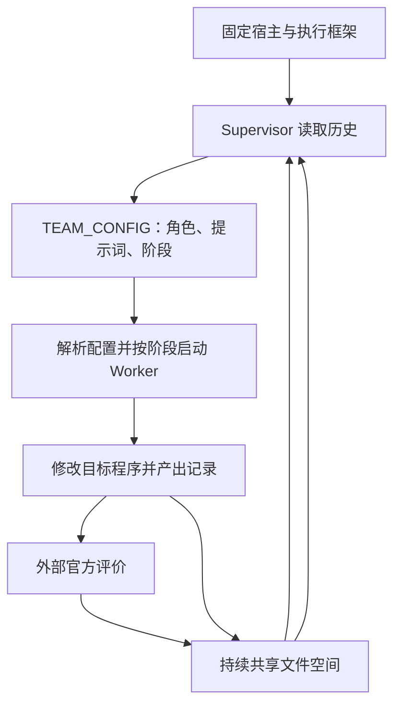

**图 3：EAT 的团队演化与目标程序演化。** 源码中 `launch_stateless.sh` 生成团队配置，`parse_team_config.py` 提取角色和阶段，`launch_team.sh` 按阶段运行 Agent，并在团队结束后调用官方评价。[R4](#ref-r4)

因此，EAT 可以归入广义 Harness/组织策略演化；`TEAM_CONFIG` 与可复用过程经验可以被封装成 Adapter 的一部分，但 **EAT 框架、其 Supervisor 更新规则、团队配置、目标程序不是同一个对象**。

EAT 论文的 MLA 消融中出现固定四角色团队 0.31×、演化团队 0.74× 的对比。该结果属于作者特定设置的实验，不能推导出任意最终团队配置跨任务都有效，也不能直接证明 ArcHa 会获益。[R3，§4.5](#ref-r3)

### 3.5 单任务改进、跨任务学习与递归自我改进

本会话采用的边界是：改进目标程序是一层；根据证据调整执行策略是另一层；将策略迁移到新任务并验证，是进一步的能力。只有更明确地界定“改进机制本身是否被改进”、资源代价和独立收益，才适合讨论更强的 RSI 主张。

EAT 的团队会变，但所查外层组织流程并不等于已证明 Supervisor 的学习算法也被递归改进。因此本文不以“实现完整 RSI”作为 ArcHa 的验收目标。也不把这当作对所有 RSI 定义的排他性裁定。

对 ArcHa 的可用抽象是：

$$
H_k=H_{\text{base}}\oplus A_k
$$

稳定底座 $H_{\text{base}}$ 承担权限、记录、执行和验收边界；$A_k$ 表示授权可变策略。$\oplus$ 仅表示组合。**共享知识更新不自动等于策略更新，策略更新也不自动等于模型训练。**

<a id="s04"></a>
## 4. 未知目标如何建立可验收的任务

### 4.1 “不知道答案”不等于“不能定义完成”

开放式 TPU 逆向可能不知道物理阵列尺寸、存储组织、DMA 通道数和队列深度；但仍可以提前定义研究用途、对象版本、可控输入、可测输出、证据要求和交付形式。

需要区分五件事：

| 要素 | 需要回答的问题 | 是否必须预知具体答案 |
|---|---|---|
| Goal | 为哪个架构或编译决策服务？ | 否，但用途应明确 |
| Scope | 研究哪个对象、版本、接口和工作负载范围？ | 应明确边界 |
| Deliverables | 最后交付模型、代码、实验、机制结论还是组合？ | 应能辨认 |
| Acceptance | 怎样证明交付有依据且适合用途？ | 应明确证据标准 |
| Method | 先研究哪个参数、采取什么实验？ | 可以交给 Agent |

数值优化中的 $\min J(\theta)$ 假定目标函数已定义。未知架构探索常常还要发现有意义的 $\theta$ 与机制类别，因此不能直接把探索压成调参任务。[R5](#ref-r5)[R6](#ref-r6)

### 4.2 可辨识性与模型边界

设可允许的输入集合为 $\mathcal X$，可观察量为 $y$。若两个结构 $h_1,h_2$ 在所有允许实验下都产生相同的可观察分布，那么在这个接口下不能唯一判定哪个内部结构为真。实际有限数据还会带来噪声、覆盖不足和弱可辨识问题。

因此必须区分：

- “当前这些实验尚未区分 H1/H2”：有限证据结论。
- “在明确限定的观测模型下可证明 H1/H2 等价”：更强的不可辨识论证。
- “真实硬件一定采用 H1”：需要能排除其他解释或直接实现证据。

不能因为多轮没测出来，就宣称在任何接口下永远无法辨识。也不能因为行为模型拟合很好，就宣称已经还原真实微架构。实验设计的理论基础在于依据研究用途选择有信息价值的观测，而非只提高已见数据的拟合程度。[R8](#ref-r8)

### 4.3 DMA/MXU 例子：从竞争解释出发

对一个可测系统，可能提出以下示意解释：H1 为搬运与计算串行，H2 为可以稳定重叠，H3 为具备重叠能力但受共享资源或队列条件限制。这不是已确认的任何 TPU 行为。

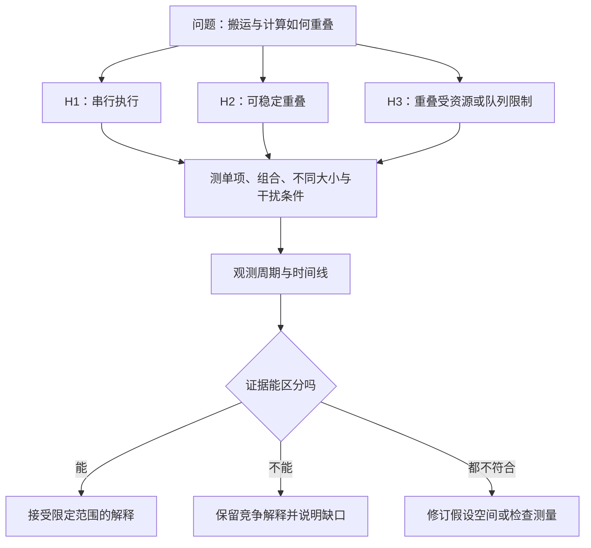

**图 4：竞争假设与区分实验。** 单项加组合测量只是起点；需要控制频率、缓存、编译产物、数据量和共享资源等混杂因素。

### 4.4 不是先列“所有参数”，而是先发现需要解释的现象

会话中的示意 GEMM 数据如下，**完全是教学构造，不是 openTPU 实测**：

| M | K | N | 执行周期 |
|---:|---:|---:|---:|
| 64 | 128 | 63 | 1,010 |
| 64 | 128 | 64 | 1,021 |
| 64 | 128 | 65 | 1,770 |

N 从 64 到 65，工作量增加约 1.56%，周期增加约 73.36%。值得提出的是“为什么有跳变”，而不是立即宣布“MXU 有 64 列”。竞争解释至少包含编译器 Tiling、计算组织、访存与排布。

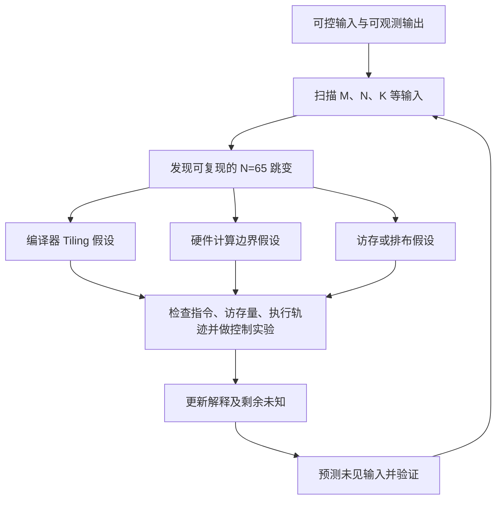

**图 5：现象驱动的问题生成。** 指令数量变化只能指导进一步调查，不能独自证明全部延迟差异的原因；指令结构不变也不能直接排除微码、内部切分或访存效应。

### 4.5 三类研究活动

**Discovery（发现）** 寻找可复现的规律、异常或有效探测手段，不强制预先有 H1/H2。阴性结果也应保存，但“没有发现”不能自动证明没有机制。

**Identification（辨识）** 对已有解释给出不同预测，用受控实验检验、排除或限定它们。允许两者均不成立、结果不确定或需要新观测。

**Validation（验证）** 在未参与形成模型的输入或独立方法上检查预测与适用范围。若验证数据被反复用于修改模型，就不再是独立最终测试，应另留封存集或说明泄漏风险。

这三类是活动类型，不是三套 Worker、不要求固定顺序，也不决定任务 Profile。LLM-AutoSciLab 的“假设—主动实验—机制更新”提供相关参考，但其实验环境与 TPU 逆向不是同一个问题。[R6](#ref-r6)

### 4.6 开放式任务的最小验收契约

一个可行表述是：在固定系统版本、允许接口和预算内，建立足以支撑指定架构决策的局部模型；关键结论有可重放证据，预测经过独立检查，无法判断的结构明确保留为未知。

验收不能要求“必须证明存在双缓冲”或“必须测得某个数值”。有效实验反驳初始设想，也可以构成研究成果。不过“实验有价值”与“本阶段交付齐全”仍是不同判断。

阶段允许以“无法识别某机制的充分证据和所需新增观测”作为一种交付，前提是合同本来允许这种结果，或经显式修订，而不是为了结束运行临时降低标准。

<a id="s05"></a>
## 5. 总体架构与组成模块

### 5.1 四个纵向阶段，三类横向能力

纵向入口保持 `archa-map → archa-task → onboard → archa-loop`。明确的工程任务可以直接进入 `archa-task`，无需先制造一张没有实际用途的研究地图。

横向贯穿的是：运行治理与账本、证据与经验空间、验证与观察能力。它们不属于某一种任务类型。

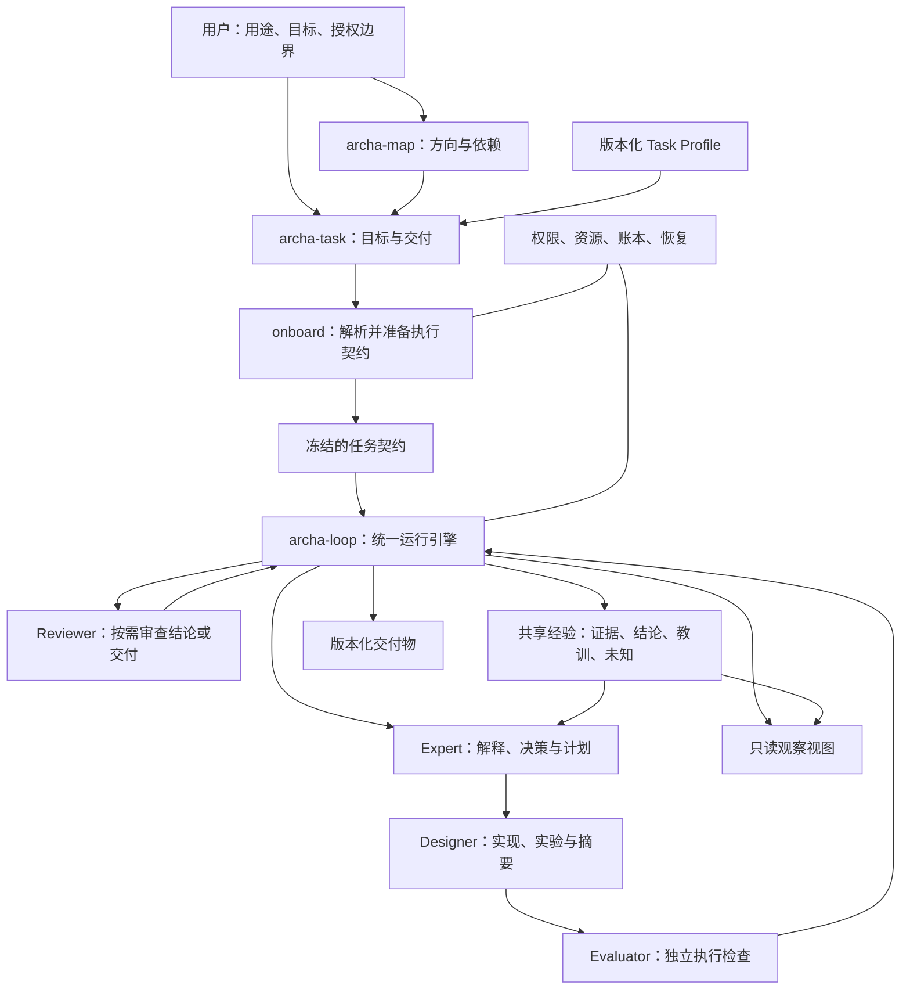

**图 6：ArcHa 总体架构。** 图中的方框是逻辑职责，不规定进程数、服务数或独立文件数。

### 5.2 组成模块及职责

| 模块 | 主要输入 | 主要输出 | 必须保留的边界 |
|---|---|---|---|
| 方向与任务定义 | 用户目标、现有材料、项目约束 | 方向图、Task Brief、依赖与未知 | 不把推测写成用户确认；不预演全部研究答案 |
| Profile 与契约解析 | Brief、模板、领域能力、资源配置 | 明确且可检查的执行契约 | 模板不能悄悄改变任务目标；只有一份有效契约 |
| 统一迭代引擎 | 契约、已保存状态、Worker 输出 | 调用、Attempt、结果接纳、停止与交付状态 | 不替 Expert 发明研究结论；不让 Worker 自己掌握权限 |
| Worker Runtime | 角色请求、上下文、可用工具 | 标准化结果、产物引用、调用用量 | 屏蔽后端调用差异，但不抹平实际能力差异 |
| 领域工具与执行环境 | 实验/开发计划、输入、版本 | 编译结果、仿真轨迹、测试数据等 | 测量接口的权限和语义明确；有失败原件 |
| 验证与评价 | 固定评价口径、候选版本、原始数据 | 检查结果、测量、证据有效性 | 不以 Worker 自报替代评价；不把程序检查当科学证明 |
| 成果累计 | 代码、数据、结论、审核结果 | 工作版本、冠军、知识更新、交付候选 | 分别处理不同产物，不简单“赢了全收、输了全删” |
| 共享经验空间 | 已登记证据、解释和经验更新 | 当前认知视图、历史来源、未知项 | 原始证据不被后续解释覆盖；冲突与过时可见 |
| 审核与交付 | 固定范围和版本的交付候选 | 审核意见、需求覆盖、交付状态 | 审核对象固定；完成不等于自动合并主分支 |
| 观察与追溯 | 账本与明确登记的产物 | 任务/运行/证据/结论视图 | 观察不偷偷执行实验，不制造新权威结论 |

这些模块之间通过少量对象与版本引用交互，不需要另建通用消息总线。它们首先是可测试的职责分界。

### 5.3 稳定底座与可演化内容

稳定底座承担文件和工具权限、预算计量、运行身份、证据归档、版本选择、暂停恢复以及交付门。可演化内容是允许范围内的下一步计划、问题表述、实验设计、局部实现方法、上下文检索策略和可复用经验。

若希望进一步演化角色提示或协作安排，应将其视为有版本的策略产物，在相同任务与成本口径下检查收益；不默认授权 Agent 修改 Engine、冻结评价器或权限制度。

### 5.4 三种状态的权威来源

运行事实、代码状态、知识状态有不同的权威来源。

运行账本记录“实际调用了谁、花了什么、运行是否结束”；版本化代码记录“哪份实现”；研究材料记录“对证据的当前解释”。观察面板和提供给模型的上下文都是这些来源的投影，不能形成第四套手工维护的真相。

共享空间中的一句“已通过”不能覆盖评价器原件里的失败；某个 Commit 也不能证明与它无关的外部实验数据已经被审核。

<a id="s06"></a>
## 6. 任务 Profile、活动类型与三类策略

### 6.1 三个默认 Profile

| Profile | 默认交付焦点 | 下一步默认依据 | 结果评价焦点 | 默认累计方式 |
|---|---|---|---|---|
| Exploration | 可检验的模型、机制结论与未知边界 | 对目标重要的不确定性 | 观测质量、区分能力、预测与推断范围 | 累计证据、主张、反证和探针 |
| Development | 满足要求的可运行交付物 | 未满足需求、依赖与工程风险 | 功能、接口、正确性、行为与指定质量条件 | 连续工作版本、测试、设计决策 |
| Optimization | 在约束内更好的候选方案 | 预期改进、瓶颈与搜索价值 | 可比较指标、硬约束、噪声与代价 | 冠军、候选档案与失败经验 |

Profile 不是“只有科研/只有写代码/只有调参数”的硬隔离。它提供合适的默认值和解释重点。本文不增加第四个 `Hybrid` Profile，因为混合活动本来就是常态。

### 6.2 三类策略

**Decision Policy：下一步做什么。** 它确定优先依据，以及 Expert 如何解释选择。探索偏重与用途有关的信息价值，开发偏重需求和依赖，优化偏重可实现的改进。但都允许诊断、实验、实现、校准、验证、整理和停止建议。

**Acceptance Policy：什么结果可被用于什么。** 它分别处理代码是否能成为工作版本、数据是否有效、结论得到多强支持、候选是否优于冠军以及是否满足最终交付。最终完成判据属于这一策略，而不是被预算或 Worker 的停止回复替代。

**Accumulation Policy：哪些成果进入后续工作。** 它决定保留哪些候选、如何组织有效结论与反证、怎样处理负结果、怎样从任务经验提炼可复用方法。保存事实与接纳结论是两件事：失败原件也应保存。

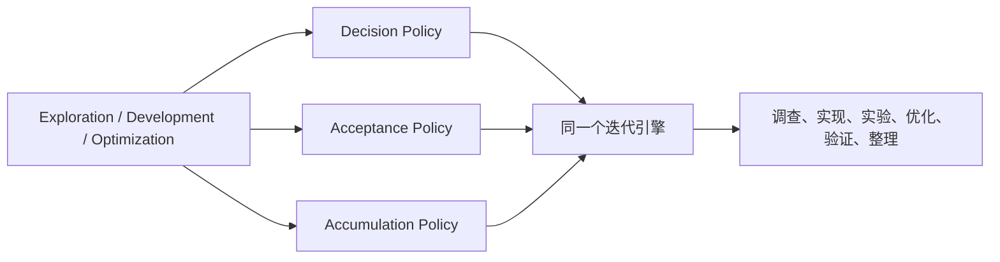

**图 7：Profile 选择策略，不选择一套独立引擎。** 三类策略是职责划分，不要求初期暴露三套可插拔编程接口。

### 6.3 Task Profile 与 Activity 的正交关系

`profile=development` 表示交付以工程完成为主；`activity=identification` 可以表示当前这一轮先辨识 DMA 背压机制。它们不冲突。

同样，优化任务可以安排“校准测量工具”，这一轮可能不产生性能收益，却能避免后续错误排名。探索任务可以实现一个重放器，但重放器测试通过不自动证明所有研究结论。

为了避免配置成为束缚，**默认优先级与授权范围必须分开**。`decision.priority` 指导选择，`scope/tools/permissions` 才定义能做什么。活动标签不是授权令牌，也不能据此越权。

### 6.4 Profile 不随每次活动切换

时序模型开发过程中先研究机制、再写代码、再降低误差，无需每轮切换 Profile。只有当交付目标或评价语义实质改变，例如从“实现模型”转为“专门优化某个性能目标”，才考虑显式修订或新任务。

切换 Profile 不能隐式重置预算、删除历史失败，或让之前不合格的结果因评价口径改变而自动变合格。新旧记录仍应区分条件和标准版本。

<a id="s07"></a>
## 7. 从 archa-map 到 archa-loop 的完整工作流程

### 7.1 总流程

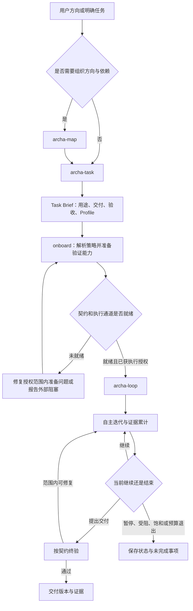

**图 8：四阶段流程。** “简报就绪”“接入就绪”“Run 已结束”“任务已完成”分别表达不同事实。

### 7.2 archa-map：确定用途与任务关系

输入是用户要解决的方向、已有系统、可用工具、已知约束和已有结论。输出是任务或问题之间的关系：哪些依赖要先解决，哪些只是备选方向，哪些被推迟，以及重开的条件。

地图不必是固定树，也不必预列全部架构参数。可以是链路、问题图或分阶段目标。每个任务应说明成果将被谁使用、帮助哪个决策，避免产生无用的“全面研究”。

Profile 在这里最多是建议，不需要马上锁定细节。一个地图包含不同类型任务是正常情况。

地图中的“简报准备完成”不能当作依赖成果已产生。例如“已写好架构辨识简报”不意味着时序模型开发已经获得真实架构证据。

### 7.3 archa-task：把方向变成可辨认的交付

Task Brief 至少说明问题与用途、目标、In/Out、交付物、验收条件、已有证据、重要未知、建议 Profile 和触发重新讨论的条件。

允许没有优化 Objective。性能模型开发可以有定量误差验收，但不要求每轮都优化一个标量。开放研究也必须说明“怎样的结论、在哪些条件下、有什么证据才可以交付”。

这一阶段要确定的是**什么算做成以及成果用在哪里**；具体微基准、假设集合、代码改动位置和后续实验顺序仍可交给 Agent。

### 7.4 onboard：将意图编译为执行契约

Onboard 负责把 Brief、Profile 和领域接口组合成可以检查的契约，补齐实际路径、输入输出、评价入口、Worker 绑定、成果入口和资源边界。

需要具备的准备能力因任务不同而不同。优化必须有可比较的评价通道和基线；开发允许功能尚未实现，只要验证和执行通道真实可用；探索至少要能获得可信观测并保留可重放原件，不能强迫它先拥有最终机制答案。

这里的“冻结”针对任务用途、验收含义、权限和必要评价方法。**不是提前冻结 Agent 未来会设计的每个实验。** 新实验可以在授权探针接口内产生；改变评价语义或越出权限时才需要修订契约。

准备过程可以构建任务必要的评价器或探针，必要时做有界环境探测。开发者自己编写的测试不因此自动成为独立最终验收，仍需明确外部参照、审核或封存检查。

Onboard 输出只证明接入准备状态，不证明目标完成，更不证明科学结论成立。

### 7.5 archa-loop：执行已经明确的任务契约

Loop 读取已解析契约、有效的 Worker/工具绑定与状态，检查执行条件，然后反复组织“决策—工作—验证—累计—反馈”。它不重新讨论用户已明确的全部要求，也不为每个正常步骤要求用户确认。

实际能力缺口应作为 `blocked` 或可修复准备问题呈现，不能假装执行成功。已关闭的 Run 不应被不加判断地无限重启，以规避预算或停止理由。

Loop 结束后交付实际状态、选定版本、证据与未解决问题。需要终验的任务以终验结果为准。交付完成与将改动合入用户分支分开。

### 7.6 变更与自主权

Agent 可自主修改下一步计划、竞争假设、探针参数、授权代码和经验解释。它不能自行降低正确性标准、扩大可读资源、改写参考答案或把独立测试集变成训练集后仍称其独立。

“未知阈值如何确定”可以先约定确定方法；但正式声称达到定量标准前，必须将其具体化并明确版本，不能看完最终成绩后临时选一个有利门槛。

<a id="s08"></a>
## 8. 统一迭代引擎与 Attempt 语义

### 8.1 一次 Attempt 的定义

**整合建议：一次 Attempt 是在一个明确任务契约和起始状态下，为推进目标而执行的一次有边界、可追溯的工作尝试。**

它可以是实现、修复、测量、诊断、独立复测、已有证据分析或知识整理。它不是“一次 Git diff”，不是“一个分数”，也不要求总会调用 Designer。

相应地：

$$
\text{AttemptResult}=(\text{执行状态},\text{代码产物},\text{观测证据},\text{解释提议},\text{验证结果},\text{资源消耗})
$$

这是结果的组成，不是要计算一个总分。

### 8.2 任务、Run、Attempt、实验与 Claim

| 对象 | 意义 | 关系 |
|---|---|---|
| Task | 稳定的用途和交付目标 | 可以有多个合同修订与 Run |
| Contract revision | 某次生效的目标、权限和验收版本 | 已执行的版本不得原地覆盖 |
| Run | 在某套执行条件下的一段连续运行 | 可以暂停恢复；引用合同与策略版本 |
| Attempt | 一次有边界的工作尝试 | 可以产生多种产物 |
| Experiment ID | 一个持续研究的问题或实验系列身份 | 可跨 Attempt/Run；不强制一一对应 |
| Execution/measurement ID | 某次实际测量或重放 | 指向具体输入、环境、原件 |
| Claim ID | 可持续修订的主张身份 | 可由多个实验支持或反对 |
| Artifact version | 一份可取回的代码、数据或文档版本 | 不能只保存摘要而丢弃内容 |

一个实验可能多轮补控制组，一次测量可能同时影响多个主张。不要把上述对象硬压缩成“第几轮”的单一编号。

### 8.3 基础执行循环

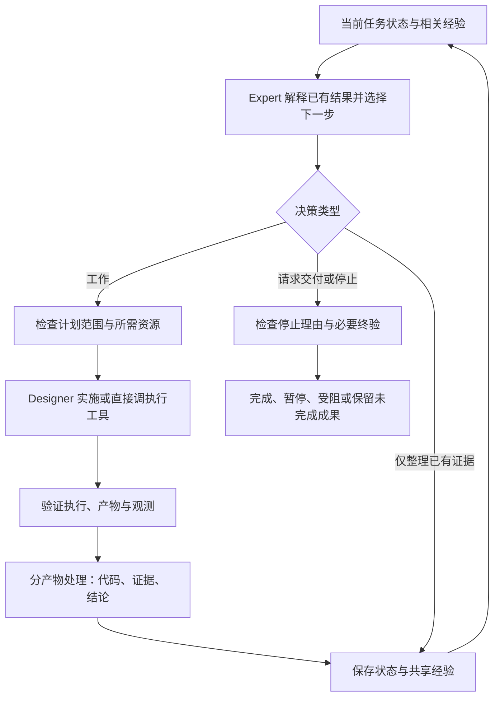

**图 9：统一引擎的最小循环。** 知识更新仍需检查来源和权限；“仅整理”不能跳过必要的科学审核。

### 8.4 分产物接纳

优化失败的候选，代码不成为 Champion，但实验数据和失败原因仍可能有用。开发中的中间代码可以成为继续工作的版本，即使尚未满足全部交付条件。一个支持性实验可使 Claim 从 `hypothesis` 变为 `supported`，而独立审核仍是 `pending`。

建议把每次尝试的接纳拆成以下语义：

| 产物 | 可能的处理 | 不得推导出的结论 |
|---|---|---|
| 代码/模型 | 保存候选、更新工作版本、更新冠军、选为交付候选 | 保存成功不等于功能完成 |
| 原始数据 | 有效、不完整、无效、待核查；全部保留实际状态 | 有数据不等于实验设计有效 |
| Claim | 待检验、有支持、被反驳、无法判定、被替代 | Expert 更新不等于独立通过 |
| 经验/方法 | 本地经验、待迁移验证、已在指定场景复用 | 某次有效不等于通用规则 |
| 最终交付 | 通过、待修复、未验证、受阻 | Run 停止不等于交付通过 |

### 8.5 两个嵌套循环

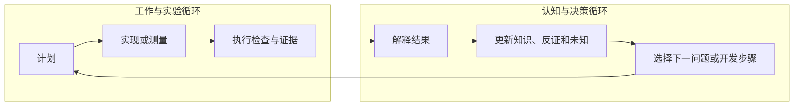

**图 10：工作循环与认知循环。** 两者不必一一对应。一次 Expert 调用可以解释上一批结果并生成下一计划；不能仅为补一段摘要默认增加一次模型调用。

### 8.6 连续状态不只有 Champion

统一状态至少要能区分“最新工作版本”“当前满足比较条件的冠军”“准备交付的选定版本”和“当前知识快照”。它们可以相同，也可以不同。

代码候选失败后可保留供修复；选择某个失败候选作为下一步起点，不等于把它晋升为冠军。知识中的有效反证不能随代码回滚而消失。

### 8.7 恢复与终止前解释

恢复必须读取实际生效的契约、已完成调用、已保存产物和控制状态。对于不确定是否完成的外部实验，应标记不确定并核查，不声称系统能自动保证外部动作“恰好一次”。重新测量必须产生新的测量身份，缓存复用必须明确标为旧观测。

如果资源耗尽时还没有机会解释最后一批数据，保存为“待分析”，不能伪造结论。若预算允许，可在原有决策调用中完成解释；这不是强制无限增加善后调用的理由。

<a id="s09"></a>
## 9. Expert、Designer、Evaluator 与 Reviewer 的组织

### 9.1 默认组织：两类主要 Worker，而非两个永久进程

本会话认可的默认组织是：Expert 负责研究/开发决策，Designer 负责实施，独立验证能力负责可核查的执行结果，Reviewer 在需要时审查重要主张或最终交付。

“两个主要 Worker”指责任角色，不要求两个模型实例永久驻留，也不要求使用不同厂商模型。不同会话、工具权限和输入边界比名称更重要；使用同一模型的独立会话，也不能声称消除了同源偏差。

| 角色 | 输入重点 | 输出重点 | 自主权 | 禁止承担的权力 |
|---|---|---|---|---|
| Expert | 目标、当前状态、相关经验、证据与未知 | 对已有结果的解释、下一步计划或停止建议 | 选问题、选方法、改假设、调整局部路线 | 无证据认证自身结论；改变最终验收标准 |
| Designer | 明确工作意图、实验设计、代码和执行权限 | 实现、探针、实际执行记录、偏差与简短摘要 | 在授权范围内定位代码、调试、选择实现细节 | 改参考答案；把自测结论冒充正式验收 |
| Evaluator | 明确版本、测试/测量口径、输入与环境 | 实测值、轨迹、检查结果、有效性信息 | 执行已授权测试、复测、结构/协议检查 | 自行决定科学机制为真；看候选成绩临时改门槛 |
| Reviewer | 指定 Claim/交付版本、原件、验收规则 | 有范围的判断、反例、缺证据与修复要求 | 定向核查与提出必要复验 | 无限制重做项目；修改被审核数据 |
| Engine | 契约、控制命令、上述结果 | 派发、记录、版本与状态处理 | 按契约执行、恢复和停止 | 以结构校验代替科学判断 |

### 9.2 Expert：研究解释与下一步决策保持在同一角色

Expert 不只是出题者，也不只是代码审查员。它负责把原始观测与当前解释分开，检查竞争假设，确认哪些结论被反驳，决定下一步最值得做什么。

默认在同一次调用中完成“解释上一批结果＋提出下一步”，避免另设一个只为总结而存在的 Agent。允许相关结论暂时待分析，不能为了清空队列仓促给出确定答案。

上下文以当前任务摘要、相关结论与证据引用为主，不把所有历史日志全部塞入提示词。但“少给原始日志”不等于不允许核查；对于会改变结论的关键点，应能按需访问授权证据，或请求有边界的核查。仅给 Designer 的自然语言摘要会造成证据瓶颈。

### 9.3 Designer：实现实验，而不是机械照抄指令

Designer 可以读取授权源码、构建工具、修复局部错误、做必要自测。计划应规定问题、控制条件、预测差异和需要的观测，而不是把每条命令都替 Designer 写死。

当实现细节变化但不影响实验含义时，记录偏差即可。例如换一种等价的日志导出方式。若变化影响对照关系、输入分布、参考版本或测量口径，就要返回说明、形成新计划版本或请求授权；不能把事后实际做法补写成事前预测。

摘要至少回答：实际完成什么、哪些命令/工具运行过、得到哪些原件、偏离哪些计划、哪里失败、还剩什么。它可以提出解释线索，但不能把解释线索当作已审核 Claim。

### 9.4 Evaluator：独立性比“必须是脚本”更重要

可以自动确定的事实尽量通过程序检查：版本、输入、退出状态、测试结果、输出范围、重复统计和必要不变量。测量本身可以有噪声，冻结评价代码不代表结果必然确定。

科学推理不能完全归约为通用确定性程序。探索任务中的验证应组合实验有效性检查、受控复测、独立预测、必要的领域判断和审核。**Evaluator 是能力边界，不是承诺存在一个无所不知的科学真值函数。**

Designer 执行探索性测量，Evaluator 在重要检查点独立重放，是可行分工；不要求所有低风险实验无条件运行两遍。哪些结果必须复测由任务契约规定。

### 9.5 Reviewer：按需而非常驻

触发点可以是重大机制结论、关键矛盾、跨任务复用前的必要检查，或最终交付。它不需要对每个代码片段和每个初步观测都启动一次。

Reviewer 应直接获得明确证据引用，不仅看到 Expert 的总结。审核结果绑定具体版本和范围；一次任务终验不自动审核每条科学主张，某条 Claim 的审核也不代表整个任务完成。

独立审核可以发现过度推断，但不能把缺失实测变成实测。多个模型一致认可，也不是硬件内部结构的直接证据。

### 9.6 交接时序

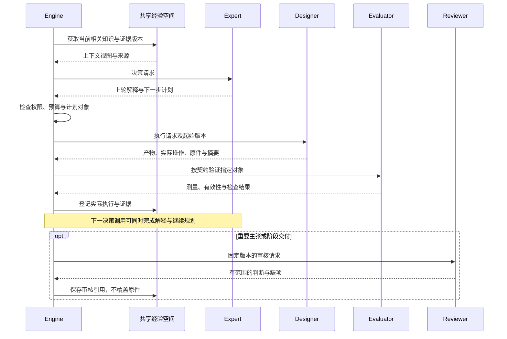

**图 11：默认角色交接。** 实际上可跳过不需要的角色，如纯分析 Attempt 不调用 Designer、纯结构检查不调用 LLM Reviewer。

<a id="s10"></a>
## 10. 共享经验空间：内容、权限、版本与认知更新

### 10.1 空间的用途

共享经验空间用于让不同 Worker 和后续 Run 建立在真实已有工作之上，避免重复实验、遗忘反证、传播错误结论和只保留最终赢家。

它不是聊天全文存档的同义词，不是只给探索任务用的论文笔记，也不是新的指令层。其内容可以影响研究判断，但不能覆盖冻结契约、权限、预算或评价规则。

### 10.2 五类核心内容

| 内容 | 回答的问题 | 例子 | 更新原则 |
|---|---|---|---|
| Evidence / Observations | 实际发生了什么？ | 输入、命令、版本、轨迹、测量、异常 | 封存后不覆盖，重跑另记 |
| Findings / Claims | 当前认为它说明什么？ | DMA 可重叠的限定结论 | 可修订，支持与反证都保留 |
| Lessons / Procedures | 哪种做法在什么条件下有用？ | 某类测量须预热；某搜索方向已失败 | 限定适用范围，迁移需验证 |
| Decisions | 为什么选择这条路线？ | 先建事件模型而非周期级模型 | 保留当时证据与取舍，不事后改写动机 |
| Open questions / Blockers | 还不知道什么、缺什么？ | 区分双缓冲和更深队列所需探针 | 可以关闭、拆分、推迟和重开 |

代码、模型和最终报告仍在它们的版本管理位置，空间保存关联，不复制所有文件。

### 10.3 证据与解释分离

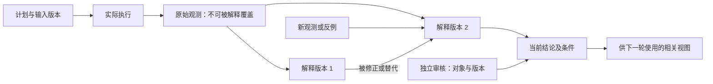

**图 12：同一证据可以产生不同解释。** 原始数据未变，不表示旧解释持续有效；旧审核也不能自动覆盖新主张。

### 10.4 一个知识条目的最小内容

一个长期引用的主张至少包括稳定身份、陈述、适用条件、支持证据、反对证据、当前判断、局限和审核引用。工程经验可以更轻，只要来源和范围清楚；不强制给每条工程笔记做完整科学分级。

以下是**示意数据结构**，不是已发生的实验结果：

```yaml
record_type: claim
claim_id: C-007
revision: 2
statement: "指定配置下，N=65 的编译结果增加了一个 Tile；它解释了部分延迟跳变"
scope:
  target_ref: "target-snapshot-01"
  compiler_ref: "compiler-snapshot-01"
  workload: "M=64, K=128, N 在 63 至 65 附近"
  observation_level: "编译产物与执行行为，不是物理阵列尺寸"
status: supported
support_refs:
  - "E-003/execution-04/compiled-program"
  - "E-003/execution-06/controlled-measurements"
contradiction_refs: []
evidence:
  level: E2
  basis: "有受控重复观测；硬件尺寸解释仍未唯一排除"
review:
  status: pending
  review_refs: []
limitations:
  - "不能据此证明 MXU 为 64 列"
  - "超出已测配置需要进一步验证"
supersedes: "C-007@1"
next_questions:
  - "固定编译策略后是否仍存在同一边界"
```

### 10.5 状态、证据等级、审核状态是三个维度

**结论状态**可以为：`hypothesis`（待检验）、`supported`（有证据支持）、`refuted`（在指定范围被反驳）、`inconclusive`（无法判定）、`superseded`（被新版本替代）。

**证据等级**沿用本会话建议，但仅作为可选经验标签：

| 标签 | 本文的操作含义 | 不能解释成什么 |
|---|---|---|
| E0 | 尚无有效经验观测的解释或构想 | 不是统一的低可信概率；严密形式证明应单独注明 |
| E1 | 初步有效观测，尚未充分检查替代解释 | 不是证明因果机制 |
| E2 | 受控实验与必要复测，关键替代解释得到检验 | 不是保证所有未列假设都被排除 |
| E3 | 再由独立方法、条件或直接实现证据交叉检查 | 不是跨场景无条件正确 |

**审核状态**为 `pending/accepted/rejected/needs_more_evidence`，并绑定审核对象、版本和范围。

这些标签不是学术界统一标准，不应作为单一排序分数，更不能映射为模型随意生成的 95% 或 99% 置信度。证据来源、实验条件和审核理由比标签更重要。高等级证据也可以强力反驳某个假设。

### 10.6 谁能写什么

Designer 可以新增自己实际产生的原件、执行摘要和候选经验；Expert 可以提交解释与主张更新；Reviewer 可以提交审核意见。引擎/主流程负责按授权规则登记和发布，防止多个 Worker 同时覆盖同一个当前事实。

只有掌握相应结果的组件才能设置其状态。例如 Expert 可提议 `supported`，不能把 `review.status` 自己改为 `accepted`。程序可以检查引用存在、版本匹配和权限，不能仅凭字段齐全保证主张为真。

初期采用单写入者或明确收尾责任即可，不需要分布式知识库事务系统。

### 10.7 修正、冲突与失效

当新证据反驳旧 Claim，保留旧版本与来源，记录修正原因。依赖它的下游结论需要标记“需重审”，但不机械宣称下游全部为假。仅修正文案不改变含义时，不必重做全部实验。

原始证据、推断过程和审核范围都要能取回。哈希只标识内容，不能代替实际存储。一个可变索引的当前路径也不足以定义过去审核过的对象。

来源有版本变化，不代表所有历史知识都失效；应判断变化是否影响结论的适用条件。反过来，UI 改版不影响旧测量，评价方法改了则可能影响比较。

### 10.8 供 Worker 使用的是相关视图，不是整库注入

默认上下文包含任务目标、当前工作状态、相关有效结论、有关反证、未解决问题和原件入口。按问题进一步读取，不把全部轨迹、完整代码库、历次审稿意见一次塞满。

视图必须标明哪些正文未展开，哪些来源缺失，哪些结论尚未审核。不能因为篇幅截断只留下结论、删去条件和反例。

### 10.9 从任务经验到可复用策略

可复用经验的提升路径是：任务中发现做法有用 → 记录条件与证据 → 在新任务或独立样本上尝试 → 标记已验证的迁移范围 → 必要时封装为 Skill/Adapter。

这条路径连接 Hermit 的适配思想与 EAT 的持续经验，但不要求每份任务总结都进入全局技能库。任务专有数值和未确认机制不应伪装成普适策略。[R1](#ref-r1)[R3](#ref-r3)

<a id="s11"></a>
## 11. 验证器、结果接纳与最终验收

### 11.1 验证不是一个万能评分器

本方案将验证分为四层，任务可按需要组合，而不是每步全部启动。

| 层 | 验证对象 | 典型手段 | 能证明的范围 |
|---|---|---|---|
| L1 执行与契约 | 是否在允许环境执行、记录是否完整 | 权限、版本、命令、退出状态、原件检查 | 执行事实与合规性 |
| L2 产物与测量 | 实现是否工作、观测是否有效 | 功能测试、对照、重放、复测、单位检查 | 指定测试与测量条件下的结果 |
| L3 推断与主张 | 证据是否支持解释、是否遗漏竞争解释 | 独立预测、定向审核、不同方法交叉检查 | 限定范围的结论与未知边界 |
| L4 任务交付 | 是否满足完整用途、范围和要求 | 需求覆盖、独立验收、交付审核 | 本阶段任务是否完成 |

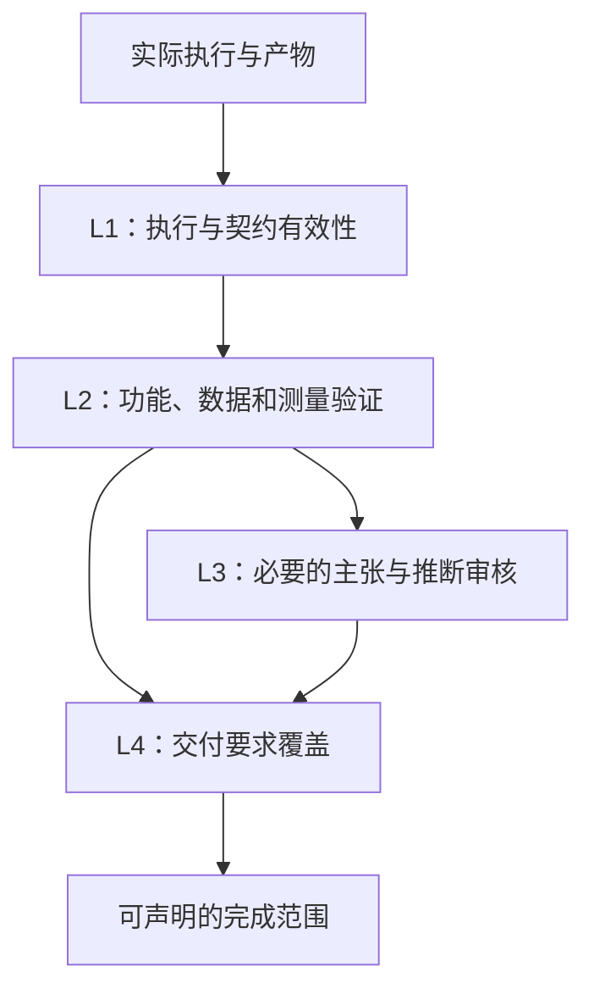

**图 13：分层验证。** 图表示依赖关系，不强制每次 Attempt 走完所有层。

### 11.2 研究结果的三种判断

会话中提出的 `Accepted / Rejected / Inconclusive` 适合表达一次研究解释的受理结果：证据足以支持限定主张、证据否定或推理不成立、现有证据不能判定。

但还需要分开“实验是否有效”。例如执行崩溃产生 `invalid/incomplete` 的测量，不能直接把 H1 标成 `refuted`；有效实验得到阴性结果，则可能反驳 H1 并形成有价值的证据。

因此同一结果可以是：实验有效，假设被反驳，研究进展成立，但整个任务仍未完成。

### 11.3 探索中怎样固定验证，又不固定实验路线

提前固定的是测量语义、记录要求、权限、评价独立性、证据标准和交付标准。每轮由 Agent 动态设计的是输入、对照、探针实现和假设检验。

例如在黑盒 TPU 任务中，参考执行器、计时定义和保留结果的接口固定；Agent 可动态生成 GEMM Shape 和组合实验。验证器检查实际使用的输入、目标版本和观测，不要求所有 Shape 事前写成一个冻结列表。

新增探针应先检查自身是否测量了预期对象。对会改变结论的重要探针，使用已知合成系统、控制组或独立复验来检验它，而不是“脚本返回 0 就算证据”。

### 11.4 工程开发与优化的不同标准

开发可保存尚不完整的工作版本，但最终需通过必要要求。优化候选只有在评价条件可比、硬约束满足、改善超过已约定噪声或容差规则时才成为冠军；一次无收益尝试仍可留下有用经验。

时序模型开发尤其要分清：被开发的模型是候选产物，RTL/独立参考和比较协议是评价依据。不能让候选模型生成自己的“真值”再证明自身准确，也不能把调整参考周期当作模型校准。

### 11.5 审核和 Hold-out 的独立性

独立审核要固定对象与证据版本；独立测试要说明是否曾反馈给开发过程。若 Agent 已反复根据某组测试修正方案，应将其视为开发/验证集，不再用它独自证明泛化。

对于架构逆向，源码事实、RTL 仿真和板级实测证据也不能混淆。功能 ISA Simulator 可以提供语义参考，但未校准的时序输出不能自动成为硬件周期真值。

### 11.6 完成证据不能被伪造为标量

不以“文档完整度 100”“问题回答数 20”“已运行实验 30”代替科学或工程验收。这些可以描述工作量，却不能证明正确性或价值。

同理，只有性能数值也不够：需要正确性、评价口径和适用范围。无数值 Objective 不等于无数字；有数字也不等于只能数值排名。

<a id="s12"></a>
## 12. 下一步如何选择、何时停止

### 12.1 研究价值不等于信息量

下一步应与任务用途相关。精确推断某个很少影响目标负载的流水级数，可能不如判断 DMA/MXU 是否可重叠对编译调度有价值。

建议 Expert 用短而可审查的理由回答四个问题：解决它会改变哪个决策？可能结果能区分或暴露什么？当前能否执行？相比其他可行选择，成本是否合适？不要求对所有候选填庞大的评分表。

开发任务可把同一问题改写为“消除哪个需求缺口或依赖”；优化任务改写为“验证哪个瓶颈或改进机会”。

### 12.2 信息增益与决策价值：理论参考而非强制算法

有明确概率模型时，可用预期信息增益表达实验价值：

$$
\operatorname{EIG}(e)=\mathbb{E}_{y\mid e,K}\left[D_{\mathrm{KL}}\bigl(p(H\mid y,e,K)\|p(H\mid K)\bigr)\right].
$$

它衡量信息变化，不自动等于工程效用。需要考虑后续决策时，可以比较实验后最优决策的期望效用与不实验的效用，再减成本。这种区分属于最优实验设计的决策论视角。[R8](#ref-r8)

本文不要求 ArcHa 为所有任务建立后验分布、实现贝叶斯优化器或强制计算一个加权总分。没有可靠概率与效用模型时，Expert 应给出可检查的定性选择依据，不能编造“信息增益 0.83”。

### 12.3 局部选择的最小输出

一次计划可附：当前问题、为什么重要、与一个主要备选相比为何优先、哪些结果会改变下一步、主要成本或风险。首次扫描没有竞争假设时，可以说明覆盖的未知区域与预期发现方式。

这不是要求展示模型内部思维过程，而是要求对外可审查的决策理由和实验预测。

### 12.4 停止原因与完成状态分别表达

| 停止/转交原因 | 含义 | 能否直接宣称目标完成 |
|---|---|---|
| completed | 约定范围的必要交付通过验收 | 可以，但只限已验收范围 |
| saturated | 当前路线在现有手段下缺乏值得做的后续工作 | 不可以自动宣称全部任务完成 |
| blocked | 重要工作需要当前缺失的接口、资源或权限 | 不可以 |
| budget_exhausted | 明确预算已耗尽 | 不可以 |
| paused / user_stopped | 用户控制或运行暂停 | 不可以 |
| inconclusive_delivery | 合同允许的“结论仍不确定”交付已满足证据要求 | 仅可声明该类交付完成，不能称机制已识别 |

状态的具体枚举是本文接口建议。关键不在英文名称，而在系统不把原因混为一谈。

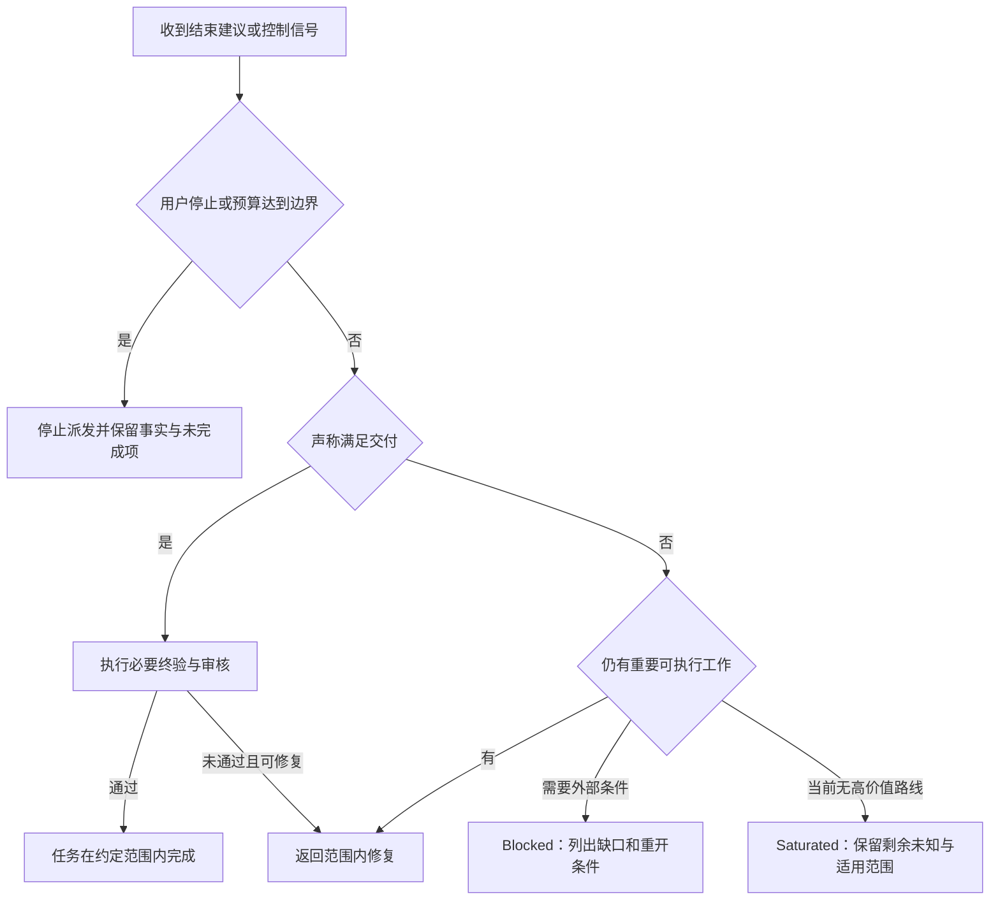

**图 14：停止不是完成的同义词。** 按合同允许的未决交付，可以进入终验；不能运行中临时发明这种豁免。

### 12.5 不以连续无收益简单判定研究收敛

连续几轮无性能提升，可能仍在建立能力、修复测量或排除关键解释。反过来，持续写入新文字也不意味着持续进步。

平台期可以触发检查：是否重复低价值实验、测量不敏感、缺必要观测、上下文丢失、团队分工不合适、现有假设空间过窄。EAT 的诊断式团队调整是相关启发，不意味着 ArcHa 每遇平台期都必须增加 Worker。[R3](#ref-r3)[R4](#ref-r4)

### 12.6 有限阶段的完成

“逆向所有真实硬件”通常不是一个合适的有限验收表达。可以限定为特定工作负载和接口下的 GEMM 与数据搬运行为模型，要求解释关键现象、对独立案例有用、明确未知边界。

没有新问题可提出，只说明当前策略的局限；目标是否完成，要由交付证据决定。理论上的最优停止比较结束收益与继续价值，但依赖模型和效用设定，不是通用终止真值。[R9](#ref-r9)

### 12.7 预算原则

本会话强调资源边界和可计量性，并不意味着替用户凭空设置固定 Token 或时间额度。配置可保留 `null` 表示该维度未设置上限，仍要记录实际消耗、响应暂停和真实外部限制。

若用户设置了某个硬上限，而该项用量无法可靠获知，应明确暂停/阻塞条件，不能用猜测的 0 表示未知。另开 Run 不能清空同一授权任务的累计消耗。

<a id="s13"></a>
## 13. 配置体系与完整配置示例

### 13.1 配置的作用与范围

**本章为整体方案的接口补全。全部格式是建议 Schema，不是当前 ArcHa 已发布的配置格式。** 示例中的路径、Gate、目标快照和阈值引用用于说明关系；接入真实项目时必须解析为实际存在且经过核对的资源。

配置应表达任务的用途、授权、默认策略、验证和成果关系，而不是把整个 Agent 思考过程写成一份节点图。

建议保留四类逻辑配置：

| 配置 | 维护者 | 内容 | 是否由运行时任意修改 |
|---|---|---|---|
| Profile 模板 | 框架/模板维护者 | 三类策略的默认值与说明 | 否；版本化引用 |
| Task 配置 | 用户讨论结果经 Task/Onboard 整理 | 目标、范围、交付、验收、任务特有覆盖 | 执行中实质变更要形成新修订 |
| 本机运行绑定 | 部署者或授权准备流程 | 后端、工具路径、凭据引用、明确资源限制 | 依变更性质记录；不能放宽用户硬边界 |
| 已解析契约快照 | Onboard/Engine 自动生成 | 本 Run 实际采用的全部生效值与来源版本 | 冻结，不人工维护第二份相同事实 |

Task Brief 是意图说明，Task 配置是可执行表达。二者应能建立明确来源映射；出现冲突时不能让 runtime 随机猜测。运行以已解析契约为准，新的意图要显式更新契约。

### 13.2 解析顺序与权限规则

普通默认值按“模板默认 → 任务覆盖 → 已允许的环境绑定”解析。权限与资源不采用“最后一个覆盖一切”的规则：用户或项目的硬限制优先，任务只能在已授权范围内选择；显式上限合并时不得因某处 `null` 而被取消。

目标、评价、角色与工具入口中的引用必须可解析。开启正式验证时，必需的阈值、输入和判断口径不能仍是未知。若任务本身是“确定阈值的方法”，应将这件事作为交付，而非假装阈值已经生效。

只冻结会影响执行和解释的必要身份：目标版本、评价口径、输入分布/数据版本、策略版本和资源条件。不要为了导航文件变化就重跑所有实验。

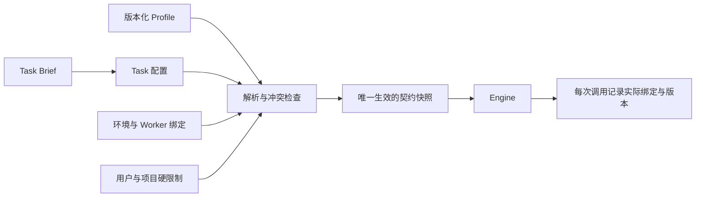

**图 15：配置解析关系。** 生成快照不是新增一份需要用户重复填写的配置。

### 13.3 Profile 模板示例

以下单个 YAML 展示三个默认模板。`activities` 是默认工作类型提示，不是文件或工具授权；实际授权由任务 Scope 决定。

```yaml
schema_version: archa.design/1
kind: profile_catalog
profiles:
  exploration@1:
    policies:
      decision:
        priority: relevant_uncertainty
        activities: [investigate, implement, experiment, validate, consolidate]
      acceptance:
        code: snapshot
        evidence: validity_checked
        claims: evidence_bound
        delivery: requirements_and_required_reviews
      accumulation:
        code: candidate_archive
        experience: task_scoped
    knowledge:
      evidence_grading: optional
    review:
      default_triggers: [major_claim, final_delivery]

  development@1:
    policies:
      decision:
        priority: requirement_progress
        activities: [investigate, implement, experiment, optimize, validate, consolidate]
      acceptance:
        code: working_version
        evidence: validity_checked
        claims: evidence_bound
        delivery: requirements_and_required_reviews
      accumulation:
        code: working_history
        experience: task_scoped
    knowledge:
      evidence_grading: optional
    review:
      default_triggers: [final_delivery]

  optimization@1:
    policies:
      decision:
        priority: expected_improvement
        activities: [investigate, implement, experiment, optimize, validate, consolidate]
      acceptance:
        code: objective_improvement
        evidence: validity_checked
        claims: evidence_bound
        delivery: requirements_and_required_reviews
      accumulation:
        code: champion_and_archive
        experience: task_scoped
    knowledge:
      evidence_grading: optional
    review:
      default_triggers: [final_delivery]
```

其中 `snapshot` 只表示保存，不排名；`working_version` 允许保留未完成的开发进展；`objective_improvement` 要求真实 Objective 和可比较评价；`claims: evidence_bound` 表示结论须带依据，不表示每条都要调用 Reviewer。

模板的 Reviewer 触发只是默认。Onboard 应将哪些对象需要审核具体化，普通开发笔记不因为用了相同模板就强制逐条审核。

### 13.4 开发任务配置：时序对齐模型

这个例子以“交付可运行模型”为主，而不是要求每次迭代必须降低误差。

```yaml
schema_version: archa.design/1
kind: task
id: timing-model
revision: r0001
profile: development@1
purpose: "为描述符调度与瓶颈分析提供可信的时序预测"
goal: "交付指定范围内可执行、可重放且经独立案例验证的事件驱动模型"

inputs:
  baseline_ref: "baseline-snapshot"
  reference_manifest: "references/rtl-traces/manifest.json"
  supported_cases: "contracts/timing-cases.yaml"

scope:
  editable: ["model/**", "tests/development/**", "experiments/**"]
  read_only: ["references/**", "validation/**", "contracts/**"]
  tools: [python_runner, trace_reader, reference_replay]
  forbidden: [modify_reference, relax_acceptance, publish_without_authorization]

deliverables:
  - id: D1
    description: "可执行时序模型及其输入输出契约"
  - id: D2
    description: "开发测试、独立重放结果与差异分析"
  - id: D3
    description: "适用范围、已支持机制与未解决问题"

requirements:
  - id: R1
    criterion: "支持范围内的描述符与依赖语义"
    verification: {kind: gate, ref: descriptor_semantics}
  - id: R2
    criterion: "事件重放满足约定的顺序和依赖不变量"
    verification: {kind: gate, ref: trace_replay}
  - id: R3
    criterion: "独立案例误差满足已确认的用途相关标准"
    verification: {kind: gate, ref: timing_accuracy}
  - id: R4
    criterion: "交付说明与实际覆盖一致，不把未知机制宣称为已实现"
    verification: {kind: review, ref: delivery_scope}

evaluation:
  objective: null
  gates:
    - id: descriptor_semantics
      command: [python, validation/check_semantics.py]
    - id: trace_replay
      command: [python, validation/check_trace_replay.py]
    - id: timing_accuracy
      command: [python, validation/check_accuracy.py]
      criteria_ref: "contracts/timing-acceptance.yaml"
  frozen_resources: ["validation/**", "contracts/**", "references/**"]

knowledge:
  entry: "research/timing-model/README.md"
  kinds: [evidence, findings, lessons, decisions, open_questions]

review:
  triggers: [final_delivery]
  scopes:
    delivery_scope: [R4]

completion:
  required: [R1, R2, R3, R4]
  allow_inconclusive_delivery: false
  automatic_publish: false
```

这里没有臆造统一的 5% 误差阈值。`timing-acceptance.yaml` 必须在正式判断前实际存在并明确误差定义、范围、统计口径与阈值。示例本身并未创建这些文件。

### 13.5 优化任务配置：编译器调度

```yaml
schema_version: archa.design/1
kind: task
id: compiler-schedule
revision: r0001
profile: optimization@1
purpose: "在正确性和硬件资源限制内改进编译调度"
goal: "形成在指定工作负载上可复核的更优调度候选"

scope:
  editable: ["compiler/schedule/**", "experiments/**"]
  read_only: ["validation/**", "references/**", "workloads/**", "target/**"]
  tools: [compiler_runner, target_executor, correctness_checker]
  forbidden: [modify_reference, relax_acceptance]

evaluation:
  objective: {metric: latency_cycles, direction: minimize}
  comparability_ref: "contracts/schedule-measurement.yaml"
  improvement_rule_ref: "contracts/schedule-noise-rule.yaml"
  hard_constraints: [correctness, memory_capacity, dependency_safety]
  gates:
    - {id: correctness, command: [python, validation/correctness.py]}
    - {id: memory_capacity, command: [python, validation/memory.py]}
    - {id: dependency_safety, command: [python, validation/dependencies.py]}
    - {id: performance, command: [python, validation/performance.py]}
  frozen_resources: ["validation/**", "references/**", "workloads/**", "target/**", "contracts/**"]

requirements:
  - id: R1
    criterion: "必要正确性与资源门通过"
    verification: {kind: gates, refs: [correctness, memory_capacity, dependency_safety]}
  - id: R2
    criterion: "收益符合冻结的测量和改善规则"
    verification: {kind: gate, ref: performance}
  - id: R3
    criterion: "报告明确工作负载范围、成本与未改善案例"
    verification: {kind: review, ref: optimization_report}

knowledge:
  entry: "research/compiler-schedule/README.md"
  kinds: [evidence, lessons, decisions, open_questions]

review:
  triggers: [final_delivery]
  scopes:
    optimization_report: [R3]

completion:
  required: [R1, R2, R3]
  allow_inconclusive_delivery: false
  automatic_publish: false
```

如果用户没有指定最低改善或终止目标，应在任务定义中明确是“寻找满足条件的改进”还是“交付预算内最好结果”。后者可以完成预算限定的交付，但不能改写为已经达到全局最优。

### 13.6 探索任务配置：未知架构辨识

```yaml
schema_version: archa.design/1
kind: task
id: architecture-discovery
revision: r0001
profile: exploration@1
purpose: "辨识会影响 GEMM 与数据搬运建模的可观测机制"
goal: "交付范围受限、可预测、可证伪且标明未知边界的行为模型"

inputs:
  target_api_ref: "interfaces/blackbox-target.yaml"
  observation_protocol_ref: "contracts/measurement-protocol.yaml"

scope:
  editable: ["probes/**", "analysis/**", "behavioral-model/**"]
  read_only: ["interfaces/**", "contracts/**"]
  tools: [compile_blackbox, execute_blackbox, read_observations]
  forbidden: [read_hidden_rtl, read_hidden_target_configuration, modify_oracle, relax_acceptance]

requirements:
  - id: R1
    criterion: "重要观测有可重放输入、环境和原始记录"
    verification: {kind: gate, ref: evidence_replay}
  - id: R2
    criterion: "模型在独立输入上达到预先确定的用途相关预测标准"
    verification: {kind: gate, ref: heldout_prediction}
  - id: R3
    criterion: "关键解释区分证据、推断、竞争解释与未知范围"
    verification: {kind: review, ref: scientific_scope}
  - id: R4
    criterion: "未决交付满足预先约定的研究覆盖、证据边界与新增观测说明"
    verification: {kind: review, ref: unresolved_scope}

evaluation:
  objective: null
  dynamic_probes: {allowed: true, protocol_ref: "contracts/measurement-protocol.yaml"}
  gates:
    - {id: evidence_replay, adapter: evidence_replay}
    - id: heldout_prediction
      adapter: heldout_prediction
      criteria_ref: "contracts/prediction-criteria.yaml"
  hidden_validator_ref: "validator-binding"
  frozen_resources: ["interfaces/**", "contracts/**"]

knowledge:
  entry: "research/architecture-discovery/README.md"
  kinds: [evidence, findings, lessons, decisions, open_questions]
  evidence_grading: optional

review:
  triggers: [major_claim, final_delivery]
  scopes:
    scientific_scope: [R3]
    unresolved_scope: [R4]

completion:
  required: [R1, R3]
  routes:
    - {id: predictive_model, required: [R2]}
    - {id: bounded_inconclusive, required: [R4]}
  allow_inconclusive_delivery: true
  inconclusive_criteria_ref: "contracts/unresolved-delivery.yaml"
  automatic_publish: false
```

隐藏真值的绑定只能由可信验证侧解析，不能把隐藏源码路径展开进 Expert/Designer 的上下文。`completion.required` 表示公共要求；存在 `routes` 时，还必须通过其中一条已获授权的交付路径，并明确交付的是哪条路径。预测模型路径要求 R2；受限未决路径要求 R4，不把预测失败伪装成模型成功。`allow_inconclusive_delivery` 不是后门：其标准必须说明允许交付的未决范围、已完成研究和所需新增观测；仅列“还不知道”不能通过。

### 13.7 Worker 与本机资源绑定

```yaml
schema_version: archa.design/1
kind: runtime_bindings
workers:
  expert:
    backend: configured_agent
    model_ref: "env:ARCHA_EXPERT_MODEL"
    permissions: [read_task_context, read_allowed_evidence, propose_work]
  designer:
    backend: configured_agent
    model_ref: "env:ARCHA_DESIGNER_MODEL"
    permissions: [read_assigned_sources, edit_authorized_paths, run_authorized_tools]
  reviewer:
    backend: configured_agent
    model_ref: "env:ARCHA_REVIEWER_MODEL"
    permissions: [read_review_scope, request_targeted_verification]

tools:
  python_runner: {executable_ref: "env:ARCHA_PYTHON"}
  reference_replay: {binding_ref: "local:reference-replay"}
  blackbox_target: {binding_ref: "local:blackbox-target"}

budget:
  max_tokens: null
  max_wall_seconds: null
  max_usd: null
  max_measurements: null

credentials:
  source: environment_or_secret_store
```

本机配置不包含明文密钥。模型/工具的实际身份和版本应记录在每次调用中。更换模型不会自动使所有代码事实失效，但会影响对 Harness 效果和费用的比较，必须保留对应条件。

### 13.8 配置必须表达的不变量

优化排名不得缺少真实 Objective 和评价依据；没有数值排名需求的任务不得被迫填虚构分数。只要宣称某条要求已完成，就必须有对应检查或审核证据。

模板和任务覆盖不能把冻结参考变成可写，不能在不存在验证器时填 `passed`。`review=accepted` 必须来自实际审核记录。隐藏接口不得向研究 Worker 泄漏真值。

以上不变量可以通过结构检查和实际准备检查组合保证。JSON/YAML 语法正确，只证明文件可解析，不证明任务或研究设计正确。

### 13.9 推荐的轻量文件组织

以下是逻辑示例，不要求迁移现有项目材料：

```text
project/
  source/ 或现有项目源码/              目标产物
  validation/                          任务明确冻结的评价资源
  references/                          参考数据与环境说明
  experiments/ 或 probes/              授权可变化的实验实现
  research/<task-id>/
    README.md                          当前成果、条件、未知、原件入口
    findings.md                        结论较多时再拆；否则留在 README
    lessons.md                         确有需要时保存可复用经验
  .opc/
    profiles/                          版本化默认模板
    tasks/<task-id>/<revision>/task.yaml 任务输入配置
    local/runtime.yaml                 本机绑定；不存明文密钥
    local/runs/<run-id>/
      resolved-contract.json           自动生成的生效快照
      attempts/                        计划、调用记录、评价和产物引用
      reviews/                         实际产生的审核，不造占位回执
      ledger                           运行事实的唯一权威来源
```

物理路径可以不同。原则是原件不搬来搬去、同一事实不多处手填、不为每条 Claim 强制创建一个文件。一个简短 README 加现有原件链接即可成为最小共享空间。

<a id="s14"></a>
## 14. Worker 接口与交接消息

### 14.1 接口目标

**本章是为完整交接而提出的接口设计，不是现有 `Worker` 类的逐行描述。** 接口应与具体后端解耦，能明确回答：谁收到什么、被允许做什么、产生什么、证据在哪里、下一步由谁接管。

“统一接口”不意味着所有角色都必须返回一样的宽 JSON。建议使用公共消息信封加按角色区分的 Payload；不适用字段省略或显式 `null`，不能用假数据填满表格。

### 14.2 公共请求与结果信封

| 字段 | 含义 | 要求 |
|---|---|---|
| `schema_version` | 消息协议版本 | 能识别不兼容变化 |
| `call_id` | 单次调用身份 | 与费用、日志、返回结果关联 |
| `task_id / run_id / attempt_id` | 工作所属对象 | 不用自然语言标题代替稳定关联 |
| `role / kind` | 责任角色与调用类型 | 例如 `expert.decide`，不是可执行任意代码的路由字符串 |
| `contract_ref` | 本次生效契约 | 指向可取回的冻结版本 |
| `context_ref` | 实际提供的上下文快照 | 包含来源、截断和缺失情况 |
| `input_refs` | 任务需要的代码、证据等 | 按角色权限投影，不展开隐藏材料 |
| `output_scope` | 允许生成的产物位置与类型 | 与运行沙箱或权限实际一致 |
| `limits` | 此次调用边界与剩余资源 | 不能重置总任务预算 |
| `payload` | 角色特定输入/输出 | 使用对应约定 |

返回信封另有 `status`、`artifact_refs`、`usage`、`error`。`status` 表示调用执行，不直接表示任务完成或科学正确。

```yaml
schema_version: archa.design/1
kind: expert.decide.request
call_id: call-041
task_id: architecture-discovery
run_id: run-003
attempt_id: a-017
role: expert
contract_ref: "contracts/architecture-discovery/r0001/resolved"
context_ref: "run-003/a-017/context"
input_refs:
  - "knowledge/architecture-discovery/snapshot-12"
  - "run-003/a-016/result"
output_scope:
  kinds: [work_plan, claim_update_proposal, stop_proposal]
limits:
  remaining_tokens: null
  remaining_wall_seconds: null
payload:
  request: "解释相关的新证据，选择下一项有价值的工作或提出有依据的结束建议"
```

此处使用的是逻辑引用，落地时可以映射为路径或对象键；并不要求专门的 URI 服务。

### 14.3 Expert 接口

逻辑签名为：

```text
Expert.decide(TaskContext) -> ExpertDecision

ExpertDecision =
  Continue(work_plan, optional_knowledge_updates, rationale)
  | Stop(stop_proposal, optional_knowledge_updates)
  | RequestContractChange(reason, affected_scope)
```

`RequestContractChange` 不能立即执行变更。它说明为何原授权不足，以及影响哪些条件；普通方法调整仍直接走 `Continue`。

`TaskContext` 应包含任务用途、有效契约、选定代码状态、相关经验与反证、近期结果、剩余资源、未验证要求和可用工具能力。不必包含全部原始日志，但来源应可定位。

`WorkPlan` 的核心字段如下：

| 字段 | 作用 | 适用范围 |
|---|---|---|
| `work_item_id` | 本次工作身份 | 所有计划 |
| `activity` | 实现、实验、验证、诊断或整理 | 所有计划 |
| `research_mode` | discovery / identification / validation | 需要时填写，不强迫普通开发 |
| `objective` | 本步要改变或弄清什么 | 所有计划 |
| `related_requirements / questions` | 与最终任务的关系 | 有关联即可，不造假编号 |
| `base_ref` | 实际代码或模型起点 | 产生代码/模型时 |
| `experiment_id` | 持续实验问题身份 | 实验及关联分析 |
| `hypotheses / predictions / falsifier` | 竞争解释与可证伪性 | 机制辨识或有假设的工作 |
| `controls / inputs / observations` | 控制条件、输入与需要的观测 | 实验 |
| `intended_artifacts` | 期望产物类型 | 所有计划 |
| `verification_request` | 需要哪些检查 | 依据任务契约 |
| `rationale` | 为什么选它、主要风险与替代项 | 简短可审查说明 |

示意 Expert 输出：

```yaml
schema_version: archa.design/1
kind: expert.decide.result
call_id: call-041
status: completed
payload:
  decision: continue
  knowledge_updates:
    - claim_id: C-007
      expected_revision: 1
      proposed_status: inconclusive
      basis_refs: ["run-003/a-016/evaluation"]
      explanation: "现有数据尚不能把编译切分与共享资源影响区分开"
  work_plan:
    work_item_id: W-017
    activity: experiment
    research_mode: identification
    experiment_id: E-003
    objective: "检查性能跳变是否随编译切分变化而变化"
    base_ref: "probe-snapshot-06"
    hypotheses:
      - id: H1
        statement: "跳变主要由额外 Tile 引起"
      - id: H2
        statement: "固定编译切分后仍存在独立的执行或访存边界"
    controls:
      - "固定 M、K、dtype、目标版本和计时定义"
      - "记录实际编译产物，不能只比较源代码形状"
    inputs:
      N_values: [63, 64, 65, 66]
    observations: [compiled_tiles, memory_traffic, execution_cycles]
    predictions:
      H1: "改变切分边界时主要跳变应随之变化"
      H2: "控制切分后仍可能保留独立跳变；需进一步排除访存混杂"
    falsifier: "控制条件有效但各假设预测均不符合时，修订解释而非强选赢家"
    intended_artifacts: [probe_code, raw_observations, execution_summary]
    verification_request:
      gate_refs: [evidence_replay]
    rationale: "此问题直接影响模型的切分项，且目前能用已有接口进行受控检查"
usage:
  input_tokens: null
  output_tokens: null
  cached_input_tokens: null
  cost_usd: null
```

示例用量为 `null` 表示示例未实际调用，不是假设免费。实际运行应写入后端报告的计数。

### 14.4 Designer 接口

逻辑签名为：

```text
Designer.execute(WorkPlan, ExecutionContext) -> ExecutionResult
```

`ExecutionContext` 包含授权工作目录、起始版本、工具能力、写入范围、原件输出位置和必要任务背景。完整验收参考可由可信验证侧使用；受限研究 Worker 不应获得隐藏答案。

`ExecutionResult` 应包括以下内容：

| 字段 | 内容 |
|---|---|
| `execution_status` | completed / partial / failed / blocked |
| `actual_actions` | 实际命令或工具调用引用，不能只写计划 |
| `artifact_refs` | 代码 Patch/快照、探针、数据、报告 |
| `observation_refs` | 原始观测的定位 |
| `local_checks` | 自测结果与对应日志，不冒充终验 |
| `deviations` | 计划与实际的差异及影响 |
| `summary` | 简短说明完成、失败与尚未完成部分 |
| `requested_followup` | 需要进一步判断或复验的具体事项 |

示例：

```yaml
schema_version: archa.design/1
kind: designer.execute.result
call_id: call-042
status: completed
payload:
  execution_status: completed
  actual_actions:
    - "run-003/a-017/execution/commands.jsonl"
  artifact_refs:
    - {kind: code_snapshot, ref: "probe-snapshot-07"}
    - {kind: compiled_programs, ref: "run-003/a-017/programs"}
  observation_refs:
    - "run-003/a-017/raw/measurements.json"
  local_checks:
    - {name: probe_output_schema, status: passed, evidence_ref: "run-003/a-017/local-check"}
  deviations: []
  summary: "完成指定输入的探测并保存编译产物与周期记录；机制结论待证据分析"
  requested_followup:
    - "按既定重放协议检查观测可复现性"
```

`status: completed` 只说明调用返回了规定结果，不表示这个研究问题已经解决。

### 14.5 Evaluator 接口

逻辑签名为：

```text
Evaluator.evaluate(VerificationRequest) -> EvaluationResult
```

请求应固定候选、评价方法、输入范围、参考版本、重复或采样口径，以及输出位置。返回至少包括检查结果、实际测量、环境、原件、是否复用缓存和有效性说明。

```yaml
schema_version: archa.design/1
kind: evaluator.evaluate.result
call_id: call-043
status: completed
payload:
  evaluated_artifacts: ["probe-snapshot-07", "run-003/a-017/raw/measurements.json"]
  evaluator_ref: "measurement-protocol@1"
  target_ref: "target-snapshot-01"
  input_ref: "run-003/a-017/inputs"
  checks:
    - id: protocol_compliance
      status: passed
      evidence_ref: "run-003/a-017/eval/protocol"
    - id: replay
      status: passed
      evidence_ref: "run-003/a-017/eval/replay"
  measurements_ref: "run-003/a-017/eval/measurements.json"
  evidence_validity: valid
  cached: false
  limitations:
    - "该结果检查观测，不直接判定物理阵列结构"
```

评价结果可包含多指标或结构化轨迹，不要求都塞入 `metrics: {name: number}`。测量缺失用缺失状态表示，不能自动写 0。

### 14.6 Reviewer 接口

逻辑签名为：

```text
Reviewer.review(ReviewScope, EvidenceView, AcceptanceContract) -> ReviewResult
```

`ReviewScope` 明确审核的 Claim 版本、代码版本或要求集合。输出每个对象的判断与依据，不只给一个总的“通过”。

```yaml
schema_version: archa.design/1
kind: reviewer.review.result
call_id: call-049
status: completed
payload:
  review_id: REVIEW-009
  scope:
    claim_refs: ["C-007@2"]
    evidence_refs: ["E-003/execution-04", "E-003/execution-06"]
  verdict: needs_more_evidence
  findings:
    - object_ref: "C-007@2"
      judgment: "编译产物变化有证据；把全部周期跳变归因于 Tile 仍超出证据"
      missing: "控制访存影响的区分实验或缩小主张"
  required_followup:
    - "缩小结论范围，或完成额外控制实验后再审"
  excluded_scope:
    - "未审核物理 MXU 列数"
```

Reviewer 不直接覆盖原 Claim。其结论由运行流程关联到被审核版本；Expert 再根据意见修改主张或设计下一实验。

### 14.7 共享经验更新接口

逻辑签名为：

```text
Knowledge.submit(UpdateProposal, SourceRefs, ExpectedVersion) -> UpdateReceipt
```

`UpdateReceipt` 只能确认“记录已保存、版本冲突、引用缺失、权限不足”等。**保存成功不是科学审核通过。** 更新主张内容不改变原始数据；实际审核状态只由审核记录的关联结果产生。

建议的更新类型是新增观测引用、修改主张、记录反证、加入经验、更新未知项和关联审核。它们可以存在于同一消息，不要求每种动作一个模型调用或一个文件。

### 14.8 Engine 的分产物处置记录

```yaml
schema_version: archa.design/1
kind: attempt_disposition
attempt_id: a-017
execution: completed
code:
  action: snapshot_saved
  ref: "probe-snapshot-07"
  ranking: not_applicable
evidence:
  action: registered
  validity: valid
  refs: ["run-003/a-017/eval/measurements.json"]
knowledge:
  action: awaiting_interpretation
  related_claims: [C-007]
delivery:
  status: not_requested
```

它体现同一 Attempt 可“执行完成、证据有效、结论待分析、交付未请求”。不要把四种状态压成一个含混的 `accepted`。

### 14.9 停止建议接口

`StopProposal` 至少包含：建议原因、已满足要求、未满足要求、选定产物版本、剩余关键未知、继续需要的资源或条件、重开条件。

`reason=completed` 是请求按完成标准检查，不是自授完成权限。Engine 根据真实验证和必要审核决定交付状态。`reason=saturated` 应说明当前可用手段和主要备选，而不是仅写“没有新想法”。

### 14.10 错误、重试与资源报告

后端请求失败、输出格式错误、基础设施不可用、候选逻辑错误、科学结论被反驳必须区分。模型返回格式错误不能登记成实验假设失败。

重试保留原 Call ID 与新的关联身份，防止重复计费或重复记为独立实验。只有已知幂等的执行才能安全自动重复；测量重跑记录新的观测身份。

用量包含实际输入/输出/缓存计数、耗时与可得费用。明确是否含嵌套调用，聚合时不能重复记账。未知不填 0；预算限制与未知用量的处理按契约。

### 14.11 接口必要的可见性

每次交接应能从观察层回答：当前谁在做什么、依据哪个版本的计划、读到了哪些材料、产生了哪些文件、结果由谁验证、知识为何改变、下一步为何被选择。

这可以通过少量结构化事件和原件链接实现，不要求把 Agent 的内部推理全文公开或另造多套长报告。

<a id="s15"></a>
## 15. 三个贯穿案例

### 15.1 案例 A：编译器调度数值优化

**目标。** 保持功能正确、VMEM 容量和同步依赖约束，降低指定工作负载的执行周期。Profile 为 Optimization；最终评价器、参考实现和输入条件固定。

**过程。** Expert 依据已有性能与失败经验选择 Tiling、流水、排布或搜索策略。Designer 在授权编译模块实现，必要时先做诊断微基准。Evaluator 检查正确性、资源合法性与执行周期。改善成立才更新 Champion；其他候选可保存供后续组合或修复。

**共享经验。** 保存哪些 Shape、资源条件下某种变换有效，哪些尝试失败，是否与 DMA/VPU 争用或同步有关。性能改善本身不证明所猜测的机制正确；机制解释应引用额外证据。

**验收。** 使用冻结口径确认收益，报告未改善或退化的工作负载，并检查不能以扩大存储、改精度或改参考实现换取未经允许的“收益”。

**允许的跨类型活动。** 测量校准、探索新的瓶颈和实现辅助工具都可以出现。不要求每轮“代码改动后分数必须上涨”，但不能让辅助工作脱离最终优化目标。

### 15.2 案例 B：性能时序对齐模型开发

**目标。** 交付读入描述符或任务序列、模拟依赖与资源、输出事件轨迹和周期预测的模型。Profile 为 Development。对齐误差可以是完成条件，不必是每轮唯一 Objective。

**阶段内活动。** 先确认参考接口和事件定义；实现最小可执行链；辨识 DMA、执行单元与控制器相关机制；加入必要时序；用独立案例检查误差和范围。Expert 可在研究和实现之间往返，不必不断更换模板。

**关键验证。** 区分请求发出、被接受、服务、完成和数据可见等事件；比较依赖关系、队列/背压影响和总周期，不只对齐一个总时长。总周期接近但内部事件错误，可能无法支撑调度决策。

**共享经验。** 代码记录机制实现，知识空间记录校准条件、尚未支持的行为和误差解释。不同硬件版本或工作负载校准的参数要保留范围。

**验收。** 需求覆盖、接口与功能测试、参考轨迹比较、独立案例误差及交付边界都满足。不能由候选模型自己产生参考真值。

若用户随后专门要求进一步降低误差，可形成后续 Optimization 任务或显式修订；之前的开发代码、实验证据与经验保留。


**图 16：开发任务内部可以包含研究闭环。** 这就是不设置额外 Hybrid 工作流的原因。

### 15.3 案例 C：未知 TPU-like 架构逆向

**目标。** 在不向研究 Worker 暴露真实配置的条件下，根据有限可测接口建立对目标用途有价值的行为模型。Profile 为 Exploration，不预设必须找出全部架构参数。

**第一轮。** Expert 安排有边界的行为扫描，Designer 生成微基准、执行并记录。以第 4 章构造数据为例，发现 N=65 附近的跳变。

**第二轮。** Expert 提出编译器切分、硬件计算边界和访存边界等解释，设计能够改变其中一项而尽量控制其他项的实验。Designer 实施，Evaluator 对关键观测重放。

**认知更新。** 编译产物新增 Tile 是观测；“它解释多少延迟”是推断；“物理阵列为某列数”是更强主张。分别记录，不能合成一个“阵列尺寸已确认”。

**后续。** 在新的输入下做预测验证；新证据不符合时修订模型。无法区分时保留等价解释、当前限制和需要的新观测。

**有限阶段交付。** 一个局部行为模型、原件与重放方法、关键结论及适用范围、未解决问题。用户可以使用它决定模型结构或调度方向，而不必要求还原全部物理电路。

### 15.4 openTPU 作为受控验证对象

会话提出用 FeSens/openTPU 构造“研究者不知道答案，验证者有独立参照”的 Benchmark。其目标文档区分 `[arch]`、`[uarch]`、`[tech]`、`[platform]`，也区分编译/ISA 配置和时序相关参数，适合讨论层级不同的辨识目标。[R10](#ref-r10)

这是一项拟议 Benchmark，不是已完成的黑盒封装。需要注意：开放的配置寄存器、编译输出、异常文本、文件路径、环境变量和源码依赖都可能泄漏答案。要么明确定义这是白盒/灰盒分析，要么由可信侧提供受限接口，不能一边允许直接读取规格一边宣称完成黑盒逆向。

时序结论应使用真实可用、语义正确的测量来源。例如 RTL 仿真可作为目标实现的受控参考，但不自动等于实际板级表现；功能模拟器不能因为能运行程序，就被当作准确周期参考。

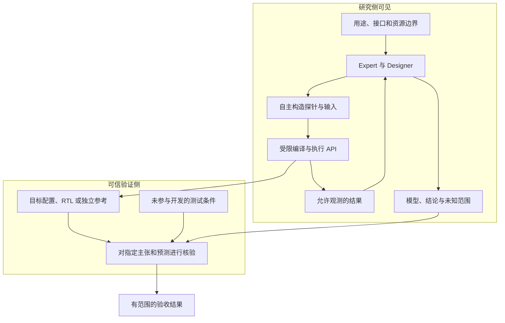

**图 17：受控逆向 Benchmark 的信息边界。** 对公开项目还应考虑模型已知知识的影响；隐藏或变体配置能减少单纯记忆答案，但不能声称消除全部污染。

### 15.5 三个案例复用什么，什么不同

它们复用任务契约、调用身份、权限、原件、代码快照、经验引用、暂停恢复和交付机制。不同的是下一步价值判断、代码版本的默认推进规则以及最终证据要求。

不强制三个案例拥有相同的报告格式、相同的指标和相同的实验次数。它们需要的是统一可追溯性，不是表面上完全相同的工作内容。

<a id="s16"></a>
## 16. 如何评价 ArcHa 的泛化与有效性

### 16.1 框架跑通与任务解决是两项验收

框架层应验证调用交接、权限、恢复、版本选择、原件保存、知识更新和停止行为。任务层应分别验证编译优化、模型开发和架构探索的实际交付。

不能用只包含预制回答的脚本证明“自主科研有效”；脚本夹具可以检验协议和异常路径，但真实能力需要实际任务。也不能因为某个真实任务失败，就忽略框架已正确保留了反证和资源耗尽状态。

### 16.2 三类端到端案例与观察项

| 类别 | 主要结果 | 不可省略的检查 |
|---|---|---|
| 优化 | 约束内的性能收益或预算内最好结果 | 固定条件、噪声、正确性、候选选择与退化分布 |
| 开发 | 必要要求覆盖和可执行交付 | 未完成基线可继续；中间版本不冒充完成；独立对齐 |
| 探索 | 有效观测、局部模型、受限主张 | 竞争解释、独立预测、反证、未知范围、隐藏信息边界 |

共同记录模型调用、Token、费用、执行时间、实验调用数、人工干预、恢复次数和验收结果。不得为了一个总榜分数而掩盖不同维度的失败。

### 16.3 与直接 Agent 的公平对照

会话建议比较 ArcHa 与直接 Codex/等效编码 Agent，但比较不应刻意削弱后者。直接基线应允许合理规划、工具使用、修错和继续执行，且使用可比较的模型、任务材料、权限、工具与预算条件。

记录实际资源而不是仅声明“相同轮数”。固定模板与动态策略对照时，还需避免把更强模型、更多数据、更多推理预算带来的收益错误归因于 Harness。

在预算允许时重复运行，报告分布与失败案例。单次漂亮结果不能证明通用性；本方案目前没有这类对照实验结果。

### 16.4 探索能力的评价方法

FIRE-Bench 提供的相关思想是：向 Agent 提供研究问题而隐藏方法与结论，再对照可核验发现评价。这启发受控逆向任务的构造，但不意味着必须把所有未知研究压成答案列表。[R7](#ref-r7)

可以同时检查：正确而有价值的主张、错误确定性主张、独立预测表现、是否把无效实验当反证、是否及时收回被推翻结论，以及下一步是否真正受新证据影响。

不应只奖励“找到多少参数”。一个有用的行为模型可能比一长串未经证实的规格更适合架构决策。

### 16.5 检查策略演化，而不仅是程序变好

若将来允许 Harness 策略演化，应单独保存其版本与评测条件。目标程序在进步、团队策略也在变化时，最终分数不能自然分解为两者各自贡献。

可以在共同起始程序、相同任务或新的测试任务上比较冻结策略；也可对知识复用、角色分工、上下文选择做针对性消融。实验设计必须与所声称的收益一致，不能用同一任务的持续改进冒充跨任务迁移。[R3](#ref-r3)

<a id="s17"></a>
## 17. 设计边界、风险与不做什么

### 17.1 默认不做的事

不为三类任务建立三套引擎；不引入自由编排循环、条件和 Agent 拓扑的通用 Workflow DSL；不默认建立知识图谱、向量服务或专门 Memory Agent；不把每次摘要或每条主张都变成新的模型调用；不让 Profile 决定全部研究路线。

不把结构校验、文件数量、语言流畅度当研究质量；不让同一个可改模型同时扮演候选与真值；不让 Agent 把评价规则改成自己容易通过的形式；不默认自动晋升用户分支。

不提前建全量通用插件体系。真正出现无法由三类默认策略表达的任务时，再基于具体差异扩展，而不是为想象中的场景增加层级。

### 17.2 风险及对应边界

| 风险 | 典型表现 | 方案边界 |
|---|---|---|
| 自我认证 | Expert/Designer 给自己的解释标“已验证” | 解释、实测和独立审核分权 |
| 共享记忆污染 | 一次猜测被多轮摘要变成事实 | 记录来源、条件、状态和版本；保留反证 |
| 评价漂移 | 改测试、改输入、改阈值后继续比较旧分数 | 评价版本与比较条件显式化 |
| 知识过度泛化 | 对一台配置有效就宣称所有硬件成立 | 结论绑定目标、输入和观测范围 |
| 工作流专用化 | 开发步骤被迫写竞争假设与科学评级 | Profile 与 Activity 分开；字段按需 |
| 无效探索 | 无限制造问题或文档，却不影响目标 | 要求与用途有关的选择理由和交付联系 |
| 过早停止 | 连续无收益就宣布收敛 | 区分平台期、饱和、阻塞与完成 |
| 永不停止 | 将 EAT/AutoResearch 的持续搜索口号当绝对规则 | 明确预算、用户控制、阶段交付与重开条件 |
| 上下文膨胀 | 全量日志和历史结论每轮注入 | 相关视图加按需读取，保留来源 |
| 硬件真值混淆 | 用功能模拟器或拟合模型证明真实周期 | 明确参考层级、校准和适用范围 |
| 隐藏答案泄漏 | 从寄存器、源码路径或配置直接读出真值 | 定义白/灰/黑盒模式并隔离可信侧 |
| 实验数据失真 | 缓存当新测量，崩溃当反证，未知当 0 | 执行身份、有效性与缺失语义独立 |
| 审核扩大解释 | 一个最终通过覆盖所有后来结论 | 审核绑定对象、版本、证据范围 |
| 成本不可比 | 只比较轮数，忽略模型和实验调用 | 记录真实用量与评测条件 |

### 17.3 共享空间不是行为控制的唯一机制

用户提出通过共享空间约束 Expert 的行为，这个方向主要体现为“让它面对已有事实、反证和未知，不随意改写历史”。真正的权限和停止控制仍由 Engine 与执行环境承担。

写在 README 的“不要改评价器”不是完整隔离。需要根据风险使用实际的权限、受限工具或独立验证环境；但不因此默认要求所有场景引入复杂分布式安全系统。

### 17.4 推断自由与交付纪律兼容

Agent 可以提出新解释、临时试验失败路线、保存尚未完成的代码。纪律施加在来源、授权、版本、独立验收和声明范围上，而不是禁止尝试。

框架越想通用，越需要让“怎样研究和开发”留给具备能力的 Worker，同时把“怎样证明它做到了”明确化。这是本会话最核心的取舍。

<a id="s18"></a>
## 18. 共识、建议和待决事项

### 18.1 本会话明确认可的方向

用户已经明确认可：未知架构研究应建立有证据、可预测且标明未知边界的模型；Agent 可以自主发现问题；研究组织默认采用 Expert/Designer、外部验证和共享经验，重大结论按需独立审核；下一步选择需要考虑价值、区分能力、成本与停止原因。

用户随后明确提出泛化要求：不能因开放探索而牺牲开发与优化，需要从 `archa-map/archa-task/onboard/archa-loop` 的完整链路考虑配置和任务模板。

### 18.2 本文采用的总体方案建议

| 编号 | 建议 | 理由 | 状态说明 |
|---|---|---|---|
| A1 | 任务策略驱动的统一 Harness | 差异在进步与验收语义，不在是否需要运行底座 | 上轮提出，本文整合为推荐方案 |
| A2 | 三个默认 Profile，不增加 Hybrid 引擎 | 混合活动已可在同一任务内表达 | 推荐默认，而非用户已确认的逐字段配置 |
| A3 | Decision / Acceptance / Accumulation 三类职责 | 明确下一步、接纳和累计的不同问题 | 概念划分，不强制三套插件 API |
| A4 | Attempt 可产生多种产物并分别处置 | 避免 no_gain 抹掉有效知识或 work 冒充完成 | 上轮提出，本文补全对象语义 |
| A5 | 公共信封＋角色专用 Payload | 保持统一追溯同时减少无关字段 | 本次为完整接口新增的建议 |
| A6 | Profile 输入、Task 输入、绑定和生效快照分离 | 避免多份配置互相覆盖和重复维护 | 本次为配置完整性补全 |
| A7 | 知识三级信息：状态、证据说明、审核 | 不把猜测、测量和认可混在一个标签 | 沿用会话建议，证据等级可选 |
| A8 | 终验与停止分离，发布另外授权 | 控制成本且不夸大完成程度 | 沿用会话核心边界 |

### 18.3 仍需在真实任务中验证的事项

两角色分工是否比单 Agent 更经济，默认 Reviewer 触发是否合适，知识摘要粒度是否够用，动态实验接口是否足以支持真正的未知机制，以及三类 Profile 的覆盖范围，都需要实际任务验证。

本文不将这些问题变成必须现在新增的模块。没有实验证据前，也不宣称这种组织已经优于直接编码 Agent。

### 18.4 可留到实现设计阶段决定的细节

配置文件最终使用 JSON 还是 YAML、消息传输采用函数调用还是进程协议、是否将 E0–E3 正式编码、不同角色的具体模型、上下文预算如何分配、哪些工具需要独立环境，均不影响本文的基本架构。

这些细节应服从项目现实，而不是由本文的示意路径和命名反向约束实现。

### 18.5 会话中出现过的渐进演进思路

上轮曾建议先使用 Profile 模板表达默认策略，再完善探索任务的证据和结论语义，最后仅在真实需求出现时开放策略插件。这里保留这条讨论记录，**但不将其作为本文必须执行的代码改造路线或开发排期**。

总体方案的判断标准不是“是否完成了三次重构”，而是三个真实任务能否在同一底座下获得可信成果，且未引入过量模型调用、中间材料和人工协调。

<a id="s19"></a>
## 19. 参考资料与采用方式

以下优先列出本会话涉及的一手资料。来源支持项目事实和理论背景；ArcHa 的组织方案、配置和接口是本会话的设计推导，不是引用项目已经证明的结论。核对日期为 2026-10-30。

<a id="ref-r1"></a>
### R1. Hermit：Harness Adapter 定义与训练边界

- 项目：[Infini-AI-Lab/hermit](https://github.com/Infini-AI-Lab/hermit)
- 定义与 FAQ：[docs/faq.md](https://github.com/Infini-AI-Lab/hermit/blob/main/docs/faq.md)
- 本次核对 FAQ 文件 Blob：`12bcde2aefe9e892cde39a30d40890a74f85db61`。
- 采用内容：外部 Adapter、固定执行模型与原始 Harness、可学习文件范围、训练/部署区分、迁移需重新评价。
- 不采用的推论：安装插件即训练；结构检查即性能提升；跨宿主兼容即跨任务有效。

<a id="ref-r2"></a>
### R2. Hermit：示例与方法差异

- 入口与教学例子：[README.md](https://github.com/Infini-AI-Lab/hermit/blob/main/README.md)
- 方法选择：[docs/methods/index.md](https://github.com/Infini-AI-Lab/hermit/blob/main/docs/methods/index.md)
- [Prompt-only](https://github.com/Infini-AI-Lab/hermit/blob/main/docs/methods/prompt-only.md)、[GEPA](https://github.com/Infini-AI-Lab/hermit/blob/main/docs/methods/gepa.md)、[SkillOpt](https://github.com/Infini-AI-Lab/hermit/blob/main/docs/methods/skillopt.md)、[MWM](https://github.com/Infini-AI-Lab/hermit/blob/main/docs/methods/mwm.md)。
- [Harness² 接入](https://github.com/Infini-AI-Lab/hermit/blob/main/docs/methods/harness2.md)、[Continual Harness 接入](https://github.com/Infini-AI-Lab/hermit/blob/main/docs/methods/continual_harness.md)。
- 采用内容：反馈到 Adapter 更新的共同界面，方法间是否验证、如何选择候选的差别。0.0→1.0 大写例子为教学构造。
- 核对范围：会话中阅读了方法文档；本次复核 README/FAQ。方法集成状态可能继续变化，本方案不依赖完整方法清单或某版本依赖安装方式。

<a id="ref-r3"></a>
### R3. Evolving Agent Teams 论文

- Shiyi Cao 等，*Evolving Agent Teams*，arXiv:2610.36848v1，2026-10-27。
- [论文 HTML v1](https://arxiv.org/html/2610.36848v1)
- 重点：§3 的团队配置与持久文件系统；§4.5 的固定团队消融。
- 采用内容：角色、协作、知识管理共同构成可变组织；诊断平台期；目标程序与组织同时变化。
- 限制：论文实验不证明 ArcHa 的收益；单任务持续优化不自动证明策略迁移或递归自我改进。

<a id="ref-r4"></a>
### R4. EAT 源码

- [caoshiyi/EAT](https://github.com/caoshiyi/EAT)
- [SKILL.md](https://github.com/caoshiyi/EAT/blob/main/SKILL.md)
- [SUPERVISOR.md](https://github.com/caoshiyi/EAT/blob/main/agent_team/SUPERVISOR.md)
- [launch_stateless.sh](https://github.com/caoshiyi/EAT/blob/main/agent_team/launch_stateless.sh)
- [parse_team_config.py](https://github.com/caoshiyi/EAT/blob/main/agent_team/parse_team_config.py)
- [launch_team.sh](https://github.com/caoshiyi/EAT/blob/main/agent_team/launch_team.sh)
- [verify_iter.py](https://github.com/caoshiyi/EAT/blob/main/ops/verify_iter.py)
- 本次复核 `launch_team.sh` Blob：`89687039b2a344ea7b2608d6d113a4a68e74501e`。
- 采用内容：配置到角色与阶段的执行、团队结束后的独立官方评价、持久运行记录。
- 限制：代码读取不是运行验证；提示词限制和禁止部分工具也不等于完备 OS 级隔离；不能把 EAT 的全部运行规则原样当成 ArcHa 的通用规范。

<a id="ref-r5"></a>
### R5. Karpathy autoresearch

- [karpathy/autoresearch](https://github.com/karpathy/autoresearch)
- [program.md](https://github.com/karpathy/autoresearch/blob/master/program.md)
- 本次核对文件 Blob：`dea9bcc0174f1502d0ba64000b94b81ba605855b`。
- 采用内容：Agent 可改训练实现，但固定评价准备与 `evaluate_bpb`，以 `val_bpb` 为优化目标；说明该类循环通常依赖先定义好的评价口径。
- 限制：这是特定自动研究项目，不是所有 Auto-Research 系统的唯一定义；其持续运行要求不作为 ArcHa 的通用停止规则。目标训练程序的梯度更新与 Agent 外循环分开理解。

<a id="ref-r6"></a>
### R6. LLM-AutoSciLab

- Sanchit Kabra 等，*LLM-AutoSciLab: Closed-Loop Scientific Discovery via Active Experimentation with LLMs*，arXiv:2605.24043。
- [论文](https://arxiv.org/abs/2605.24043)
- [官方项目页](https://scientific-discovery.github.io/llm-autoscilab-project/)
- [源码](https://github.com/scientific-discovery/LLM-AutoSciLab)
- 采用内容：以竞争机制指导主动实验，观测反馈更新机制与记忆；未知重要变量也可通过实验逐步调查。
- 限制：本次采用论文/项目页机制说明，没有运行源码；其科学环境中的算法和效果不是 TPU 逆向的现成保证。

<a id="ref-r7"></a>
### R7. FIRE-Bench

- [官方项目页](https://firebench.github.io/)
- [论文 arXiv:2602.02905](https://arxiv.org/abs/2602.02905)
- [PMLR 发表入口](https://proceedings.mlr.press/v306/wang26d.html)
- 采用内容：通过隐藏方法与已知发现，构造可核验的研究再发现任务；以主张而非仅代码运行评价研究。
- 限制：本文使用其评测思想，不复制任务数、排行榜或错误比例作为 ArcHa 的验收阈值；已发表发现作为 Benchmark 参照也不代表科学真值永不修正。

<a id="ref-r8"></a>
### R8. 最优实验设计与信息价值

- Xun Huan、Jayanth Jagalur、Youssef Marzouk，*Optimal experimental design: Formulations and computations*，Acta Numerica 33，2024，715–840。
- [arXiv:2407.16212](https://arxiv.org/abs/2407.16212)
- [期刊入口](https://www.cambridge.org/core/journals/acta-numerica/article/optimal-experimental-design-formulations-and-computations/38BBD0DC1A0386FDF306B6C0167DF7D9)
- 采用内容：实验目标可由效用与信息准则表达；预期信息增益与后续决策价值应区分；支持序贯选实验的讨论。
- 限制：这是本次为会话理论补充核对的一手入口，不表示前面未展开的所有检索编号都指向它；也不要求 ArcHa 实现完整贝叶斯算法。

<a id="ref-r9"></a>
### R9. 序贯实验设计中的最优停止

- Chen Cheng、Xun Huan，*Optimal Stopping for Sequential Bayesian Experimental Design*，arXiv:2509.21734，最初提交于 2025，后续有修订。
- [论文入口](https://arxiv.org/abs/2509.21734)
- [作者实验室说明](https://uq.engin.umich.edu/sequential-design.html)
- 采用内容：把下一实验与是否停止联合考虑，比较终止价值和继续价值。
- 限制：依赖明确定义的模型、效用和成本；不能将理论规则直接当作开放科研任务的自动完成证明。

<a id="ref-r10"></a>
### R10. openTPU 作为受控研究对象

- [FeSens/openTPU](https://github.com/FeSens/openTPU)
- [README](https://github.com/FeSens/openTPU/blob/main/README.md)
- [目标层次 docs/targets.md](https://github.com/FeSens/openTPU/blob/main/docs/targets.md)
- [ISA docs/isa.md](https://github.com/FeSens/openTPU/blob/main/docs/isa.md)
- [编译器 docs/compiler.md](https://github.com/FeSens/openTPU/blob/main/docs/compiler.md)
- [Benchmark docs/benchmarks.md](https://github.com/FeSens/openTPU/blob/main/docs/benchmarks.md)
- 本次复核 targets 文件 Blob：`7c3ed6c8b6253d2605df1187c539db143aac0a6b`。
- 采用内容：架构、微架构、工艺与平台配置分层，以及编译/ISA/RTL/观测之间的关系。
- 限制：本方案未搭建黑盒、未跑 Verilator、未确认实际设备环境；辨识该开源实现不等于还原 Google 闭源 TPU。

<a id="ref-r11"></a>
### R11. ArcHa 会话中的源码背景

- [kongxiangcong/ArcHa](https://github.com/kongxiangcong/ArcHa)
- 本次核对 main 提交：[`8b70578be3aa9ee63538271993e67bf4aa4aee3a`](https://github.com/kongxiangcong/ArcHa/commit/8b70578be3aa9ee63538271993e67bf4aa4aee3a)。
- [Engine](https://github.com/kongxiangcong/ArcHa/blob/8b70578be3aa9ee63538271993e67bf4aa4aee3a/opc/core/engine.py)
- [Worker 协议](https://github.com/kongxiangcong/ArcHa/blob/8b70578be3aa9ee63538271993e67bf4aa4aee3a/opc/adapters/worker.py)
- [角色提示](https://github.com/kongxiangcong/ArcHa/blob/8b70578be3aa9ee63538271993e67bf4aa4aee3a/opc/adapters/prompts.py)
- [配置](https://github.com/kongxiangcong/ArcHa/blob/8b70578be3aa9ee63538271993e67bf4aa4aee3a/opc/core/config.py)
- [成果入口](https://github.com/kongxiangcong/ArcHa/blob/8b70578be3aa9ee63538271993e67bf4aa4aee3a/opc/core/results.py)
- [终验](https://github.com/kongxiangcong/ArcHa/blob/8b70578be3aa9ee63538271993e67bf4aa4aee3a/opc/core/promote.py)
- [archa-map](https://github.com/kongxiangcong/ArcHa/blob/8b70578be3aa9ee63538271993e67bf4aa4aee3a/skills/archa-map/SKILL.md)、[archa-task](https://github.com/kongxiangcong/ArcHa/blob/8b70578be3aa9ee63538271993e67bf4aa4aee3a/skills/archa-task/SKILL.md)、[archa-loop](https://github.com/kongxiangcong/ArcHa/blob/8b70578be3aa9ee63538271993e67bf4aa4aee3a/skills/archa-loop/SKILL.md)。
- 采用内容：会话对现有结构的观察与事实校正。它不是本文目标架构已经完成的证据。

<a id="ref-r12"></a>
### R12. 本次研讨的方法约定

- [Winson 技能](https://github.com/kongxiangcong/skills/blob/main/Winson/SKILL.md)
- 采用内容：先做减法、检验默认前提、核对一手资料、区分事实与推断、保留讨论演变。
- 文档完整交付取代逐概念暂停；不会为了遵循讨论节奏而省略用户要求的内容。

<a id="s20"></a>
## 20. 附录：逐轮覆盖索引、历史表述校正与图示索引

### 20.1 逐轮讨论覆盖索引

本表按照会话推进顺序定位内容，便于检查是否遗漏某个问题，而不是仅按最后一次结论编写。

| 会话内容 | 本文落点 | 保留的细节 |
|---|---|---|
| Hermit 的训练是梯度还是提示词修改 | §3.1–3.3 | 外部 Adapter、模型权重固定、教学大写例子、非梯度外循环 |
| 超出 Prompt 的技能/工具/记忆/代码/协作 | §3.2–3.3、§10 | Adapter 的对象边界和可编辑范围 |
| RL-style 不等于 PPO/GRPO 策略梯度 | §3.1 | 看更新对象和算法，不由名称判断 |
| GEPA、SkillOpt、MWM、Harness²、Continual Harness | §3.3、R2 | 同一入口不同更新/选择方式，不一律假设有改进门 |
| EAT 是否为 Harness Adapter | §3.4–3.5 | 广义演化与严格封装区分；底座、Supervisor、配置、目标程序分开 |
| EAT 的源码执行路径 | §3.4、R4 | 配置生成、解析、分阶段运行、官方评价、持久记录 |
| EAT 同时演化 T 与 s 的归因问题 | §3.4、§16.5 | 程序改进不自动证明配置迁移，保留消融数据及范围 |
| RSI 与自我递归改进的谨慎判断 | §3.5、§17 | 不把单任务演化自动升级为完整 RSI |
| 无数值目标时如何定目标与验收 | §4、§11 | 用途、交付、接口、证据标准；无 Objective 不等于无验证 |
| TPU 参数/规格本身未知 | §4.2–4.6 | 可辨识性、竞争解释、有限范围模型、允许未知 |
| DMA/MXU 并行与串行假设 | §4.3、图4 | 单项/组合/干扰观测；不把示意当事实 |
| 从参数清单转向现象驱动 | §4.4、图5 | N=63/64/65 示意数据与计算；编译/硬件/访存解释 |
| 主动系统辨识与假设驱动实验 | §4、§12、R6/R8 | 控制输入、观测、选择能区分解释的实验 |
| 预先固定可信证据标准而非预先知道答案 | §4.6、§7.4、§11.3 | 实验路线可变，验收含义不可随意漂移 |
| Expert 提问题，Designer 执行并摘要 | §9、§14 | 实验计划、实际偏差、原始证据和角色权限 |
| 回 Expert 更新认知还是加审核 Worker | §9.2、§9.5 | 默认 Expert 解释，Reviewer 按需，避免每轮多一次调用 |
| 共享知识空间与结论评级 | §10 | Evidence/Findings 分离，E0–E3、审核状态、版本与反证 |
| 现有 results/ledger/promote 等基础 | R11、§20.2 | 只作为源码背景，不扩展成改造任务表 |
| 两个嵌套循环 | §8.5、图10 | 实验/工作与认知更新不强制一一对应 |
| 下一研究问题是否值得 | §12.1–12.3 | 相关性、区分能力、可执行性与成本，不强制伪精确总分 |
| 信息增益不等于决策价值 | §12.2、R8 | 理论参考与实践定性判断分开 |
| Discovery/Identification/Validation | §4.5、§6.3 | 不强制每轮 H1/H2，不构造三套流程 |
| Completed/Saturated/Blocked/Budget | §12.4–12.7、图14 | 停止原因与任务完成分离，保留重开条件 |
| EAT 平台期启发与不能轻率宣布上限 | §12.5、§17 | 诊断观测/策略/上下文，不默认无限加角色 |
| 担心 ArcHa 变科研专用框架 | §1、§5–§8 | 统一底座，策略驱动，保留开发与优化能力 |
| 三个默认任务模板 | §6、§13 | 模板不是路线，不设独立 Hybrid 工作流 |
| Decision/Acceptance/Accumulation | §6.2 | 下一步、接纳、累计三种职责 |
| 四阶段从讨论到配置 | §7、§13 | Map/Task/Onboard/Loop，明确任务可直接接入 |
| 时序对齐开发中混合研究与优化 | §15.2、图16 | 交付主线不变，活动自由切换，实质变更显式修订 |
| 不增加 Workflow DSL 与复杂框架 | §17、§18 | 减少重复权威、常驻角色和中间产物 |
| 曾提出模板→探索语义→按需插件的演进 | §18.5 | 保留历史路线，不作为本次开发排期 |
| 三个真实端到端例子与直接 Agent 对照 | §15–§16 | 公平基线、成本、结果范围、无实测收益声明 |
| 最后提出 Attempt 的统一语义 | §8、§14 | 代码、实验数据、知识可单独或联合产生并分别处置 |
| 本次要求整体框架、模块、配置和接口 | 全文，重点§5/7/10/13/14 | 不以现有代码改造方案取代整体架构 |

### 20.2 对此前表述的必要校正

**校正一：不是“ArcHa 完全不支持无补丁测量”。** 会话中有些引用文档仍这样描述，但核对的 Engine 已允许空 Patch 进入正式评价，并在该路径请求新测量；非数值任务默认是否评价另有控制。更准确的说法是：已有部分纯测量能力，不等于探索任务的知识、审核和完成语义已全部完备。[R11，`attempt()`](#ref-r11)

**校正二：不是“当前停止已经等于任务完成”。** 当前代码和技能已经有运行结束与交付检查的区分。本文强调进一步明确完成、饱和和受阻，是目标语义建议，不应据此否认已有终验能力。[R11](#ref-r11)

**校正三：独立验证不能全部等同于确定性脚本。** 执行与协议检查适合自动化；实验设计和科学推断仍需要明确假设、独立预测与必要审核。形式合格不证明科学成立。

**校正四：EAT 与 Hermit 不应被固定为“一个只单任务、一个只跨任务”。** 这是讨论中用于突出重心的对比。Hermit 容纳不同训练/在线流式方法；EAT 的主流程侧重当前任务组织演化。是否具备跨任务有效性，仍要看具体方法和验证。[R1](#ref-r1)–[R4](#ref-r4)

**校正五：知识分级不是客观概率或通用科学标准。** E0–E3 是本会话的建议约定，保留依据和适用范围，不能因等级更高就覆盖反证。

**校正六：黑盒逆向 Benchmark 不能直接开放泄漏答案的配置。** openTPU 是合适的候选研究对象，不表示把仓库交给 Agent 后自动形成黑盒辨识。需要明确白盒/灰盒/黑盒边界。[R10](#ref-r10)

**校正七：不存在以“没有新想法”证明物理上不可辨识的捷径。** 当前未区分、接口受限下等价、全局唯一真实结构是不同强度的主张。

**校正八：本次新 Schema、消息和状态名称是方案建议。** 不能把示例复制到当前 ArcHa 后假定能运行，也不能将本文写出的逻辑模块当作已经存在的服务。

### 20.3 Mermaid 图示索引

| 图号 | 内容 | 对应讨论 |
|---|---|---|
| 1 | 本会话方案演变 | 从优化到探索再到泛化 |
| 2 | Hermit 外部适配循环 | “训练”的含义 |
| 3 | EAT 组织与程序演化 | Adapter 与团队策略 |
| 4 | DMA/MXU 竞争假设 | 未知机制怎样验收 |
| 5 | N 边界现象驱动研究 | 自主发现应该研究什么 |
| 6 | ArcHa 总体模块关系 | 整体框架 |
| 7 | Profile 与三类策略 | 统一引擎的泛化 |
| 8 | Map→Task→Onboard→Loop | 任务定义到执行 |
| 9 | 统一 Attempt 循环 | 多类产物与状态 |
| 10 | 工作循环与认知循环 | 研究组织 |
| 11 | Worker 交接时序 | 输入输出与责任 |
| 12 | 证据与解释版本关系 | 共享经验空间 |
| 13 | 分层验证 | 执行、主张、交付 |
| 14 | 停止与完成判定 | 继续/停止决策 |
| 15 | 配置解析与唯一契约 | 配置组织 |
| 16 | 时序模型开发中的研究循环 | 混合活动 |
| 17 | 受控逆向评测信息边界 | openTPU 验收案例 |

### 20.4 文档的最终落点

ArcHa 不需要在“优化器”“开发工作流”和“科研系统”之间选择唯一身份。它需要稳定管理授权、执行和证据，使 Worker 能在不同任务用途下，自主组织相应的研究与开发活动。

统一的不是每一步都做同样的事情，而是：**目标明确可追溯，工作有边界，事实有原件，结论有条件，经验能修正，验收独立于自我宣称，停止理由不冒充成功。**

任务 Profile 提供默认策略，共享空间承接代码之外的经验，Worker 接口保持职责清楚，统一引擎把这些连接起来。至此，探索型任务成为 ArcHa 的一种自然能力，而不是把 ArcHa 改造成只能做探索的专用框架。
