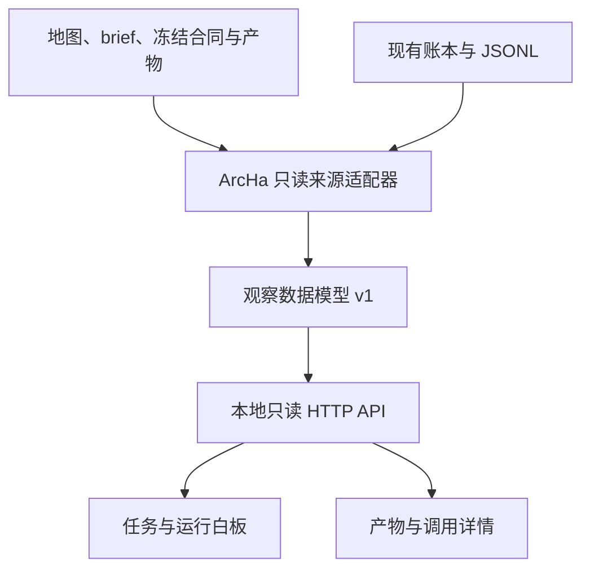

# ArcHa 只读观察工作台：首版产品与接口规范

日期：2026-10-27。Spec 版本：1.0。观察接口版本：1.0。

状态：**用户已确定首版只做观察、复用已认可原型、优先复用开源组件。本文件是完整开发依据，当前尚未实施工作台。** 配套 [development-prompt.md](development-prompt.md) 供下一开发会话使用：先生成唯一的 `tickets.md`，再连续实施，不另设方案确认关卡。

源码核对基点：`main@49ba90af8819cb9cd6c48d1933d2448d3c171e6a`（PR #5 已合并），与此前审查的 PR 头 `4ff4ceec17b399d7f7f90cbb821cf7d00e452cc6` 内容相同。路径和符号名只作当前定位；开工时核对实际源码。

视觉与浏览交互基准：[prototype.html](prototype.html)。它由用户认可的第一版原型收敛而来，仅移除控制演示、增加只读与示例数据标识；不是已接入 ArcHa 的产品。原型文字和数值不能成为真实数据缺失时的回退。

## 1. 产品目标与已确定的边界

### 1.1 要解决的问题

用户需要在 ArcHa 自主推进时，随时读懂当前任务目标、准备与执行进展、每轮专家思路、开发实际成果、文件关键信息、验证结论和剩余缺口。ArcHa 可能大改版，因此观察界面必须通过独立的读取适配边界跟随演进。

首版成功标准是用户能从一条任务进入一轮工作，回答以下问题，并能回到对应来源：

1. 这项任务原本要完成什么，当前查看的是哪个任务版本和 run？
2. 已有哪些阶段记录，当前记录到哪个阶段，哪些状态尚未确认？
3. 本轮专家提出了什么方案，开发实际做了什么，观察到了什么结果？
4. 产生了哪些文件或账本记录，其中的关键信息是什么？
5. 哪些完成条件已有对应证据，哪些仍未验证，终审检查了哪个版本？

**观察工作台没有推进任务的职责。** 用户可据此在已有宿主会话或 CLI 中作决定，首版不提供执行入口，也不替 ArcHa 判断新的研究方向。

### 1.2 决定表

| ID | 已确定的决定 | 对实施的约束 |
| --- | --- | --- |
| D1 | 首版纯观察 | 无启动、暂停、停止、续跑、重试、审批、改目标、编辑合同、执行工具、promote/apply 接口和按钮；连禁用占位按钮也不保留 |
| D2 | 保留原型效果 | 保留顶部任务信息、五阶段入口、常驻完成条件、轮次/角色/产物及右侧详情；增加必要任务导航，不重做通用后台 |
| D3 | 固定信息栏目，按实际记录展开 | 不要求每个任务产生相同文件、执行全部阶段或拥有相同角色；缺失、未发生与不适用分别表达 |
| D4 | 以任务为中心，下钻到调用 | 地图负责研究任务关系；run 内按轮次浏览，调用及工具明细按需展开 |
| D5 | 界面只消费观察接口 | 前端不依赖 SQLite 表名、ArcHa Python 类、源码目录和 provider JSONL 格式 |
| D6 | 不为展示改变执行流程 | 不新增 agent、模型总结、强制报告、逐轮审阅、评价器或引擎埋点；现有来源不足时允许未知 |
| D7 | 本地、单项目、单用户首版 | 一个 Python 观察服务、一份 React 前端；使用现有数据，依赖本机文件权限；不建设多租户、账号和部署平台 |
| D8 | 用离线材料完成可重复验收 | 自行构造符合当前来源格式的测试材料与演示数据；无需模型、API key、设备或新的 benchmark |

本 spec 的 D1 覆盖之前讨论中“首版必须加入真实停止”的建议。历史讨论、旧原型、其他专题开发提示词都不能恢复该要求。**不预埋控制路由、命令总线或将来才用的控制 SDK。**

### 1.3 本次不做与重新考虑条件

| 本次不做 | 将来何时再考虑 |
| --- | --- |
| 执行控制、交互聊天、brief 编辑与人工审批 | ArcHa 新执行接口稳定，且用户另行要求界面参与执行 |
| 新生命周期协议、进程探测、心跳和完整宿主 trace | ArcHa 自身开始提供这些事实；观察器按来源能力接入 |
| Phoenix/AgentOps/OTel 服务、react-o11y 时间瀑布 | 已有调用详情不足以诊断跨 run 或时间关系时单独评估 |
| Recharts、全局成本仪表盘、预计完成时间 | 有明确可比较数值系列和用户用途；首版以数值表呈现 |
| 自由绘图、拖线改依赖、流程编排、可视化 DSL | 不属于本工作台当前定位 |
| 平行业务数据库、持久事件总线、插件注册平台、微服务 | 单读取模块不能满足真实已出现的规模或来源需求时再论证 |
| 自动修复、自动关联猜测、自动升级用户 runtime | 不属于观察器职责 |

## 2. 信息架构与视觉交互

### R1. 项目与任务入口

- 默认打开当前项目的研究地图及任务选择区；地图正文与任务依赖图并存。只把稳定任务清单和明确 `depends` 转换为图，保留自由组织的研究背景。
- 地图使用 React Flow + Dagre；允许缩放、平移、选中和查看详情，关闭新增/删除节点、连线和修改依赖等编辑能力。节点不作为可编辑流程状态机。
- 任务列表是与依赖图等价的入口。无法解析某一地图时保留正文及可识别任务，并说明具体缺项；不因图不可画而挡住任务和 run。
- 无地图的直接任务、只有 brief 的任务、仅有执行合同/run 的任务都可访问。关联不明确的执行记录放在“未关联执行记录”中，不消失、不强行挂到标题相似的任务。
- task/revision/run 均可明确选择。页面 URL 保存当前任务、run、阶段、轮次和产物选择；刷新可恢复仍然存在的选择，不依赖浏览器存储成为事实来源。

### R2. 单任务白板骨架

保留原型的以下布局：

1. 顶部：任务名称、一句话目标、所选 revision/run、数据来源模式与读取时间。
2. 状态行：准备状态、所选 run 执行状态、验收状态及已记录用量；三种状态不合成一个完成百分比。
3. 五阶段查看入口：方向地图（可选）、任务目标、执行接入、迭代执行、交付验收。点击只改变阅读位置。阶段可未开始、无记录、不适用，不能暗示必须依次执行。
4. 常驻完成条件条：当前所选合同的要求及已知证据状态，可进入完整表。
5. 左侧内容：所选阶段/轮次的信息、角色记录和产物列表。
6. 右侧详情：所选产物或调用的要点、归属、原文入口。窄屏下移为同页单列，不改成另一套信息结构。

正式评价与独立审阅未执行或不适用时如实标注。角色列表按实际数据生成，不能把原型中的四张角色卡当作每轮强制角色集合。

### R3. 每轮解释与历史回看

每轮固定保留以下栏目，内容只来自已有记录：

| 栏目 | 优先来源 | 缺失时的表达 |
| --- | --- | --- |
| 本轮意图与专家理由 | plan 的 title/changes/已有理由或研究字段 | 未记录，不由看板补写 |
| 实际成果或最近活动 | execution 摘要、已完成工具项、已报告活动 | 尚未回传，或实时活动未确认 |
| 实验与验证 | experiment、既有评价结果与数据引用 | 未请求、未执行或未发现记录，按证据区分 |
| 当前结论 | 该 attempt 对应的 conclusion | 尚未形成/未记录结论 |
| 剩余缺口与下一步 | 已有结论、审阅或明确需求结果 | 暂无逐项结论，不自动推导开发计划 |

正文摘要用现有字段提取、结构化排版与长度折叠完成，不调用模型。不把原始 plan 的预期结果显示成实际成果。截断必须可展开或打开原文。

回看旧轮次时显示“正在回看第 N 轮”；后台有新数据时只更新最新状态或提示，不强制切走当前轮次、产物、滚动位置和已展开内容。conclusion 可能由后续专家调用回填，归属仍是被复盘轮次，保留其来源记录。

### R4. 产物和原文

- 同一产物列表可包含文件和账本记录，明确标出两者区别。记录没有实际文件时不能捏造 `execution.json` 等路径。
- 详情显示名称、类型、可用性、来源路径/记录定位、任务版本、run/轮次/角色/调用归属（已知时）、现有要点和原文入口。
- Markdown 用 react-markdown + remark-gfm；JSON 以结构/格式化文本；补丁和纯文本以可读原文；其他类型至少提供名称、大小及允许的下载。首版不做专用 PDF/图片编辑器。
- 文件“已生成”只说明存在。计划中提到但尚不存在的文件标为“未发现”，不能据此认定已交付。
- 首版只发现既有记录引用的产物与已知产物目录，不递归遍历整个工作区或服务器。产物原文按需读取。
- 新建议可在已有来源明确写出时单列。看板不通过语义猜测判断建议越界，也不把建议自动加入完成条件。

### R5. agent 调用详情

- 每次调用独立标识，展示角色、provider、原始调用 ID（已知时）、所属阶段、起止时间、已报告状态、用量及消息/工具内容。
- 使用 assistant-ui 的只读 Provider 与消息/内容 primitives。界面不出现 composer、发送、编辑、重新生成、审批、重试或执行工具按钮，不注册浏览器侧执行回调。
- 有现成 Codex/DSH 公开消息和工具事件时适配到只读消息；未知 provider 事件保留原始类型及原文入口。不能因无法转成聊天气泡而丢弃整次调用。
- 只有明确父子调用 ID 时才嵌套显示；没有关系证据时保持独立列表。不能把全部 expert/designer 回复串成一个伪造的总会话。
- 缺少开始时间、完整 transcript 或实时事件时允许仅显示终态调用卡。只读 Provider 自身的聊天状态不作为 ArcHa 存活状态。

### R6. 完成条件、数值与审阅

- `verification=automated/review` 是验证方式，不能直接映射为满足/通过。
- 要求表至少包含：要求 ID、内容、验证方式、已有结果、结果所属版本、证据入口。未发现对应结果即未验证；不按已有文件数量、测试 PASS 数量生成完成率。
- 终验来自现存 promotion 结果，展示所审 commit、任务/评价依据、总体结论、逐项 findings 及尚未满足的条件。没有终验记录时不调用 promote，不在每轮追加 reviewer。
- 运行结束、预算耗尽、专家停止探索、目标数值满足、全部需求验收通过分别展示。
- objective 缺省时不产生分数、排名、冠军图或伪指标。存在真实数值时以表展示名称、方向、阈值、baseline/candidate/champion/selected 的实际值及证据范围。
- 不混用工作版本、最后候选、数值冠军和交付选择；不同 revision、commit 或评价条件的数据不能无说明地比较。差值仅在来源可比且已有明确口径时确定性计算，缺基准则为空。

### R7. 视觉、可访问性和响应式

- 基准取 prototype.html：浅灰背景、白色面板、细边框、低饱和绿色强调选中项、琥珀色表达具体缺项，保留接近 1.45:1 的内容/详情双栏比例。
- 保留层次、留白与密度。任务切换可以是紧凑列表/选择区，不新增抢占主页面的大型统计首页或后台模板侧栏。
- 阶段、轮次、产物和原文切换均可用键盘；有可见焦点、选中语义和文字状态，不能只靠颜色。
- 默认只做必要的短过渡，尊重 `prefers-reduced-motion`；更新数据不制造假进度动画或强制自动滚动。
- 验收至少覆盖 1440×900 桌面与 390×844 窄屏。窄屏单列、长路径换行、表格可在自身容器滚动，不出现整页横向溢出。

## 3. 技术组成与复用范围



| 部分 | 首版选择 | 复用边界 |
| --- | --- | --- |
| 前端应用 | React + TypeScript + Vite，一个 `web/` 应用 | 普通 React 状态管理选择/展开；原生 fetch 与轮询即可 |
| 依赖图 | `@xyflow/react` + `@dagrejs/dagre` | 仅地图任务依赖；五阶段导航仍是普通组件 |
| Markdown | `react-markdown` + `remark-gfm` | 复用安全默认渲染、GFM 和链接组件 |
| 数据表 | `@tanstack/react-table` | 要求/执行记录列表的排序筛选；用本地 CSS 匹配原型 |
| 调用内容 | `@assistant-ui/react` | `ReadonlyThreadProvider`、`ThreadPrimitive.Messages`、`MessagePrimitive.Parts` |
| 后端 | FastAPI + Uvicorn，位于 `opc/observer/` | 提供读取 API 与预构建静态资源；使用标准库 sqlite3 读取现有账本 |
| 样式 | 原型 CSS 迁移为少量本地样式 | 不新建组件仓库、主题平台或完整设计系统 |

assistant-ui 已核查发布版本为 `0.15.31`，对应提交 `d8124e7b427021d977abf9aabc9a057705a81644`。可先据此验证接入；实际安装版本写入锁文件并在 tickets 记录。`makeAssistantToolUI` 已弃用，工具卡使用 `MessagePrimitive.Parts` 的局部渲染；首版不需要 `useExternalStoreRuntime` 或 generative compiler。

其他依赖在实施时选兼容稳定版本并锁定，不追随开发分支或 prerelease。React Flow 核心与 Dagre 的 MIT 许可不等于所有 Pro 示例都采用 MIT。使用免费文档和可复用代码，保留必要许可说明。

**观察模块是可选安装部分。** FastAPI 等依赖通过 Python optional extra 提供；原 CLI 的普通安装和核心运行不能因此强制安装前端/观察依赖。首版不引入云账号、遥测平台或模型密钥。

## 4. 当前 ArcHa 来源适配

### 4.1 发现入口与允许读取范围

服务由用户显式指定一个项目根目录启动。没有 `.opc/` 时显示“未发现 ArcHa 材料”，不能自动初始化项目。

| 当前来源 | 默认位置或定位规则 | 注意事项 |
| --- | --- | --- |
| 项目信息 | `.opc/project.json` | 可能尚未生成；`project_id` 不保证跨根目录唯一 |
| 地图与任务讨论 | `.opc/research/research-map.md`、`discussion.md`、`tasks/*/task.md` | 兼容已有材料引用的其他项目内位置，不自动搬迁 |
| 简报 | 通常 `.opc/research/tasks/*/task-brief.md`，或明确引用的项目内路径 | `Source` 可能为 Map 或 Task；正文可展示，结构缺项不阻塞整个页面 |
| 交接关联 | `.opc/context/DECISIONS.md` | 当前是约定文本，不是严格机器 schema；仅采纳明确、唯一且可核对的关系 |
| 执行合同 | `.opc/tasks/<task_id>/revisions/rNNNN/task.json` | 分版本读取，不默认把最新 revision 用于旧 run |
| 账本 | `.opc/local/ledger.sqlite3` | 只读现有 runs/attempts/events/champions/charges；不写 control |
| 运行产物 | `.opc/local/artifacts/<project_id>/<task_id>/<run_id>/` | `.opc/local/bindings.json` 可指定其他 artifact_root |
| 历史上下文 | run 下 `frozen/task.json`、`component.json`、`baseline.json` | 解释历史 run 时优先读取 |
| 轮次与交付 | run 下 `attempts/aNNNNNN/`、`promotion/*/report.json`、`views/` | 文件允许不齐全；views 是派生快照 |
| 准备调用 | 既有 preparation 事件与明确引用的 onboard 产物 | 固定日志可能覆盖；不按修改时间猜历史归属 |

读取范围包含显式项目根及该项目配置的具体 artifact_root；如某条显式引用超出这些根，只显示不可访问原因。首版不搜索用户主目录和其他项目来补关联，不向浏览器返回配置中的密钥或无关环境信息。

### 4.2 当前映射规则

- `runs` 保存 `run_id/task_id/revision/task_digest/state/stop_reason/created_at/closed_at` 等；没有 `project_id` 列。观察 ID 由项目根命名空间和原始 ID 组合，原始 ID 另外保留。
- `attempts` 以 `(run_id, attempt_no)` 定位。参照 `Engine.attempt_records()`，把 `development_parent`、`candidate_saved`、`execution`、`experiment`、`comparison_baseline`、`conclusion` 事件映射到对应轮次。
- 当前 `worker_call` 通常在调用结束后记录。一个 provider thread/session ID 可被复用，不能独自充当全局调用 ID；优先以该调用事件的 `seq` 或明确日志身份构造观察 ID。
- `charges` 没有 call 外键。可准确计算 run/task 级已记录用量；不能只靠同一角色和相近时间把账单强行分配给某次调用。
- `revision='preparation'` 是准备记录，不是正式合同 revision。准备状态只能附到它有明确关系的对象；不能把最近一次 ready 自动套给任意正式 run。
- 逐项需求结果优先来自绑定了被审 commit 和 `evidence_key` 的已有 promotion 报告。局部执行摘要可以展示，但不自动升级为终验通过。
- 原始 ledger 记录优先于较旧的派生 views；同一事实在两处出现只计一次。仅有 views 时允许快照模式，明确来源和时间。
- 可参考、复制小段纯投影规则，或调用已确认无副作用的纯函数。首版不为复用而重构核心引擎；不得构造 Engine/现有 Ledger 查询对象，不运行 CLI status/report/check、reconcile、promote 或恢复命令。

### 4.3 历史关联与已知缺口

关系状态统一为 `verified | unresolved | ambiguous | digest_mismatch`。`verified` 只表示来源关系明确且摘要一致，不表示研究内容正确或验收通过。

查看历史 run 的顺序：读取该 run 的冻结上下文；缺失时仅回退到它明确指定的 revision 并核对 digest；仍无法核对则标为缺失/冲突。当前 brief 内容的 SHA 与历史关联不一致时，不能用当前正文冒充旧正文。当前仓库 HEAD 也不能冒充历史运行的 runtime 版本。

首版允许以下信息未知：map/task 宿主完整对话、准备阶段精确目标 revision、调用开始与存活、每轮逐项要求结果、逐工具 token、已被覆盖的日志及历史 brief 内容。**不通过修改 ArcHa、增加埋点或调用模型补齐。**

## 5. 稳定观察数据模型 v1

### 5.1 设计原则

这是观察器的展示合同，不是 ArcHa 新执行协议。只要求实现一个当前格式的 adapter；不建设动态插件加载和通用映射 DSL。

- 前端只消费下述 DTO，不直接读源文件、SQL 或 provider JSONL。
- ID 在同一项目根、同一源身份下跨刷新与服务重启稳定。浏览器把 ID 当作不透明字符串。
- 显式未知值用 `null`，列表无记录用 `[]`；缺失不是 `0`、通过或失败。
- 内容和状态带来源，确定性推导标为 `derived`；推导只涉及已定义规则，不包括模型总结或主观推断。
- 时间使用带时区的 ISO 8601；前端按用户时区显示并可查看原始时间。金额单位固定 USD，数值不明为 null。

### 5.2 公共结构

以下类型表达必须保留的语义；后端可用 Pydantic 定义，前端用 TypeScript。实施时生成或维护类型，不额外发布 SDK 包。

```ts
type Availability = "available" | "partial" | "missing" | "unreadable" | "unsupported";
type LinkState = "verified" | "unresolved" | "ambiguous" | "digest_mismatch";
type Phase = "map" | "task" | "onboard" | "loop" | "acceptance" | "other";

interface Issue {
  code: string;                 // 稳定机器标识，例如 source_missing
  message: string;              // 可直接显示的具体原因
  entity_id: string | null;
}
interface SourceRef {
  kind: "file" | "ledger" | "snapshot";
  display_path: string;         // 仅展示，不可作为任意文件读取参数
  locator: string | null;       // 例：events.seq=17，JSON pointer 或原文位置
  artifact_id: string | null;   // 已登记、可供查看的内容；SQL 行未必有文件入口
}
interface EntityMeta {
  availability: Availability;
  source_refs: SourceRef[];
  issues: Issue[];
}
interface ObservedState {
  value: string;                // 约定值见 §5.4；未知的新值须有回退
  raw_value: string | null;     // 保留来源原值
  basis: "recorded" | "derived" | "unknown";
  at: string | null;            // 来源记录时间，不用抓取时间代填
  note: string | null;
}
interface Envelope<T> {
  schema_version: "1.0";
  snapshot_at: string;          // 本次读取/投影时间
  source_observed_at: string | null; // 已知最新源事件时间；文件 mtime 不证明业务活动
  data: T;
  issues: Issue[];
  next_cursor: string | null;   // 只有分页接口使用，其余为 null
}
interface TextFact {
  text: string;
  source_refs: SourceRef[];
}
interface UsageView {
  scope: "run" | "task" | "call";
  scope_id: string;
  includes_preparation: boolean | null;
  recorded_tokens: number | null;
  recorded_usd: number | null;
  recorded_wall_seconds: number | null;
  completeness: "complete" | "partial" | "unknown";
  budget_tokens: number | null;
  budget_wall_seconds: number | null;
  note: string | null;
  source_refs: SourceRef[];
}
```

`snapshot_at`、最后源事件时间和调用起止时间互不替代。每次轮询的新 snapshot 不证明 agent 正在活动。

### 5.3 核心实体字段

所有实体含 `id` 和 `meta: EntityMeta`。表中的可空字段必须接受 null；没有真实来源的内容不作为必填阻塞。

| 实体 | 必须表达的字段 | ID 与关系 |
| --- | --- | --- |
| Project | `project_key, display_name, source_project_id?, source_format?, source_runtime_version?, adapter_id, adapter_version, source_mode` | project_key 由配置根命名空间稳定生成；source_mode 为 live/snapshot/demo |
| ResearchTask | `title, research_task_id?, map_artifact_id?, task_artifact_id?, depends_on[], raw_preparation_status?, briefs[], revision_refs[], link_state` | 地图路径+稳定任务 ID；直接任务可由源任务文件或执行 task 定位，不能伪造地图 ID |
| Brief | `path, sha256?, source_kind, source_task_id?, body_artifact_id?, goal?, done_when?, scope?, deliverables[], requirements[], objective?, link_state` | 明确路径+内容摘要；同路径新内容作为另一内容版本 |
| TaskRevision | `execution_task_id, revision, task_digest?, goal?, requirements[], objective?, budget?, brief_id?, link_state, contract_artifact_id?` | project_key + 执行 task ID + revision + 已知 digest |
| Run | `source_run_id, kind, task_revision_id?, execution_task_id?, preparation, execution, acceptance, stop_reason?, phase, last_activity_at?, versions, requirements[], metrics[], usage, attempts[], calls[], artifacts[], report_refs[]` | project_key + run_id；kind 为 preparation/execution；attempts/calls/artifacts 在本层是摘要引用 |
| Attempt | `run_id, attempt_no, phase, execution_state, outcome?, intent?, rationale?, execution_summary?, experiment_summary?, conclusion?, gaps?, next_step?, parent_commit?, candidate_commit?, calls[], artifacts[], usage?` | run_id + attempt_no；文字项为 TextFact 或 null |
| Call | `run_id?, attempt_id?, phase, role, provider?, provider_call_id?, parent_call_id?, state, started_at?, ended_at?, last_activity_at?, transcript_availability, artifacts[], usage?` | 当前 worker_call 事件身份或明确日志身份；role 是开放字符串，新增角色不要求前端升级 |
| Artifact | `kind, title, display_path, content_origin, owner_refs[], phase, availability, mime?, size_bytes?, digest?, digest_algorithm?, key_facts[], can_preview, can_download` | 登记根+相对路径或 ledger 记录身份；内容摘要独立于稳定 ID；content_origin 为 file/ledger |

约定：表中的 `?` 代表类型可空，不表示缺失必须隐藏整个栏目；所有引用至少含 `{id, label}`。ResearchTask、TaskRevision 与 Run 不靠同名合并。直接执行任务可独立存在，后续发现明确关联时仍保留其执行 ID 和可访问入口。

`versions` 固定含 `baseline/working/champion/selected` 四个可空 commit 值；candidate 属于对应 Attempt。缺少某个版本时保持 null。

要求项至少为：`id, text, verification?, result, tested_commit?, evidence_refs[], report_artifact_id?`。`result` 为 `met | not_met | pending_review | unverified | not_applicable | unknown`；`verification` 原样保留，不能充当 result。

数值行至少为：`name, unit?, direction?, threshold?, baseline?, candidate?, champion?, selected?, comparison_state, source_refs[]`。`comparison_state` 为 `comparable | not_comparable | unknown`；各数值必须附带或能定位其 commit/评价范围。objective 为 null 时无需存在数值行。

overview.capabilities 采用开放键与 Availability 值，至少覆盖 `task_graph/attempt_history/call_content/live_activity/requirement_results/numeric_measurements`。它说明当前来源可读到什么，不控制后台执行；单个实体仍可缺数据。未知能力键前端忽略。

### 5.4 状态含义

| 维度 | v1 展示值 | 解释限制 |
| --- | --- | --- |
| 准备 | draft / ready_for_onboard / preparing / ready / blocked / unknown / not_applicable | 地图勾选最多说明 ready_for_onboard；合同存在不自动等于准备成功 |
| 执行 | not_started / running / paused / blocked / finished / failed / cancelled / unknown | `running` 必须同时显示 basis 和最后记录时间；没有存活信号时文案为“记录中运行，实时状态未确认” |
| 验收 | not_evaluated / passed / failed / pending_review / unknown / not_applicable | 只由所选版本的既有报告与明确规则产生；不能从 finished 推导 passed |
| 阶段 | 沿用以上观察状态，配合 Phase | 固定阶段是导航分类，不能反过来要求执行器满足流程模板 |

新源状态无法映射时，value=unknown，raw_value 保留原值。观察器知道某阶段没有记录时显示“未发现记录”；只有来源明确说明未执行/不适用时才使用相应状态，不能靠缺文件证明未执行。

## 6. 只读 HTTP 合同

### 6.1 路由

统一前缀 `/api/observer/v1`，JSON 使用 §5 的 Envelope。ID 由服务端产生并作为 URL 编码后的不透明参数。

| 方法与路径 | 返回 data | 说明 |
| --- | --- | --- |
| GET `/overview` | `project, maps[], tasks[], unlinked_revisions[], unlinked_runs[], capabilities` | 地图/任务入口；maps 含正文 artifact 引用，tasks 为摘要 |
| GET `/research-tasks/{id}` | `task, briefs[], revisions[], runs[], artifacts[]` | 明确关联的准备材料、版本和运行；冲突关系另外显示 |
| GET `/task-revisions/{id}` | `revision, runs[], artifacts[]` | 无地图任务的直接入口；不加载其他 revision 替代 |
| GET `/runs/{id}` | Run | 所选 run 的完整摘要与轮次/调用/产物引用 |
| GET `/runs/{id}/attempts/{number}` | Attempt | 轮次内容和来源，不隐式启动该轮 |
| GET `/calls/{id}` | Call | 调用元数据，可只有终态记录 |
| GET `/calls/{id}/messages?cursor=...&limit=100` | `call_id, items[], reset, reset_reason` | 只读内容页；limit 范围 1–200 |
| GET `/artifacts/{id}` | Artifact | 登记产物元数据，原文另取 |
| GET `/artifacts/{id}/content?offset=0&limit=262144` | 内容响应，见 §6.3 | 原文按需读取；字节上限最高 1 MiB；允许下载的资源可加 `download=1` |

HTML 静态文件和必要的 HEAD/OPTIONS 属于服务基础能力。业务 API 不注册 POST/PUT/PATCH/DELETE。不存在任何执行、编辑或确认命令路由。

列表以稳定 ID 和明确源顺序排序；数据大时可分页，但不能静默截断并宣称已经列全。需要分页的集合采用 Envelope.next_cursor，并让界面有继续读取入口。

### 6.2 调用内容适配

观察 API 不直接暴露 assistant-ui 的版本相关内部类型。消息 item 使用以下最小形状，再由前端一个 renderer adapter 转成 assistant-ui parts：

```ts
interface CallContentItem {
  id: string;                  // 相同源记录每次读取相同
  call_id: string;
  sequence: number;            // 仅调用内部顺序，不伪造全局时序
  at: string | null;
  kind: "message" | "tool_call" | "tool_result" | "activity" | "error" | "unknown";
  role: string | null;
  text: string | null;
  tool_call_id: string | null;
  tool_name: string | null;
  payload: unknown;            // 有界的原始 JSON 片段；过大内容改为 artifact 引用
  state: ObservedState | null;
  artifact_ids: string[];
  source_refs: SourceRef[];
}
```

工具输入与结果只有存在对应 ID 时才配对。游标包含源文件身份与位置；仍能确认属于同一次调用的文件被截断/替换时，返回 200 与 `reset=true`，前端替换相应内容并提示来源变化。若路径已被另一调用复用，旧调用应显示源记录已覆盖/不可用，不能把新日志替换进旧调用；归属无法确认时保留 unresolved。无法建立属于当前调用的有效新游标时才返回 409。分页重试以 item.id 去重。浏览和重新挂载工具卡不能发起任何工具执行。

### 6.3 原文、错误和一致性

- 文本原文接口在 Envelope.data 中返回 `artifact_id, content, encoding, byte_offset, next_offset, eof, truncated, content_version`。offset 以字节计；实现须正确处理 UTF-8 边界，不把截断文本当完整原件。JSON 只在完整且可解析时格式化，否则作为有截断标识的文本。
- `download=1` 仅对 can_download 的已登记产物返回附件流，属于不使用 JSON Envelope 的明确例外；其他原文请求仍走 JSON。HTML/SVG 等主动内容不得作为可执行页面嵌入，默认展示源码或以附件下载。SourceRef 不等于任意文件下载授权。
- 400/422：参数无效；404：未知实体/产物 ID；409：游标对应的源身份已变化且无法安全继续；503：本次来源暂不可读。已知对象的部分缺项优先返回正常 Envelope + availability/issues，不让整页白屏。
- 非 2xx 错误体统一 `{schema_version, error: {code, message}}`，不返回堆栈或配置秘密。不存在项目材料是可显示的空状态，不等于创建失败。
- 一次 run 投影在短数据库读事务中取得一致的相关行；文件与 SQLite 之间不宣称原子快照。必要文件正在替换或 digest 冲突时标为 partial，并在下一次读取更新。
- 不要求 v1 引入 WebSocket/SSE。2 秒轮询所选运行/调用即可；任务概览采用进入页面、手动刷新或较低频率刷新，不能每次轮询全量扫描全部文件。

### 6.4 调用元数据响应示例

以下是接口形状的**合成示例**：只取得调用结束记录，没有可靠起点或逐调用账单，因此允许空值。它不表示已有真实运行数据，也不要求来源补字段。

```json
{
  "schema_version": "1.0",
  "snapshot_at": "2026-10-27T15:00:00Z",
  "source_observed_at": "2026-10-27T14:58:00Z",
  "data": {
    "id": "p_demo:call:event17",
    "run_id": "p_demo:run:run01",
    "attempt_id": "p_demo:run:run01:a2",
    "phase": "loop",
    "role": "designer",
    "provider": "codex",
    "provider_call_id": null,
    "parent_call_id": null,
    "state": {
      "value": "finished",
      "raw_value": "ok",
      "basis": "recorded",
      "at": "2026-10-27T14:58:00Z",
      "note": "调用已返回；任务验收状态另行显示"
    },
    "started_at": null,
    "ended_at": "2026-10-27T14:58:00Z",
    "last_activity_at": null,
    "transcript_availability": "missing",
    "artifacts": [],
    "usage": null,
    "meta": {
      "availability": "partial",
      "source_refs": [{
        "kind": "ledger",
        "display_path": ".opc/local/ledger.sqlite3",
        "locator": "events.seq=17",
        "artifact_id": null
      }],
      "issues": [{
        "code": "call_start_unrecorded",
        "message": "未记录调用开始时间",
        "entity_id": "p_demo:call:event17"
      }]
    }
  },
  "issues": [],
  "next_cursor": null
}
```

## 7. 只读、不干扰与内容边界

### R8. 不改变 ArcHa

- 不创建或修改研究地图、brief、合同、ledger 业务数据、control、视图报告、Git refs、工作树或用户产物。
- 不构造会建表/写 WAL 模式的现有 Ledger，不调用 Engine 初始化、重建历史、repair/reconcile 或生成报告路径。
- 不调用 worker、evaluator、reviewer、provider API、任意 shell 命令或模型总结来回应浏览请求。不存在用户数据时以空状态结束。
- 读取器不持有 ArcHa writer lock。前端选择、缩放、折叠和原文查看只改变浏览状态。
- 首版缓存与游标在内存中即可；明确演示模式的数据可放观察器自身临时目录。观察器不能新增平行权威文件。

### R9. SQLite 与正在写入的文件

- 使用 URI `mode=ro` 打开既有数据库，必要时设置连接级 `query_only`；检查实际表/列后读取。不存在数据库时不得由 sqlite connect 创建空库。
- 不更改 journal mode，不执行 checkpoint/迁移/VACUUM，不为“兼容”切回可写连接。
- 读取活动 WAL 时保留正常 WAL 语义，不使用 `immutable=1`、`nolock` 或只复制主数据库来绕过。短事务读完即释放，不能跨下一次轮询或浏览器等待持有事务。
- 只读约束针对数据库业务内容、schema 和执行行为。允许 SQLite 在 `mode=ro` 下正常维护读访问所需的 WAL/SHM 辅助文件和锁协调；应用不得自行创建、删除或修复它们。不能将正常协调文件变化当作业务写入，也不能为此建设复制数据库/快照系统。环境不满足只读访问条件时返回具体诊断，并可降级读取已存在的 views，不能改权限或切换写连接。
- JSONL 只解析完整行，最后半行等待下一次更新；明确损坏的完整行记录问题并保留原文，不使之后有效记录全部消失。
- 检测文件截断、替换和身份变化；解析失败保留最后一次成功内容及其时间，显示“更新失败/数据可能滞后”，不能把读取失败转成任务失败或继续显示为实时。
- 关闭页面、请求取消或观察服务退出，只终止观察请求；绝不影响 ArcHa 执行进程。

### R10. 路径与渲染

- 原文 API 只接受登记 artifact ID。服务端对实际路径 resolve 后检查归属；拒绝范围外路径、越界符号链接及目录遍历。不能通过参数读取任意服务器文件。
- 允许读取项目配置中明确 artifact_root 下的对应产物；不因为目录在项目之外就全部拒绝，也不因此放开整个父目录。
- Markdown 默认不执行 raw HTML；外部链接采用安全协议，`javascript:` 等不执行；GFM 任务复选框只读。外部图片默认不自动请求，可保留链接或占位，避免浏览记录造成后台网络访问。
- 结构化配置只投影本 spec 必要字段；不把 secrets、环境变量或完整 bindings 配置当作普通产物目录发布。首版不建设自动秘密扫描平台。
- 默认只绑定 loopback。远程使用可通过已有 SSH 隧道；公网托管、鉴权和团队共享不进入首版验收。

### R11. 用量与状态的诚实性

- 默认显示“已记录用量”，明确 scope 是单次调用、所选 run 或整个 task，以及准备阶段是否包含。
- 没有账单不显示已消费 0；USD 未知不显示 `$0`。来源明确记录零才可显示零。
- 不重复累加已被 charges 记入的 host_usage 累计值。账单无法唯一关联 call 时只展示可证明的聚合范围。
- 未结算调用或 accounting_unknown 使统计标为 partial/unknown；不匀速增长 token，不按价格估算补齐，不声称剩余预算是实时硬限额。
- 阶段、agent 状态、最后活动和观察器读取时间分开。无新日志不能推断卡死、等待用户或任务完成。

## 8. 随 ArcHa 演进的规则

### R12. 来源版本与展示版本分离

1. URL 主版本 `/v1` 与 Envelope.schema_version 表达观察合同；Project.source_format/source_runtime_version 表达读到的 ArcHa 来源。源码版本未知就保留 null。
2. 同一主版本内允许增加可空字段、能力键、角色和来源类型；前端忽略不认识的额外字段，对未知枚举显示原值和“暂未识别”。不能因新字段出现而整页失败。
3. 修改既有字段含义、删除必需字段或改变 ID 含义属于破坏性变更，必须调整观察接口主版本；不能仅靠字段同名宣称兼容。
4. ArcHa 路径、表或日志变化集中在 `opc/observer/` 的来源 adapter。前端继续使用相同 DTO；只有用户可见概念发生变化时才修改展示合同。
5. 只实现当前来源 adapter；测试/演示把来源根指向 fixture，完整复用同一 adapter，不做第二套同格式解析器。少量 DTO 级兼容样例可以直接注入前端测试，但不替代来源读取验收。以后确有第二种真实来源格式时再加入对应模块，不先做通用插件体系或用户配置映射语言。
6. 来源无法识别时报告 unsupported/partial，能安全读取的 Markdown/文件仍可展示；不迁移旧项目、不修复记录、不探测运行命令。
7. 类型、适配样例与兼容性测试随实际实现更新，避免 spec、API 和前端各维护一套不同语义。OpenAPI 可由后端模型生成，不手工另写第二份 API 规范。

每次 ArcHa 升级的最小维护步骤：核对变化的来源 → 更新单个适配映射 → 运行现有源格式/展示合同测试 → 检查同一条任务仍可浏览。兼容声明只覆盖已核查的格式和场景，不承诺自动兼容任意未来重构。

## 9. 实施落点、运行与交付

建议结构如下；开工若仓库已有等价结构应就地复用，避免创建第二份前端或服务：

```text
docs/design/observer-workbench/
  spec.md
  development-prompt.md
  prototype.html
  tickets.md                 # 下一开发会话生成并持续更新
opc/observer/                # 只读 adapter、DTO、HTTP 服务和独立入口
web/                        # 唯一 React/Vite 前端应用
opc/tests/                  # 复用当前后端测试组织，增加必要 observer 覆盖
```

规定的用户入口为 `python -m opc.observer --project /absolute/project`；默认地址 `127.0.0.1:8765`。另提供明确的 `--demo` 模式，不要求项目或模型密钥，页面持续显示演示标识。两个模式不得在没有告知时互相回退。

Python 可选依赖安装方式为 `pip install '.[observer]'`。前端开发使用 `web/` 下的标准 install/dev/build 命令；构建脚本把静态文件交给 Python 包的观察模块托管。交付说明须给出从干净 checkout 到构建、启动、访问真实项目/演示的完整命令。使用预构建产物的观察服务不依赖 Node 常驻。

保持项目原有 Python 版本支持范围；如果某候选库的新版本不兼容，选择兼容版本，不能仅为观察器抬高核心 runtime 的最低版本。安装与浏览观察器不依赖 Codex/DSH CLI 是否可执行。

默认按 Linux 本地与 Windows/WSL 文件路径兼容方式实现，不写死 `/tmp`、盘符或路径分隔符。实测平台与未实测平台分别报告。

首版交付包括：可运行服务/界面、离线演示、符合来源格式的验收 fixture、必要测试、安装使用说明、完成的 tickets。不会产生新的研究流程文件或要求用户修改已有任务目录。

## 10. 验收方案

### 10.1 材料与方法

实施者自行构造一个小型 DMA 背压任务，复用原型语境：R1 满载拒绝、R2 释放恢复、R3 既有行为保持。至少两轮：第一轮保存候选但要求未全满足；第二轮有明确未结束/未完整记录的活动，再由普通 fixture 写入器追加已有格式的结束记录。材料包括地图/直接任务、brief、两个不同合同 revision、SQLite、worker JSONL、候选补丁及已有验收报告的正反例。

夹具必须通过真实读取 adapter 进入页面，不能只把期望 DTO 写死到前端。演示模式可复用同一材料投影，但必须有 demo 标识；它不代表真实模型执行。另用少量 DTO 级样例验证接口新增字段、未知角色和状态的兼容。

不启动真实 ArcHa 研究、不进行模型对照、不新增 benchmark 框架。现有真实运行包若可读取，可额外只读走查；没有真实运行包不阻塞上述首版交付，报告时注明未验证用户实际环境。

### 10.2 必须满足的验收矩阵

| ID | 场景 | 必须观察到的结果 | 对应要求 |
| --- | --- | --- | --- |
| A01 | 有地图、无地图直接任务、只有 brief、仅有合同/run | 均有可访问入口；缺图不阻塞，未关联记录可见 | R1、§4 |
| A02 | 明确 brief SHA 绑定、歧义与内容修改 | 正确关联；歧义/mismatch 不静默猜测；当前正文不冒充历史版本 | §4.3、§5 |
| A03 | r0001 历史 run 与 r0002 新目标不同，另有 preparation ready | 历史目标/证据保持 r0001；准备不被强套到 r0002 或任意 run | R6、§4 |
| A04 | 切换五阶段、两轮、文件与原文；刷新深链接 | 选中与来源始终一致，页面可恢复；无控制入口 | R2–R5、D1 |
| A05 | plan 有预期、execution 缺失、conclusion 后续回填 | 不把预期当成果；未知明确；回填结论归属原轮次 | R3 |
| A06 | 候选已保存、局部测试通过、R2 未验证、预算结束 | 不显示任务已完成；验证方式与结果分开；新建议不计必需条件 | R6 |
| A07 | 无 objective 与有真实数值目标；不同 commit 的结果 | 无伪分数；数值表显示实际来源；不混比较范围和 selected/champion | R6 |
| A08 | 两次 Codex/DSH 调用与未知事件类型，工具卡反复打开 | 调用消息不串；原文可找；未知内容可降级；零工具/模型执行 | R5、§6.2 |
| A09 | 缺开始时间、账本 active、长时间无新日志、无账单/未知 USD | 实时状态未确认；用量未知不填零；无虚假 ETA/心跳 | R11 |
| A10 | 普通 SQLite 写入器提交新行，JSONL 先半行后补齐，再截断/替换；同一路径被另一调用复用 | 增量可见、不重复；旧调用不显示新调用内容；刷新间无长读事务；写入器继续正常工作 | R9、§6 |
| A11 | 页面留在旧轮次时后台更新，随后读取失败并恢复 | 不强制跳页；显示更新时间与滞后；恢复不丢选择、不重复事件 | R3、R9 |
| A12 | 静态只读 fixture 连续浏览全部路由 | 业务文件集合/内容及数据库业务内容不变；无新报告/控制/运行文件；所有执行入口调用计数为零；SQLite 正常辅助文件/锁协调单独处理 | D1、R8 |
| A13 | 缺库、未知表列/状态、部分文件损坏；新可空字段/角色 | 返回具体 partial/unsupported/unknown；能读部分仍可用；不建表、不迁移、不崩溃 | R9、R12 |
| A14 | 合法外置 artifact_root、路径穿越、越界 symlink、含脚本 Markdown/HTML | 合法产物可读；越界拒绝；主动内容不执行；无任意路径 API | R10 |
| A15 | 1440×900、390×844、键盘与减少动画设置 | 保留原型布局/层次；无整页横向溢出；焦点与选中可辨；交互可用 | R7 |
| A16 | 干净安装/构建，分别启动 --demo 和 --project | 命令可复现；单服务托管；模式标识明确；不要求模型密钥；核心 CLI 无观察依赖也能使用 | §3、§9 |

补充口径：A12 的静态业务文件不变检查与 A10 并发写入检查分别进行。对活动 WAL，业务数据的写入来自 fixture 写入器；SQLite 自身的 WAL/SHM/读锁协调不计为应用业务写入。静态材料准备阶段可以创建数据库，观察服务浏览阶段不能创建/迁移源数据库或生成缺失业务材料。

### 10.3 验证强度

- 后端：测试真实 SQLite/文件适配、历史版本归属、只读性和边界；测试材料小而可检查。
- 前端：围绕阶段/轮次/详情联动、未知状态和只读调用渲染做必要测试，不为简单样式写镜像实现测试。
- 浏览器：对一次完整浏览链和两个视口执行实际烟测并查看截图，确认没有脚本错误和视觉遮挡。
- 整体验收：运行新增/受影响测试、前端类型检查与构建、现有必要回归及 `git diff --check`；若共享核心代码未改，不强制重跑无关真实模型/设备试验。
- `resolved` 只用于已满足该票验收。依赖安装或浏览器不可用时如实记 blocked，但继续完成其他独立工作；不能用“源码看起来可行”代替运行验证。

## 11. tickets 梳理与开发顺序

下一开发会话在本目录生成唯一的 `tickets.md`，不用外部工单服务，也不为每票创建 spec、计划和总结副本。建议按以下依赖拆成约 5–7 张行为工单，数量可按实际代码调整：

1. 观察合同、只读来源读取与可重复夹具。
2. 任务关联、历史版本/状态/用量投影与 HTTP 接口。
3. 复用原型的白板骨架、地图/任务导航及详情联动。
4. 产物/Markdown/表格与 assistant-ui 只读调用详情。
5. 增量刷新、缺失/不兼容与浏览状态保持。
6. 安装构建、浏览器验收、回归和说明收口。

每票写：目标、范围、依赖、对应 R/规范段落和 A 编号、涉及位置、明确不做、验证方式、状态与最终结果。状态使用 `todo/in_progress/blocked/resolved`。先完成当前票及必要验证再进入下一票；可以把独立源码核查/测试审查交给协作者，不并行修改同一文件。

生成后立即核对 D1–D8 与 A01–A16 全部被覆盖，然后直接开始开发。无需用户再次确认 tickets，也不能仅完成第一张或只交静态原型。不得继承 `task-completion` 专题的真实模型 pilot、预算或旧工单范围。

## 12. 依据与本轮验证状态

### 12.1 ArcHa 一手依据

基点均为上述 main commit：

- [ledger.py](https://github.com/kongxiangcong/ArcHa/blob/49ba90af8819cb9cd6c48d1933d2448d3c171e6a/opc/core/ledger.py)：表结构、构造副作用、费用与事件。
- [engine.py](https://github.com/kongxiangcong/ArcHa/blob/49ba90af8819cb9cd6c48d1933d2448d3c171e6a/opc/core/engine.py)：冻结上下文、attempt_records、worker_call、summary/write_views。
- [config.py](https://github.com/kongxiangcong/ArcHa/blob/49ba90af8819cb9cd6c48d1933d2448d3c171e6a/opc/core/config.py)：revision 与 artifact_root。
- [promote.py](https://github.com/kongxiangcong/ArcHa/blob/49ba90af8819cb9cd6c48d1933d2448d3c171e6a/opc/core/promote.py)：selected version、evidence_key、需求及审阅报告。
- [brief.py](https://github.com/kongxiangcong/ArcHa/blob/49ba90af8819cb9cd6c48d1933d2448d3c171e6a/opc/scaffold/brief.py)、[onboard.py](https://github.com/kongxiangcong/ArcHa/blob/49ba90af8819cb9cd6c48d1933d2448d3c171e6a/opc/scaffold/onboard.py)：brief 路径/摘要与 preparation 语义。
- [archa-map](https://github.com/kongxiangcong/ArcHa/blob/49ba90af8819cb9cd6c48d1933d2448d3c171e6a/skills/archa-map/SKILL.md)、[archa-task](https://github.com/kongxiangcong/ArcHa/blob/49ba90af8819cb9cd6c48d1933d2448d3c171e6a/skills/archa-task/SKILL.md)：地图任务、直接任务、交接约定。

### 12.2 组件与读取依据

- [React Flow 的 Dagre 示例](https://reactflow.dev/examples/layout/dagre)、[react-markdown](https://github.com/remarkjs/react-markdown)、[TanStack Table](https://tanstack.com/table/latest/docs/overview)。
- assistant-ui [只读 Provider 源码](https://github.com/assistant-ui/assistant-ui/blob/d8124e7b427021d977abf9aabc9a057705a81644/packages/core/src/react/providers/ReadonlyThreadProvider.tsx)、[工具 API 迁移](https://www.assistant-ui.com/docs/migrations/toolkit-tools)、[外部状态接口](https://www.assistant-ui.com/docs/runtimes/custom/external-store)。
- [FastAPI 响应与文件托管](https://fastapi.tiangolo.com/advanced/custom-response/)。
- [SQLite WAL](https://www.sqlite.org/wal.html)、[SQLite URI 参数](https://www.sqlite.org/uri.html)：只读连接、并发读和 immutable 的适用边界。

本轮已经重新 fetch main，阅读当前相关源码与官方资料，维护本 spec 和配套开发提示词，并保留只读原型参照。**本轮未安装上述组件、未实现 HTTP/适配器、未运行真实 agent 或部署观察工作台。** 文档和原型的检查不等同于 A01–A16 产品验收通过。
