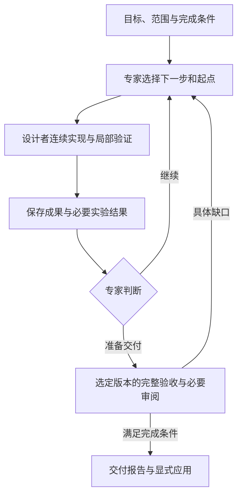

# 以任务完成为主线的轻量迭代改造

日期：2026-10-27。状态：**2026-10-27 用户已确认并授权实施；实际验收见 tickets**。

基线：`main@c111a72e35051793e1bffbeb949e9e9cc4d59b6d`。分支：`codex/task-completion-spec`。
实施清单：[tickets.md](tickets.md)。验证方案：[validation.md](validation.md)。开发交接：[development-prompt.md](development-prompt.md)。规划基线只含方案与素材；当前实施及真实模型验收结果见 tickets。

## 1. 问题与目标

ArcHa 已允许专家继续能力建设、选择未涨分候选、解释实验并决定何时结束；合同、基线初始化、接纳与交付仍要求数值目标和冠军。这使普通开发必须先构造分数，补齐证据也需要重新参赛。另一方面，机器指标被反复展开到模型上下文，造成与决策无关的输入膨胀。

本次目标：**在同一个循环中积累任务成果，由专家选择下一步与交付版本；完成条件判断交付，数值冠军只表达可比较的测量最优。**

用户在本次会话确认此前优化方向，并提出约束：不增加框架复杂度、不增加中间产物、不过度防御，尊重 expert/designer 的能力与灵活度，不向 agents 硬塞大量上下文。用户另行要求先审核 spec 和 tickets，确认后才允许依次实施。方向认可不等于实施授权。

2026-10-27 补充：用户认可用单项工程开发任务与直接 Codex 对照，自行构造全部测试素材，不再采用旧 benchmark。本次已准备材料；框架实施由后续开发提示词授权，不能把这次素材准备当作实施已完成。

R03 的同分证据补齐、机器数据膨胀和无效请求重复是本方案的动机，来自用户提供的前轮分析；本轮核对以下源码，未重跑 R03，不把历史 token、耗时当作本次实测结果。

| 已核查入口 | 当前耦合 | 要改变的行为 |
| --- | --- | --- |
| `opc/core/config.py::TaskSpec.load`、`accept.py::required_metrics` | 必需数值 objective | 完成条件可独立成立，objective 可缺省 |
| `engine.py::preflight/reconcile/measure_champion` | 开始执行前必须得到通过基线与冠军测量 | 未实现的功能可以作为开发起点 |
| `engine.py::attempt/development_parent` | 默认从冠军开发；每轮正式评价；停止分支不处理版本选择 | 积累工作版本，停止时明确选择成果 |
| `promote.py::promote` | 至少两条冠军记录；始终计算 gain | 终验选定成果，不以涨分作为交付资格 |
| `engine.py::context`、`adapters/prompts.py` | 历史、候选、基线、冠军多处展开指标和背景 | 默认只提供当前决策所需材料 |
| `adapters/worker.py::validate_plan`、`engine.py::save_conclusions` | 所有计划字段必填、必须补全全部 pending 结论 | 允许直接开发与有选择的复盘 |
| `adapters/codex.py::_run`、`engine.py::attempt` | 一部分确定性请求错误继续下一次尝试 | 无有效执行的请求拒绝直接阻塞 |
| `scaffold/brief.py`、`scaffold/ONBOARDING.md`、`skills/archa-task/` | 地图强制前置，`Objective: none` 阻塞 | 明确任务可直接接入，复用已有调查 |

## 2. 范围与减法原则

### 必须保留

- 一个引擎循环；现有 expert、designer、领域评价器和按合同需要的终验 reviewer。
- 专家对研究价值、路线、起点及继续/停止的判断权；target 达到和停滞只是信息。
- designer 连续读代码、实现、局部测试和修复的能力；专家不承担源码调查。
- 独立验收依据、修改范围、预算、暂停/恢复、费用记账、Git 候选保存及显式应用到用户分支的边界。
- 真实优化任务的可比性、正确性约束、噪声阈值、重复测量和已有缓存。

### 不在本次建设

- 不分裂开发引擎和搜索引擎，不加任务模式矩阵、工作流 DSL、调度层或插件体系。
- 不新增摘要 agent、逐轮 reviewer、恢复专家、RAG、上下文服务或资格审批。
- 不新增运行时文档类型、并行状态文件、证据数据库、缓存依赖图或监控系统。复用现有 ledger、候选、评价产物及 run/promotion 报告；删除或精简重复投影。
- 不为模型思考制定强制论证表、置信度分数、每轮完整复盘或机械化转向规则。
- 不先改模型、推理强度、持久会话或工作树复用；不承诺未经测量的提速比例。
- 不批量改写旧研究报告、旧运行账本，不自动升级用户已部署 runtime，不在本 PR 安装技能。

必要的新增语义仅在现有合同、plan、事件和报告内表达；每个新增字段必须用于本 spec 的可观察行为，并删除被替代的旧职责。不能用“以后可能需要”为理由加通用抽象。

## 3. 唯一主流程与职责

该图表达任务闭环，不要求新增常驻服务，也不要求 `run` 自动调用 `promote`。保留现有命令边界：`run` 的停止只表示结束本次探索；`promote` 检查交付。终验发现缺口后，按已有 run/revision 规则继续同一任务：已关闭 run 使用明确的新一轮授权和剩余/新预算，从被审版本继续；暂停/阻塞 run 沿既有恢复规则处理。不得暗中重开 run 或重置预算。

框架只验证执行所必需的结构、范围、版本与证据关联，保存真实执行结果。专家决定做什么、从哪里继续、是否值得继续；designer 自主决定授权范围内的实现和调试方法；验收负责判断交付声明是否成立。

## 4. 行为要求

### R1. 合同以完成条件为依据，数值择优可选

1. `acceptance.objective` 缺省或为 `null` 均表示不做数值排名；不得生成失败数量、完成百分比或 0/1 分数替代它。不新增 `mode=development/optimization`。
2. 复用 `requirements`、既有 gates、`requirements[].check` 和 review 验证方式表达完成条件。`Done when`、交付物和要求应有明确映射，不新增一套完成条件文档或平行需求 DSL。
3. objective 存在时，沿用真实指标及既有比较规则。objective 缺省时，不要求 direction/gain/noise 排名参数，也不生成伪冠军；绝对值约束仍有效。依赖冠军的相对约束和排名 rule 没有比较基准时应直接指出合同矛盾，不悄悄忽略。
4. 未声明的指标无需产生；声明为验收依据的指标缺失不能算通过。无 objective 不等于无验收要求。
5. 既有带 objective 合同继续可读并按原数值语义执行；不自动改成新语义，不改写历史 task digest。

### R2. 未完成基线可以开工，不能伪装为已通过

1. 无 objective 的开发任务，`check/preflight` 核对合同、输入、工具和评价入口能否工作。评价已经运行并报告功能失败，是有效的未完成基线，不阻塞进入开发循环。
2. 命令不存在、必要输入不可用、工具启动失败、输出契约损坏仍是执行问题；沿用现有分类，不把所有非零退出改为可忽略。功能失败也不得写成通过、零指标或有效冠军。
3. 对带 objective 的既有优化任务，继续要求能够取得有效、可比较的基线。尚无正确实现的任务先按完成条件推进；改为优化目标沿现有 revision/new-run 规则，不自动变更冻结合同。
4. `reconcile`、恢复、报告不能再次因没有冠军而强制调用 `measure_champion`。基线及工作版本从既有 run/candidate 事实恢复。

### R3. 工作版本、数值冠军与交付选择职责清楚

| 概念 | 含义与规则 |
| --- | --- |
| 工作版本 | 专家选定起点上完成的授权修改；可尚未通过全部功能验收，用于继续开发 |
| 数值冠军 | 通过原有比较规则的当前测量最优，仅有 objective 时存在 |
| 交付版本 | 专家停止时明确选定、随后接受终验的已有版本；不是另一份成果副本 |

1. 复用 `base_attempt`：`0` 选初始基线，正整数选已保存候选。无 objective 时 `null`/省略从当前工作版本继续；带 objective 时保持现有默认冠军，专家仍可显式选任一已保存候选。
2. 无 objective 时，designer 成功返回、修改范围检查通过并已保存的候选成为下一轮默认工作版本；测试失败保留事实且允许继续修复。worker 失败或越界不能自动推进工作版本，恢复时不得推断它已完成。
3. 版本选择也应用于停止回复：`base_attempt` 指定交付候选；缺省沿用该任务的默认起点。保存这个选择后再结束；不把“最后一次尝试”“最后一个冠军”硬编码为所有任务的交付结果。
4. 不以 `no_gain` 排除无数值目标的成果；已保存但未验证、验证未通过、已测量但未涨分须如实区分。保留一个必要的工作结果语义即可，不建设细分状态矩阵。
5. 优化任务可以选择非冠军交付，但其测量及 gain 必须属于该版本，不能借用另一个冠军的性能声明。
6. 选定 commit 和证据归属复用现有 ledger 事件、候选引用和报告；不增加平行权威文件。暂停、恢复和重启后选择一致，旧优化 run 仍按原冠军语义恢复。

### R4. 实施与验证按工作需要发生

1. 一次外层计划表达完整能力、待解问题或实验，普通编辑—测试—修复在一次 designer 调用内连续完成；不把每个调试动作升级成外层 attempt。
2. 计划必需的是可执行工作说明和版本选择，普通开发不强制编写“涨分假设/预期数值/反证”。既有研究字段保留为可用材料；研究如何设计由专家判断，不扩建计划协议。相同计划文字不足以证明工作无效，明确复测或从新状态重试不得被机械的文本去重拒绝；继续投入由专家和既有预算约束。
3. 继续允许修改范围内的开发测试。保护的是声明冻结的 evaluator、golden data 和验收资产，不是名字包含 `test` 的全部文件。prompt 与真实范围检查保持一致。
4. 无 objective 的普通步骤默认采用 designer 局部验证，框架保存摘要及已有证据位置，不自动运行全量冻结评价；专家可在确有需要时请求正式评价。带 objective 的步骤默认沿用正式评价，专家可明确安排暂不测量的能力建设。至多在现有 plan 增加一个评价意图字段，不新增阶段图或验证调度器。
5. 无代码改动的测量/诊断仍是有效工作；明确请求新测量时保留当前绕过缓存能力。未测量不能被记作约束通过、涨分或研究假设被推翻。
6. 研究复盘与下一步仍复用同一次 expert 调用。返回的 conclusion 须关联真实 attempt，但不再要求补齐全部历史 pending 才允许继续；缺项留缺项，不补调模型或编造结论。

### R5. 终验检查选定成果，收尾证据不参加排名

1. `promote` 不再要求存在涨分冠军。对 R3 的选定版本检查累计范围、冻结验收依据、完整功能验收、必需约束和必要独立审阅。
2. 现有报告分别表达：探索为何停止、数值 target 是否满足（如有）、选定版本、完成条件的证据与缺口。专家说“没有值得做的事”、预算用尽或指标达标都不能直接变成“任务已完成”。
3. 必需 gate 未通过、必需指标缺失/约束不满足、明确需求不满足，以及必需 review 未完成/拒绝，均不能声明完整完成或允许完整交付应用。无 `check` 不再自动等价于 `enforced_per_attempt`；用已声明门覆盖与 review 说明依据，缺少覆盖则如实报告待验证。
4. 只有合同需要的 review 才必需；保留原独立 reviewer 能力，不新增逐轮审核。`accept_with_conditions` 的未满足必需条件不能当作完成；缩小范围必须回到用户确认的任务约定。
5. reviewer 结果和使用/安装证据直接关联被审 commit，复用现有 promotion 产物。纯追加审阅证据不创建 designer 候选、不重新排名、不重跑已有效的产品评价。第一次终验仍须取得该版本完整证据。
6. 证据复用限于同一被测 commit、冻结评价依据、输入及工具环境仍适用；不通过“所有 .md 都不影响产品”等后缀豁免跨版本复用。安装脚本、配置、可执行示例或产品修改必须验证。暂不实现任意文档改动下的跨 commit 缓存。
7. 必须随产品交付的文档可以进入正常候选提交，即使同分也可选为交付版本。外置审阅回执与产品文档不混同；前者无需成为代码候选，后者不能靠摘要替代真实文件。
8. 终验暴露缺口时提供具体事实供专家安排修复，不扩建自动修复框架。`apply_to` 仍显式调用，不因终验成功自动合入用户分支。

### R6. 模型输入按需提供，完整事实保存在已有产物

| 默认提供 | 按需读取或留在程序侧 |
| --- | --- |
| 当前目标、方向、完成条件、必要约束、预算 | 完整合同、无关项目背景和研究地图 |
| 当前工作版本；有 objective 时的关键对照 | 所有候选的全量指标、重复冠军快照 |
| 最近相关工作的计划、实际摘要、关键实验条件/对照/结果、已有结论 | 全量机器位图、原始日志和大样本集合 |
| 少量可续用候选的 ID、commit 与短说明 | 全部历史详情及旧候选材料 |

1. 不再把完整 `Measurements.values` 同时展开在 baseline、champion、history、experiment 和 candidates 中；仅用于程序判定的机器指标不默认输入模型。所需 objective、约束判断及有解释意义的实验数据仍保留来源，不能只剩总分或主观摘要。
2. 复用 `Evaluation.data` 中的实验材料与现有文件位置；通用框架不猜测领域含义，不加入 R03 专用字段过滤器。默认数据投影须对大数组/大量标量同样有效，不能只限制历史轮数或粗暴截断整段 JSON。
3. 框架只附带少量与当前任务有关的背景及现有材料引用，模型按需补读。expert 可按需查看相关研究材料和结构化实验证据；仍不要求其查源码或原始日志。designer 按需读代码。不得为此新增检索代理、材料复制流水线或新的长期存储。
4. 不再因“所有改善项”和“所有 pending 项”无条件突破默认历史窗口；候选目录不携带完整 metrics/execution 副本。未默认展示的候选仍可按已有 attempt ID 选择和恢复，原始数据不删除。
5. 不再让 prompt 与工作目录中的 `research.json` 各携带一份完整上下文。复用现有文件或引用，保持一次默认呈现；最终发送的 prompt 和可见材料必须一起检查。
6. 不要求每轮完整读取地图、所有历史或所有证据；不增加模型硬性阅读额度与机械化摘要要求。用离线测试验证输入随相关材料变化，而非随无关机器字段线性膨胀。

### R7. 确定性请求拒绝停止当前调用路径

输入过长、请求/schema 不合法等已知且未产生有效执行的错误，记录原始原因和实际成本后使当前 run 阻塞，不再次原样调用、不消耗后续搜索尝试去等它自行成功。复用现有 worker 错误通路，Codex/DSH 的同类结果一致；不增加自动裁剪重试、恢复 agent 或通用故障治理层。修正条件后按现有机制显式恢复。

不能把“模型执行过但结果格式错误”“实现失败”“测量缺陷”一律归为请求拒绝。保留真实分类和已有预算边界。

### R8. 入口与文档减少重复准备

1. 明确工程任务可直接使用已确认简报或形成简报并 onboard，不强制先建 research-map；开放问题仍可使用地图。沿用现有项目初始化能力，不新增安装入口。
2. `Map` 在有地图时保持路径与来源校验；无地图有真实直接任务来源时允许省略，不创建空地图骗过校验。既有 map 驱动任务不受影响。
3. 已有调查、简报和交接继续复用；onboard 只核对关键依据、映射合同并完成必要适配。`Objective: none` 不阻塞，真实缺失的验收依据或执行条件仍明确报告。
4. `archa-loop`、ONBOARDING、CLI/README 统一 preflight、工作版本、停止与交付语义。更新当前用法，不改历史报告；不自动开展不相关新任务或强制增加材料文件。

## 5. 兼容边界与复杂度验收

- 旧 objective 合同、默认冠军起点、既有参数搜索、Codex/DSH worker 配置继续使用；旧 plan 的研究字段及 `base_attempt` 继续可读。
- 旧报告与运行记录不回写。缺少新选择信息的旧优化 run 回退到已记录冠军；缺少结论或审阅不伪造。新能力不用于“追认”旧交付完成。
- 可在现有函数/事件/结果中加必要字段，不另起数据库或控制器。所有模型输入、输出及报告变更同时检查 scripted worker 和历史读取路径。
- 本次复杂度判断看职责和路径：仍只有一个执行循环、既有角色和命令，运行产物种类不增加；被替代的强制评分、重复上下文、全 pending 校验与同分交付障碍应删除，不能在其外再包例外分支。
- 单次调用结束后预算记账的现有限制不在本次扩建；不可宣称实现了实时 token 硬中断。

## 6. 可执行验收场景

使用现有 pytest、scripted/fake workers 和临时 Git 工程；机制测试直接放现有测试套件，不新建 benchmark 框架。另将一个可复制的小型开发任务作为测试 fixture 保存，真实运行副本和原始日志留在临时/外置目录。

| ID | 场景 | 必须观察到的结果 |
| --- | --- | --- |
| A1 | 无 objective，基线功能门失败但评价可运行 | 进入开发；基线保留失败事实；无伪分数/冠军 |
| A2 | 连续两步能力开发、第一步未完成；暂停后恢复 | 第二步默认接上第一步，最终选定版本含两步成果 |
| A3 | 专家明确选旧候选/基线，或在 stop 中选同分候选 | 实际起点和交付选择正确，不被冠军覆盖 |
| A4 | worker 失败、越界、评价未执行、预算用尽 | 不误推进工作版本，不假报测量或完成 |
| A5 | 无涨分历史的成果通过终验；反例缺一项需求/必需 review | 正例可交付；反例阻止完整交付，报告具体缺口 |
| A6 | 同一产品 commit 已完整验证，仅增加独立审阅证据 | 无新 designer attempt/候选、无新产品全量评价；回执绑定被审版本 |
| A7 | 产品、安装脚本或环境改变；显式请求重复测量 | 相关验证执行；不得跨版本借证据或把缓存当新测量 |
| A8 | 同样研究信号下加入 2,156 个机器字段及大 cases/samples 数组 | 原始证据保留；默认 prompt/材料不膨胀为全量副本；关键实验数据仍可取得 |
| A9 | 超出历史窗口，包含多项 improvement/pending | 默认输入仍有限，旧候选可选择；缺 conclusion 不使下一计划失败 |
| A10 | 输入过长/schema 拒绝；另设模型实际执行失败作对照 | 请求拒绝仅一次调用后 blocked；对照不被错误归类 |
| A11 | 既有数值优化、噪声/约束/工具变化、无补丁测量 | 冠军比较、可比性、缓存和 fresh 语义保持；target/停滞不强停专家 |
| A12 | 直接任务与既有地图路径，objective none 与有效 objective | brief/onboard/check/loop 语义一致，复用交接，无空地图/伪指标 |

实现阶段每票运行其涉及的针对性测试；全部完成后跑 `python -m pytest -q` 和 `git diff --check`。Linux 本地结果与现有 Windows/Python CI 结果分开报告，未跑的平台不声称通过。

工程任务对照按 [validation.md](validation.md) 执行：所需基线、82 组输入、参考计算及外置验收已构建；T6 在 T1–T5 完成后运行同起点的直接 Codex / ArcHa 各一次。默认模型与预算、共享准备及组内成本口径、终点锁定与盲审均已明确。没有硬件实测数据，不宣称硬件性能精度；一组 pilot 不证明普遍优越。真实模型不可用时保留 blocked/not_run，不能把完整任务验收标为完成。旧 benchmark 退役，不重跑 R03，也不扩建实验矩阵。

## 7. 审核与执行规则

本 spec 和 [tickets](tickets.md) 一并交用户审核。确认后按 T1 → T6 逐票实施；每票完成相关验证、更新清单并单独提交后进入下一票。无需为已批准范围内的常规实现选择重复确认。

改变目标、削弱验收或新增架构层不在此授权内，应先修订本 spec 并指出具体差异。若问题可在既有接口内通过更简单实现解决，直接处理，不额外引入审批和中间文档。
